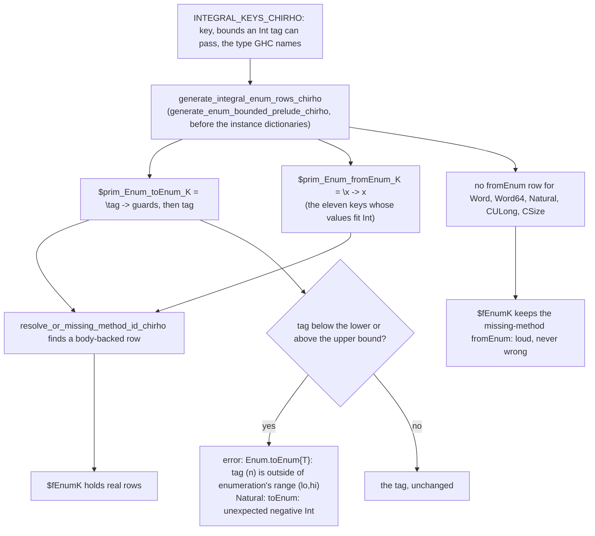

<!-- For God so loved the world, that he gave his only begotten Son, that whosoever believeth in him should not perish, but have everlasting life. — John 3:16 (KJV) -->

# Integral Enum rows: checked `toEnum`, identity `fromEnum` where values fit Int

Sixteen builtin Enum keys are integers at run time:
- the sized `Int` and `Word` types;
- `Word`;
- `Natural`;
- the C integer wrappers.

Their instance dictionaries used to hold missing-method stubs. Now:
- every key's `$prim_Enum_toEnum_K` checks the tag against the key's range.
  Outside it, it fails with GHC 9.14.1's message; inside it, it returns the tag.
- `$prim_Enum_fromEnum_K` returns its argument at the eleven keys whose every
  value fits Int: Int8, Int16, Int32, Int64, Word8, Word16, Word32, CChar,
  CInt, CLong and CUInt.
- The five wide keys keep their missing-method `fromEnum`, which fails loudly:
  Word, Word64, Natural, CULong and CSize (revision 1, gpt_chirho's
  disposition of 4b98964b).

Code: `crates/haskelujah-core-chirho/src/dict_chirho/prelude_chirho/integral_enum_chirho.rs`.

## Keys and GHC 9.14.1's behaviour (measured on aarch64-darwin)

| Family | Keys | `toEnum` check | `fromEnum` |
|---|---|---|---|
| signed | Int8, Int16, Int32 | below and above, `{IntN}` in the message | identity |
| signed | Int64 | none: every Int tag is in range | identity |
| unsigned | Word8, Word16, Word32 | negative and above, `{WordN}` | identity |
| unsigned | Word, Word64 | negative only, range `(0,18446744073709551615)` | missing-method stub |
| Natural | Natural | negative only, `toEnum: unexpected negative Int` | missing-method stub |
| C | CChar, CInt | below and above; messages name `Int8` and `Int32` | identity |
| C | CLong | none (it is `Int64`) | identity |
| C | CUInt | negative and above, `{Word32}` | identity |
| C | CULong, CSize | negative only, `{Word64}` | missing-method stub |

- **Default target.** The C wrappers' representations (CChar `Int8`, CInt
  `Int32`, CLong `Int64`, CUInt `Word32`, CULong and CSize `Word64`) are the
  measured aarch64-darwin model, the default target. The compiler has no
  target ABI map, so no cross-target C parity is claimed. Another target's
  sizes would be an explicit parameter of the table.
- **The failure route** is `error`. The held STG lowering maps it to
  `ErrorChirho`, and the interpreter raises the forced string, so a computed
  message comes out exactly. `error#` is not needed.
- **Dispatch is by exact key.** The rows serve whichever route names K: the
  checker's proof for `toEnum` and `fromEnum`, or a key the pass reads from an
  annotation. On held alone, `toEnum 300 :: Word8` is still keyed from its Int
  argument and takes Int's identity. So the end-to-end range controls belong to
  the combined replay with the Char unit, where `toEnum` carries the proof.

## Boundaries

- Float and () keep their stubs.
  - () fails loudly today, a never-wrong outcome.
  - A Float list printed through `toEnum` prints nothing with rc 0. The list
    renderer swallows the stub's error. That is a separate fail-closed
    prerequisite, not this unit.
- succ, pred, Bounded, Num, Show and Read at these keys are unchanged.
- **Wide `fromEnum`.** Values of the five wide keys can pass Int's bounds in
  GHC, which then fails loudly. These were measured by gpt_chirho
  (`/private/tmp/integral-enum-fromenum-audit-chirho/`):
  - `fromEnum (maxBound :: Word64)` fails with `Enum.fromEnum{Word64}: value
    (18446744073709551615) is outside of Int's bounds
    (-9223372036854775808,9223372036854775807)`;
  - Word, CULong and CSize at `9223372036854775808` fail the same way;
  - `fromEnum (9223372036854775808 :: Natural)` fails with
    `fromEnum: out of Int range`.

  Haskelujah's integers are i64 end to end. `parse_integer_literal_chirho`
  (parser `lower_chirho.rs`) returns i64 and turns an out-of-range literal into
  0, and the AST, Core and runtime int values are i64. So an identity
  `fromEnum` at a wide key would answer wrongly as soon as any value producer
  (Num, Read, FFI) builds such a value. Until Word/u64 and arbitrary-precision
  Natural representations can keep the value and enforce Int's bounds, the
  missing-method `fromEnum` stays, loud and never wrong.
- The narrow keys' maxima fit, and GHC returns them: Int64 gives
  `9223372036854775807`, and Word32 and CUInt give `4294967295`.
- The LLVM and Cranelift backends are not measured here.

## Controls

- `crates/haskelujah-core-chirho/src/dict_chirho/prelude_chirho/integral_enum_tests_chirho.rs`
  runs the dictionary pass alone:
  - all 16 `toEnum` slots and the 11 narrow `fromEnum` slots take body-backed
    rows;
  - the five wide `fromEnum` slots stay missing-method stubs that name the
    method, and the wide set is exactly those five keys;
  - `fromEnum` is the identity where it is real;
  - each `toEnum` guards exactly the table's bounds, lower first;
  - 23 measured failures render GHC's exact text, and 23 measured in-range tags
    pass.
- `crates/haskelujah-driver-chirho/src/stg_lower_chirho/primitives_chirho/tests_chirho.rs`:
  a computed `error` message, the rows' `showInt#`/`++#` chain, fails with its
  exact text.
- **On the combined Char replay** (revision 1):
  - the six never-wrong `toEnum` rows (`STUB_BACKED_PRINTS_CHIRHO`), still
    green because every `toEnum` row stays;
  - 11 exact scalar round trips at the narrow keys;
  - five never-wrong wide controls, Word, Word64, Natural, CULong and CSize:
    GHC's answer or a loud `missing method Enum.fromEnum for K`;
  - the signed negatives;
  - the measured `toEnum` failures;
  - () as a green never-wrong control.
