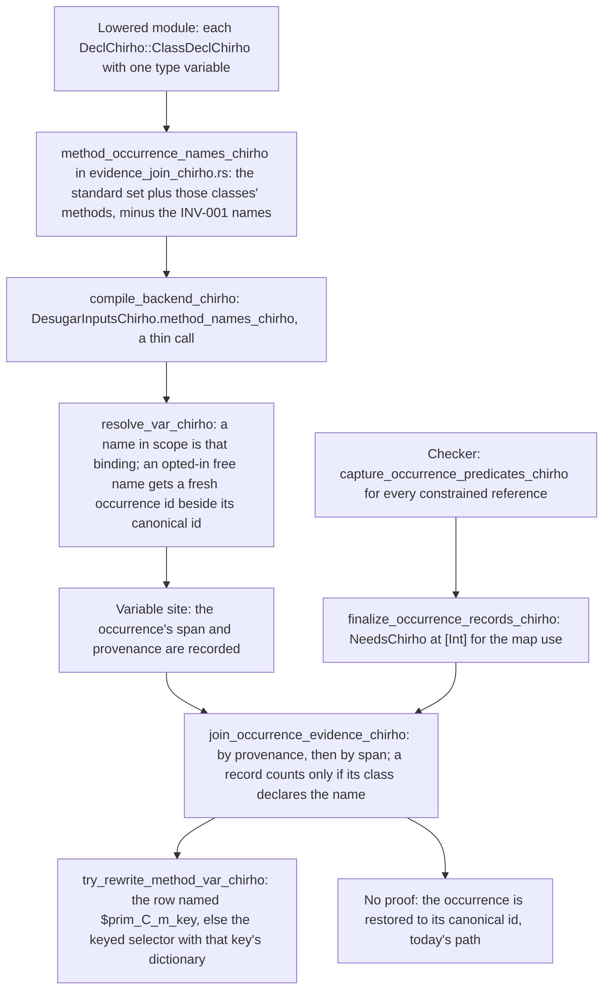

<!-- For God so loved the world, that he gave his only begotten Son, that whosoever believeth
in him should not perish, but have everlasting life. — John 3:16 (KJV) -->

# Own-class method occurrences workflow

A method of a class the program itself declares gets one occurrence id per reference, so the
checker's proof for that one use reaches the dictionary pass. Before, every use of such a method
shared one free-variable id, and the pass guessed its dictionary from sibling arguments:
`map neededChirho [[1 :: Int]]` ran `NeedsChirho Int`'s method on each list. Trace 2
(2026-10-23, frozen base 926ccd4b and Ord dea2a0b7 CLIs, GHC 9.14.1) measured `[[1]]` where
GHC fails with "No instance nor default method", `[[1]]` where GHC prints `[99]`, and a crash
where GHC prints `[1005]`. The proof already existed: the checker captures every constrained
reference, with no name filter. Only an occurrence to carry it was missing.

This document stands beside [the dictionary evidence workflow](dictionary-evidence-chirho.md),
which describes the join and the pass. That file is one of the Ord unit's preserved paths, so
this unit leaves it unchanged (gpt_chirho #28092).

## Rule (gpt_chirho #28091)

- Opted in: the standard set (`EVIDENCE_METHOD_NAMES_CHIRHO`) and every method of a
  single-parameter class the compiling module declares.
- Never opted in: `>>=`, `>>`, `return`, `pure` and `fail` (INV-001), even when the module's own
  class declares one. They keep their dedicated dispatch machinery.

## Boundaries

Each of these keeps its shared id and today's verdict:

- A seeded standard class's methods outside the standard set (`fmap`, `<>`, `toList`,
  `traverse`). Switching about forty seeded classes at once is its own measured brick.
- A class imported from another module. Its rows live in that module's Core, and finding them
  from the importing module is unmeasured.
- A multi-parameter class.
- The spelling of an operator method (`(<+>)` or `<+>`) is not pinned: the unit test checks
  alphanumeric methods only.

## Shadows

- A lambda, case, let or where binder is found in scope before any occurrence is minted
  (`resolve_var_chirho`), and the dictionary pass skips local shadow ids.
- Top-level functions and record fields are bound in scope before any body (desugar Pass 1 and
  1b). In one module, neither can share a name with a method of that module's own class.
- A qualified reference resolves by its text unless the qualified name itself is bound, and the
  checker records the same text.

## Dependency on Ord brick 2

A proven occurrence calls the row named for its key directly. Before Ord brick 2 (f93ca45f), the
conditional list stub under `$prim_C_m_[T]` took leading `$Dict_Missing` parameters that only
the dictionary applied, so a caller that found the row by name bound its first argument as the
dictionary. On main alone this unit would turn cd95568b's direct missing-method control into a
partial application. The unit therefore sits on the exact Ord replay dea2a0b7 (gpt_chirho
#28096), and the combined gate is its only landing authority.

## Controls

- `tests/dictionary_evidence_chirho/higher_order_occurrences_chirho.rs`:
  - GHC-exact programs: the defined list method under `map`, two types in one program, the
    element method inside an instance, a constrained binding's own dictionary, the direct call,
    and the self-qualified `Main.neededChirho`;
  - missing-method programs that must fail by name: a constant element method, the eta form, and
    a context-free `[a]` head;
  - four lexical shadows: lambda, let, where and case binders.
- `src/tests_chirho/evidence_chirho/occurrence_names_chirho.rs`: the name set's boundaries.
- Mutant o1 drops only the opt-in (`.chain(own_methods_chirho.take(0))`). The higher-order
  controls must catch it.
