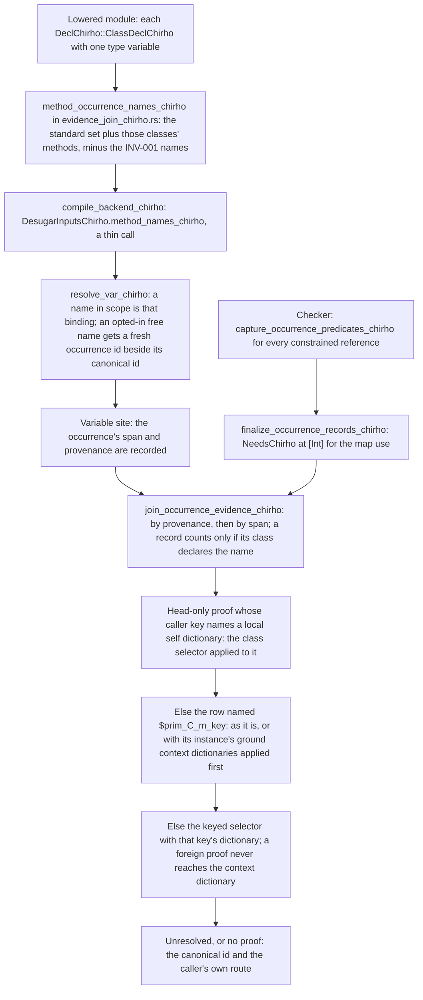
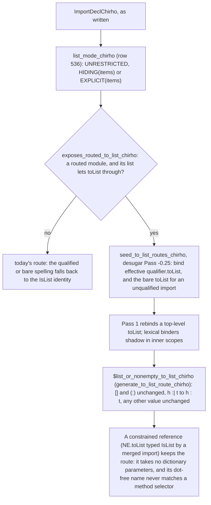

<!-- For God so loved the world, that he gave his only begotten Son, that whosoever believeth
in him should not perish, but have everlasting life. — John 3:16 (KJV) -->

# Own-class method occurrences workflow

A method of a class the program itself declares gets one occurrence id per reference, so the
checker's proof for that one use reaches the dictionary pass. Before, every use of such a method
shared one free-variable id, and the pass guessed its dictionary from sibling arguments:
`map neededChirho [[1 :: Int]]` ran `NeedsChirho Int`'s method on each list. Trace 2
(2026-10-23, frozen base 926ccd4b and Ord dea2a0b7 CLIs, GHC 9.14.1) measured `[[1]]` where
GHC fails with "No instance nor default method", `[[1]]` where GHC prints `[99]`, and a crash
where GHC prints `[1005]`. The proof already existed: the checker captures every constrained
reference, with no name filter. Only an occurrence to carry it was missing.

This document stands beside [the dictionary evidence workflow](dictionary-evidence-chirho.md),
which describes the join and the pass. That file is one of the Ord unit's preserved paths, so
this unit leaves it unchanged (gpt_chirho #28092).

## Rule (gpt_chirho #28091)

- Opted in: the standard set (`EVIDENCE_METHOD_NAMES_CHIRHO`) and every method of a
  single-parameter class the compiling module declares.
- Never opted in: `>>=`, `>>`, `return`, `pure` and `fail` (INV-001), even when the module's own
  class declares one. They keep their dedicated dispatch machinery.

## Boundaries

Each of these keeps its shared id and today's verdict:

- A seeded standard class's methods outside the standard set (`fmap`, `<>`, `toList`,
  `traverse`). Switching about forty seeded classes at once is its own measured brick.
  `toList` stays outside the evidence set: unit 517 routes the spellings an import of
  Data.List.NonEmpty or Data.Foldable exposes by scope instead (below).
- A class imported from another module. Its rows live in that module's Core, and finding them
  from the importing module is unmeasured.
- A multi-parameter class.
- The spelling of an operator method (`(<+>)` or `<+>`) is not pinned: the unit test checks
  alphanumeric methods only.

## Shadows

- A lambda, case, let or where binder is found in scope before any occurrence is minted
  (`resolve_var_chirho`), and the dictionary pass skips local shadow ids.
- Top-level functions and record fields are bound in scope before any body (desugar Pass 1 and
  1b). In one module, neither can share a name with a method of that module's own class.
- A qualified reference resolves by its text unless the qualified name itself is bound, and the
  checker records the same text.

## Dependency on Ord brick 2

A proven occurrence calls the row named for its key directly. Before Ord brick 2 (f93ca45f), the
conditional list stub under `$prim_C_m_[T]` took leading `$Dict_Missing` parameters that only
the dictionary applied, so a caller that found the row by name bound its first argument as the
dictionary. On main alone this unit would turn cd95568b's direct missing-method control into a
partial application. The unit therefore sits on the exact Ord replay dea2a0b7 (gpt_chirho
#28096), and the combined gate is its only landing authority.

## Where a proof lands (gpt_chirho #28111)

The first combined gate (combined-03a337d4-chirho) measured two regressions this unit made. Both
come from proofs the old route never had. The rules live in
`dict_chirho/rewrite_chirho/occurrence_rows_chirho.rs`, and both dispatch entries call them
(`occurrence_head_replacement_chirho`, `try_rewrite_method_var_chirho`).

- Self agreement. Inside `instance DescribableChirho a => DescribableChirho [a]`, the checker
  proves `describeChirho xs` only as `[]`, a list over a variable. The instance's self
  dictionary is registered under `[a]`. The proof is served by that dictionary when the
  caller's key (`[a]`, read off `xs`) has the proof as its head and names a dictionary this
  binding holds. Never a global `[]` alias: a `[b]` or ground occurrence in the same body is
  not a local dictionary here.
- No ambient answer. A proof that is not the binding's own dictionary key is never served by
  the context dictionary. Before, it was, and Int's method ran on the tail: `1:[2,3]` on the
  interpreter, a pointer on LLVM and Cranelift. Unresolved, the occurrence returns to its
  canonical method and the caller's own route.
- Context-leading rows. A `$prim` row whose instance has a context takes those dictionaries
  first (`\$dShow -> \_ -> 7`). The rows are recorded from the class environment before any
  binding is rewritten, by the same rule that gives them their parameters. A proof is served
  by such a row only with every context dictionary applied (each predicate one-parameter,
  ground and registered); otherwise the keyed route decides. The rows the pass generates for
  ground keys (`$prim_C_m_[Int]`) take no dictionary.

Self agreement and no ambient answer serve the same recursive calls: the restored route finds
the self dictionary through the same `[a]` key. Each masks the other in every behavioral
control, so one terminating mutant reverts both together (gpt_chirho #28112). Measured
boundaries, before and after: a recursive `TreeChirho a` instance fails loudly on main too
("missing STG binding"), and a bare self occurrence (`goChirho = describeChirho`) is wrong on
main too. Neither is claimed here.

## Context-free list heads (gpt_chirho #28111)

`instance NeedsChirho [a]` had no reachable dictionary. Its dictionary was registered under the
typed head, a spelling no use site carries, and the generic-head alias
(`instance_chirho/generic_heads_chirho.rs`, G1-G6) refused list syntax. So a proof `[Int]` (and
the argument key `[Bool]`) found nothing. Main answered `[[1]]` under `map` and failed with
"missing STG binding" for a direct call. The opt-in failed for both.

The list arm extends the generic-head rule and nothing else:
- The typed head `[v]` is the list constructor `[]` over one variable.
- Its one written spelling is `[v]`.
- G1, G2, G4 and G6 are unchanged. A competing `[Int]` or variable head means no alias, and
  exact registrations still win.
- G5, for the list head only: a body-backed row fills its slot, and a slot no row covers is a
  method the instance genuinely omits, because the list head has no second spelling for a
  row to hide under. Its generated stub keeps the method's calling convention and fails by
  name when forced, as GHC's NoMethodError does. Every other head keeps G5 whole.

The shared dictionary-evidence workflow describes the generic heads, but it is an Ord path, so
this list arm is recorded here instead.

## Controls

- `tests/dictionary_evidence_chirho/higher_order_occurrences_chirho.rs`:
  - GHC-exact programs: the defined list method under `map`, two types in one program, the
    element method inside an instance, a constrained binding's own dictionary, the direct call,
    and the self-qualified `Main.neededChirho`;
  - missing-method programs that must fail by name: a constant element method, the eta form, and
    a context-free `[a]` head;
  - four lexical shadows: lambda, let, where and case binders.
- `src/tests_chirho/evidence_chirho/occurrence_names_chirho.rs`: the name set's boundaries.
- Recursive calls on the interpreter (`1:2:3:[]`, direct and through a `where`), plus the
  LLVM and Cranelift recursive custom-list round trips in `compile_chirho.rs`. An occurrence
  at `[Bool]` inside the `[a]` instance (`1:2:[]bb`). Context-leading rows: one predicate,
  under `map`, and two predicates (`7`, `[7,7]`, `2`).
- `occurrence_rows_tests_chirho.rs`: agreement, context-leading rows and their record.
- Mutant o1 drops only the opt-in (`.chain(own_methods_chirho.take(0))`). The higher-order
  controls must catch it.
- Mutant o2 reverts self agreement and no ambient answer together, and the recursive and
  agreement rows catch it. Mutant o4 calls a context-leading row bare, and the
  context-leading rows catch it.
- `tests/dictionary_evidence_chirho/generic_heads_chirho.rs`: a context-free `[a]` with a
  defined method, under `map` and direct (`[99]`, `99`); competing `[a]` and `[Int]` heads that
  must fail closed; and a direct user method reaching a generic alias (`generic`). The
  missing-method list control is the context-free head row above. Unit tests sit in
  `generic_heads_tests_chirho.rs`.
- Mutant g1 aliases a list head despite a competitor, and the fail-closed control catches it.
  Mutant g2 refuses the list arm again, and the defined-method control catches it.

## Constrained builtin aliases and `Data.Map.toList` pairs (row 534, 2026-10-25)

gpt_chirho #28360, #28371, #28378. Qualified `Data.Map.fromList` and `Data.Map.toList` exposed two
orthogonal hops:

1. **Constrained builtin alias canonicalization (`constrained_references_chirho.rs:313-318`).**
   `seed_builtin_import_aliases_chirho` binds `M.fromList` to `CoreId("mapFromList")`. Because
   `M.fromList :: Ord k => [(k, v)] -> Map k v` is in `constrained_names_chirho`,
   `reference_occurrence_chirho` mints a per-use occurrence id named `"M.fromList"` with canonical
   id `CoreId("mapFromList")` and records `Ord` in `reference_evidence_chirho`. Deferring
   canonicalization in `occurrence_head_replacement_chirho` whenever `reference_evidence_chirho`
   was non-empty left `"M.fromList"` on the spine when `canonical_id_chirho` had no entry in
   `dict_param_bindings_chirho`, so `collect_method_app_chirho` stripped `"M."` and rewrote it to
   `$sel_IsList_fromList $fIsList[tN]` (list identity). `occurrence_head_replacement_chirho` now
   defers to the dictionary-parameter call-site path only when
   `dict_param_bindings_chirho.contains_key(canonical_id_chirho)` holds; otherwise it restores
   `*canonical_id_chirho` (`CoreId("mapFromList")`).
2. **Runtime pair constructor name and registered tag (`eval_chirho.rs:4700-4705`).**
   `MachineChirho::build_pair_list_chirho` allocated 2-tuples under `"(,)"` (`tag = 0`) instead of
   Core/STG's `"$tuple2"`, so both `$prim_Show_show_[(k, v)]` and `fst` failed with
   `no matching alternative for tag 0`. `build_pair_list_chirho` now looks up and constructs
   `"$tuple2"`, matching the shared constructor name and its registered tag in `con_tag_map_chirho`
   independent of registration order.

- **Controls (`tests/dictionary_evidence_chirho/data_map_tolist_chirho.rs` and `occurrence_rows_tests_chirho.rs`):**
  - 4 separately observable tests in `data_map_tolist_chirho.rs` covering 7 movers and 2 holds:
    - `qualified_data_map_from_list_size_answers_as_ghc_chirho` (Hop A only: `M05`,
      `M.size (M.fromList ...)` -> `2`, without `M.toList` or pair `Show`);
    - `qualified_data_map_to_list_insert_answers_as_ghc_chirho` (Hop B only: `M02`,
      `M.toList (M.insert ... (M.singleton ...))` -> `[(1,"a"),(2,"b")]`, without `M.fromList`);
    - `qualified_data_map_from_list_and_to_list_answer_as_ghc_chirho` (combined movers: `D01`
      `[(1,'a'),(2,'b')]`, `M01` `[(1,10),(2,20)]`, `M03` annotated `M.Map Int Char`, `M04`
      `String` values, and `M06` let-bound `map fst (M.toList (M.fromList ...))` -> `[1,2]`);
    - `list_to_list_and_insert_from_list_holds_answer_as_ghc_chirho` (2 holds: `M07`
      `GHC.Exts.toList [1, 2, 3 :: Int]` -> `[1,2,3]` and `M08`
      `M.size (M.insert 2 "b" (M.fromList [(1, "a")]))` -> `2`). `M08` and the existing
      `eval_import_data_map_chirho` already print `2` on base `b19f30b8` (`e7b6c69d`) because
      3-argument `M.insert 2 "b" (...)` enters `try_rewrite_typed_higher_order_args_chirho`; they
      are exact holds, not restored movers.
  - 3 measured boundaries outside this unit (unasserted in `data_map_tolist_chirho.rs` for oracle
    extraction): `D02` (`import Data.Map (fromList, toList)`, unqualified explicit import,
    `STAYS-WRONG` `[(2,'b'),(1,'a')]`), and `T07`/`Q01` (local `toList` binder `CoreId` collision
    in `resolve_or_fresh_id_chirho`, `STAYS-LOUD`).
  - Native boundary: neither `rts-chirho` nor either native backend implements `Data.Map` primops
    (`LLVM` rejects `mapToList#/1` at compile time, and `Cranelift` lowers unknown primops to `0`
    and prints `[]`). Row 534 changes neither and does not claim native `Data.Map` coverage.
  - Mutant M1 drops the `dict_param_bindings_chirho.contains_key(canonical_id_chirho)` guard in
    `occurrence_head_replacement_chirho`: it fails the Core unit test
    (`a_builtin_alias_without_dict_params_canonicalizes_despite_reference_evidence_chirho`), the
    Hop A test (`M05`), and the combined test (`D01`, `M01`, `M03`, `M04`, `M06`), while the Hop B
    test (`M02`) passes. Mutant M2 reverts `"$tuple2"` to `"(,)"` in `build_pair_list_chirho`: it
    fails the Hop B test (`M02`) and the combined test, while the Hop A test (`M05`) and the Core
    unit test pass.

## Routed `toList` imports (unit 517, 2026-10-26)

gpt_chirho #28473-#28520. The bare `toList` every module sees is the IsList identity, so a real
`x :| xs` came back unchanged and printed as `:| x xs`. Each spelling of `toList` that an import
of Data.List.NonEmpty or Data.Foldable really exposes now reaches one private dual-shape binding.
No class, evidence entry or typing scheme changes.

- **Exposure, read from the written list:**
  - an unrestricted import exposes `toList`;
  - a `hiding` list exposes it unless an item names it, and an unrepresented item names nothing;
  - an explicit list exposes it only when an item names it.
- **What names it:** for both modules, the plain item `toList`. For Data.Foldable, also
  `Foldable(..)` and `Foldable(toList)`. Data.List.NonEmpty's `NonEmpty(..)` never names its
  top-level `toList`.
- **Why one binding serves both modules:** `NE.fromList` and `NE.map` still build ordinary lists,
  while `x :| xs` builds a real `:|`. The list alternatives come first, so every list keeps its
  answer, and the default keeps every other value exactly as the identity returned it.
- **Code:**
  - `crates/haskelujah-core-chirho/src/desugar_chirho/builtin_routes_chirho.rs` (exposure and seeds);
  - `crates/haskelujah-core-chirho/src/dict_chirho/prelude_chirho/non_empty_chirho.rs` (the binding).
- **Tests:**
  - every import form, in pairs, in `desugar_chirho/builtin_routes_tests_chirho.rs`;
  - end to end, one mechanism per test, in `tests/dictionary_evidence_chirho/non_empty_routes_chirho.rs`.
    Its programs are GHC 9.14.1-measured files embedded by generation.
- **Boundaries, not claimed:**
  - NonEmpty's `head`, `tail`, `length`, traversals and other Foldable methods;
  - the list representation that `fromList`, `map` and `nonEmpty` build;
  - Data.Foldable's `toList` on Maybe, Set or Map, which keeps the identity's answer;
  - WebAssembly, where `:|` and `[]` share a tag;
  - a qualifier that two modules share (GHC's ambiguity), which stays with scope resolution.
