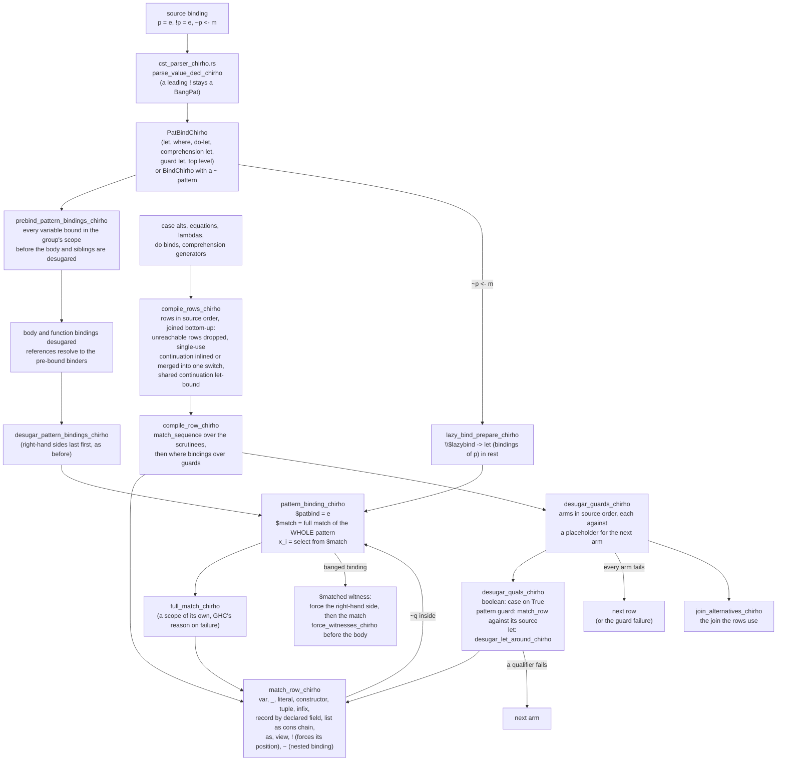

<!-- For God so loved the world, that he gave his only begotten Son, that whosoever believeth in him should not perish, but have everlasting life. — John 3:16 (KJV) -->
# Workflow: pattern matching

How a pattern becomes Core. Functions on this DAG carry a
`workflow: language-features-chirho/pattern-matching-chirho` comment.

There is ONE single-row matcher, `match_row_chirho`
(`crates/haskelujah-core-chirho/src/desugar_chirho/row_match_chirho.rs`): it matches one
pattern against one variable, left to right and depth first, continues with a success
expression once every variable of the pattern is in scope, and evaluates a failure expression
otherwise. It handles every pattern shape: a literal is tested wherever it appears, a record
matches its named fields at their DECLARED positions, a list is matched as the cons chain it
is (so its length is part of the match), and `~`, `!`, `@` and view patterns mean what the
Report and GHC say they mean.

Every position goes through it: pattern BINDINGS (below), and every MATCH position as ROWS
(`match_rows_chirho.rs`) - case alternatives, function equations, lambdas, do binds and
list-comprehension generators. A row is its patterns matched left to right, its `where`
bindings over its guards, and every failure (a pattern or the last guard) continuing with the
next row. The older per-position machinery is deleted.

A row's guards are ARMS (`guards_chirho.rs`), each a list of qualifiers kept as qualifiers from
the parser on (`GuardedExprChirho::quals_chirho`): a boolean guard, a pattern guard `p <- e`
(a one-pattern row against `e`, through the same matcher) and a `let`. They run in order, each
scoping over the ones after it and the body; any failing qualifier goes on to the next arm, and
after the last arm to the next row. Arms and rows share one bottom-up join, so a fall-through is
placed once: let-bound when it is used more than once, never copied.

Every local `let` - a `let` expression, a guard's `let`, a do block's `let` and a list
comprehension's `let` - goes through ONE helper, `desugar_let_around_chirho`: every name is in
scope before any right-hand side is desugared (a local function recurses, a binding refers
forward), and a pattern binding is lazy through one match of the whole pattern. The do block
and the comprehension used to carry their own copies, which bound a function's name only after
its right-hand side, and (the comprehension's) dropped every pattern binding.

A guard's `let` ends where its bindings do, even on one line (`| let y = x * 2, y > 10 = y`):
the layout pass closes an implicit block only by indentation, so the parser applies the
Report's parse-error(t) rule itself (`cst_parser_chirho/guard_let_chirho.rs`), closing the
block at the `,` before the next qualifier or the `=`/`->` before the body, and moving the
layout pass's later virtual `}` there (with the virtual `;` it placed for that block).

A multi-way `if` is the same arms with nowhere to fall to: its parser reads each arm's
qualifiers as a case alternative's (the arm lookahead reads a qualifier's `let` as the parser
ends it), and the desugarer gives `desugar_guards_chirho` the failure "Non-exhaustive guards in
multi-way if".

The checker types an arm the same way (`infer_chirho/guards_chirho.rs`): its qualifiers in a scope
of the arm's own, a boolean guard checked as an `if` condition is, and a pattern guard bound
against its source's type as a case alternative is against its scrutinee
(`bind_pat_against_chirho`, GADT refinement included).

## The rules it implements

- A pattern binding is LAZY: nothing is forced where it is bound, so an unused variable never
  fails (`let (Just n) = undefined in 5` is 5).
- Demanding ANY variable matches the WHOLE pattern (Haskell 2010 §3.17.3, rule (d)), so `x` in
  `(x, Just y) = (1, Nothing)` fails even though `x`'s own position matched. The match is
  built once and shared, not once per variable.
- A `~` below the binding's top keeps its sub-pattern OUT of the match: `(x, ~(Just y))` gives
  `x`, and demanding `y` then runs `Just y`'s own match.
- `!p = e` forces the MATCH before the body and not the variables:
  `let !(Just n) = Just undefined in 5` is 5, `let !(Just n) = Nothing in 5` fails. A bang
  deeper in the pattern forces its position when the match runs.
- An outer `~` on a binding changes nothing (a binding is lazy already), which is why a
  top-level `~(Just n) = ...` is an ordinary binding and no longer loops.

## Controls

`crates/haskelujah-driver-chirho/tests/lazy_patterns_chirho.rs`, each expectation measured on
GHC 9.14.1 and the key ones mutation-checked (a skipped literal test, an unforced witness, a
witness that forces the variable, record fields by listed order, an unforced inner bang: each
fails exactly its own control).

## Not yet covered

Tracked in `spec-chirho/tasklists-chirho/26-09-30_00-25-tasklist-full_pattern_match-chirho.md`:

- nothing in the guard family that the probes found: a multi-way `if`
  (`ExprChirho::MultiWayIfChirho`) now carries the same guard arms, typed with its arms'
  results agreeing as an `if`'s branches do and desugared with GHC's own failure text.
