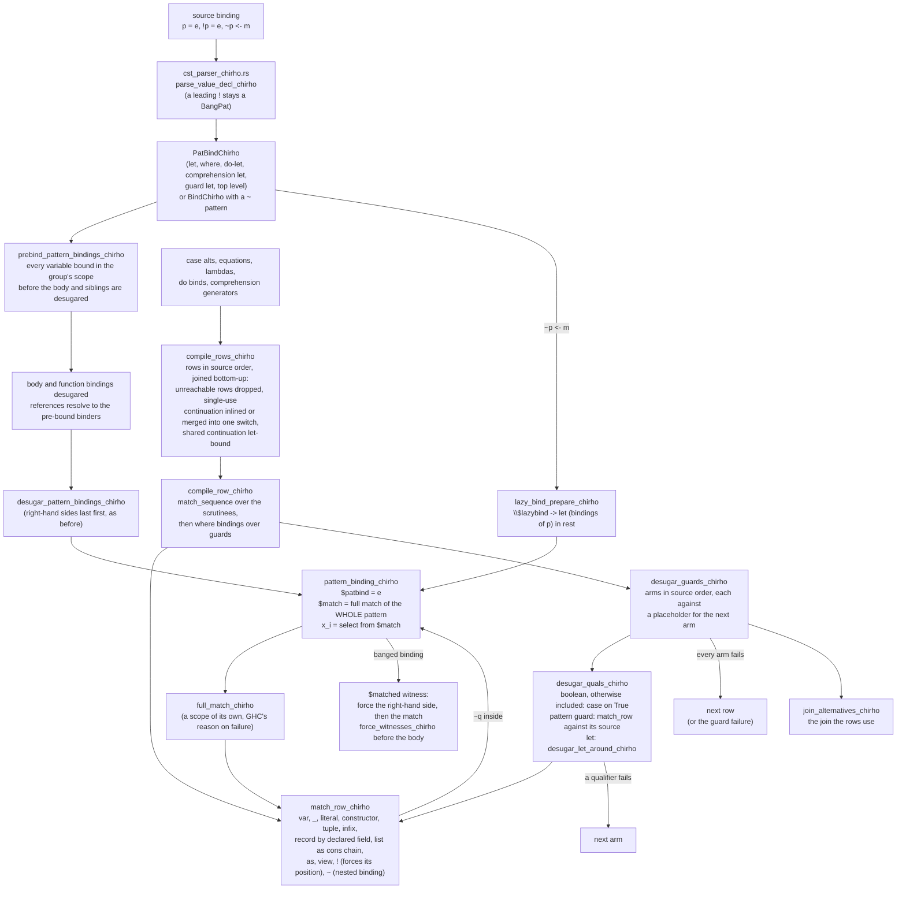
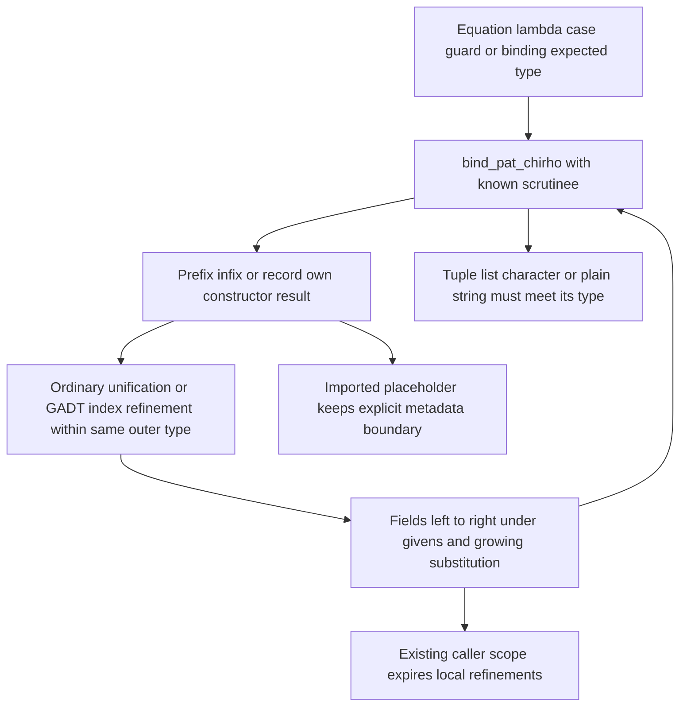
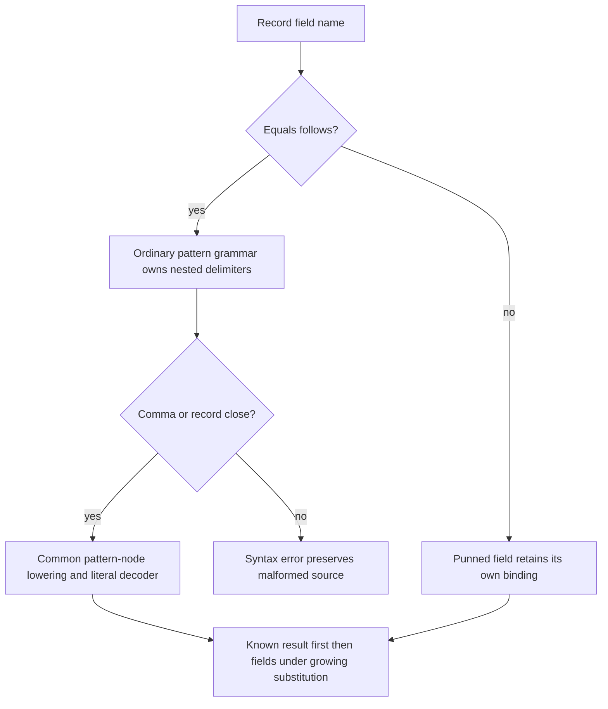
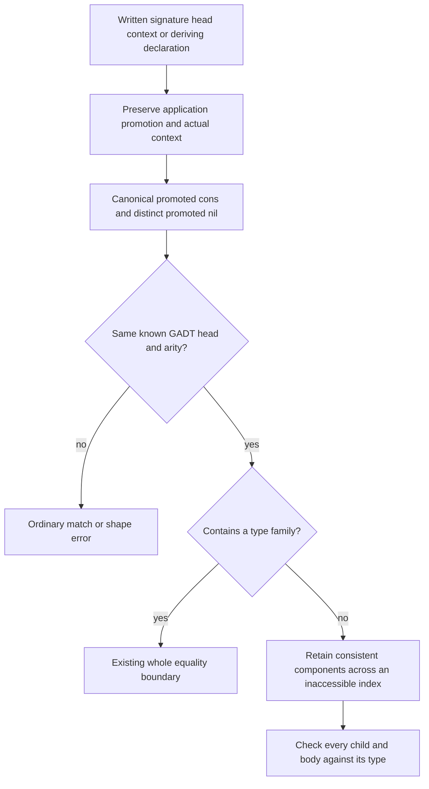

<!-- For God so loved the world, that he gave his only begotten Son, that whosoever believeth in him should not perish, but have everlasting life. — John 3:16 (KJV) -->
# Workflow: pattern matching

How a pattern becomes Core. Functions on this DAG carry a
`workflow: language-features-chirho/pattern-matching-chirho` comment.

There is ONE single-row matcher, `match_row_chirho`
(`crates/haskelujah-core-chirho/src/desugar_chirho/row_match_chirho.rs`): it matches one
pattern against one variable, left to right and depth first, continues with a success
expression once every variable of the pattern is in scope, and evaluates a failure expression
otherwise. It handles every pattern shape: a literal is tested wherever it appears, a record
matches its named fields at their DECLARED positions, a list is matched as the cons chain it
is (so its length is part of the match), and `~`, `!`, `@` and view patterns mean what the
Report and GHC say they mean.

Every position goes through it: pattern BINDINGS (below), and every MATCH position as ROWS
(`match_rows_chirho.rs`) - case alternatives, function equations, lambdas, do binds and
list-comprehension generators. A row is its patterns matched left to right, its `where`
bindings over its guards, and every failure (a pattern or the last guard) continuing with the
next row. The older per-position machinery is deleted.

A row's guards are ARMS (`guards_chirho.rs`), each a list of qualifiers kept as qualifiers from
the parser on (`GuardedExprChirho::quals_chirho`): a boolean guard, a pattern guard `p <- e`
(a one-pattern row against `e`, through the same matcher) and a `let`. They run in order, each
scoping over the ones after it and the body; any failing qualifier goes on to the next arm, and
after the last arm to the next row. Arms and rows share one bottom-up join, so a fall-through is
placed once: let-bound when it is used more than once, never copied.

Every local `let` - a `let` expression, a guard's `let`, a do block's `let` and a list
comprehension's `let` - goes through ONE helper, `desugar_let_around_chirho`: every name is in
scope before any right-hand side is desugared (a local function recurses, a binding refers
forward), and a pattern binding is lazy through one match of the whole pattern. The do block
and the comprehension used to carry their own copies, which bound a function's name only after
its right-hand side, and (the comprehension's) dropped every pattern binding.

A guard's `let` ends where its bindings do, even on one line (`| let y = x * 2, y > 10 = y`):
the layout pass closes an implicit block only by indentation, so the parser applies the
Report's parse-error(t) rule itself (`cst_parser_chirho/let_qualifier_chirho.rs`, shared with a
list comprehension's `let`), closing the block at the `,` before the next qualifier or the
`=`/`->` before the body, and moving the layout pass's later virtual `}` there (with the
virtual `;` it placed for that block).

A multi-way `if` is the same arms with nowhere to fall to: its parser reads each arm's
qualifiers as a case alternative's (the arm lookahead reads a qualifier's `let` as the parser
ends it), and the desugarer gives `desugar_guards_chirho` the failure "Non-exhaustive guards in
multi-way if".

`otherwise` is an ordinary boolean guard: the name denotes whatever binding scope gives it (a
parameter, `where`, `let`, pattern guard or top-level definition may rebind it), and the
Prelude's is `True` in the Core prelude. Recognising it by its spelling took the wrong arm
under every such shadow; the controls are `eval_pattern_chirho/otherwise_binding_chirho.rs`.

The checker types an arm the same way (`infer_chirho/guards_chirho.rs`): its qualifiers in a scope
of the arm's own, a boolean guard checked as an `if` condition is, and a pattern guard bound
against its source's type as a case alternative is against its scrutinee
(`bind_pat_against_chirho`, GADT refinement included). Each arm's result is decided INSIDE that
scope, while its refinements hold: against the expected type when the equation or alternative has
one, and an arm that cannot meet it is handed to the caller, which judges it as it judges an
unguarded body. The controls are `eval_pattern_chirho/gadt_guard_chirho.rs`.

## Known-type pattern checking

The source candidate in `infer_chirho/pattern_bindings_chirho.rs` checks constructor
results before their fields. Its combined validation found two accept losses at
49b71e7b; the gate remains stopped until the producer repair restores membership
and passes the complete combined gate. Prefix and infix patterns
share `bind_constructor_pattern_chirho`. It opens outer constructor foralls while
preserving higher-rank field foralls, then checks fields left-to-right under the
result's ordinary substitution and local GADT givens. Records use the same order,
including the growing substitution between named fields and a result-type check
for positional `C {}` patterns. A descendant GADT never makes its ordinary parent
a refining constructor.

`unify_constructor_result_chirho` first tries ordinary normalized unification. Only
this constructor's own GADT result can refine indices, and only within the same
known outer constructor; a bare rigid type cannot become an arbitrary data type.
A failed shape match reports its error, including tuple/list and fixed character
or non-overloaded string patterns. The existing skolem refinement helper already
returns ordinary residual substitutions and propagates unification failure; that
behavior is preserved. Case alternatives and pattern guards call the known-type
binder directly; they no longer unify a fresh whole-pattern type and promote its
sibling constraints into givens. Their existing lexical scopes own refinements.

Controls are in `tests/rigid_tyvars_chirho/known_type_patterns_chirho.rs`, included
by the existing rigid-variable integration target: explicit constructor foralls,
higher-rank fields, partial/nested GADTs, generic versus specialized siblings,
source order, records, infix constructors, empty record patterns and all three
known-type match positions. GHC 9.14.1 measured all source verdicts; five runtime
controls also matched the frozen main CLI before the candidate build. Numeric,
fractional and OverloadedStrings pattern obligations, incomplete imported metadata
and full existential-escape checking remain explicit boundaries.

`tests/rigid_tyvars_chirho/known_type_contexts_chirho.rs` adds the source review's
positive context controls: equality givens, refinements reaching later patterns,
pattern synonyms, supported family reduction and imported constructors. The eleven
sources check on GHC and frozen current main; ten also match exact runtime output.
Imported infix constructor values now use the constructor-operator repair below;
malformed constructor arity recovery remains a measured residual. Baseline measurements and later candidate gates remain distinct in the tasklist.
An additional empty-record pattern on a GADT with a rank-N field must retain its
constructor-result refinement. GHC accepts that positive while current main
rejects it; the candidate's result still needs measurement. Written pattern
signatures, nested-family GADT givens and equality-context constructor registration
remain separately named baseline gaps.

## The rules it implements

- A pattern binding is LAZY: nothing is forced where it is bound, so an unused variable never
  fails (`let (Just n) = undefined in 5` is 5).
- Demanding ANY variable matches the WHOLE pattern (Haskell 2010 §3.17.3, rule (d)), so `x` in
  `(x, Just y) = (1, Nothing)` fails even though `x`'s own position matched. The match is
  built once and shared, not once per variable.
- A `~` below the binding's top keeps its sub-pattern OUT of the match: `(x, ~(Just y))` gives
  `x`, and demanding `y` then runs `Just y`'s own match.
- `!p = e` forces the MATCH before the body and not the variables:
  `let !(Just n) = Just undefined in 5` is 5, `let !(Just n) = Nothing in 5` fails. A bang
  deeper in the pattern forces its position when the match runs.
- An outer `~` on a binding changes nothing (a binding is lazy already), which is why a
  top-level `~(Just n) = ...` is an ordinary binding and no longer loops.

## Controls

`crates/haskelujah-driver-chirho/tests/lazy_patterns_chirho.rs`, each expectation measured on
GHC 9.14.1 and the key ones mutation-checked (a skipped literal test, an unforced witness, a
witness that forces the variable, record fields by listed order, an unforced inner bang: each
fails exactly its own control).

## Not yet covered

Tracked in `spec-chirho/tasklists-chirho/26-09-30_00-25-tasklist-full_pattern_match-chirho.md`:

- nothing in the guard family that the probes found: a multi-way `if`
  (`ExprChirho::MultiWayIfChirho`) now carries the same guard arms, typed with its arms'
  results agreeing as an `if`'s branches do and desugared with GHC's own failure text.
- The known-type pattern candidate above addresses whole-pattern refinement and concrete
  constructor/tuple/list mismatch leniency; its behavior and corpus effect are not yet measured.
- A guarded right-hand side with no expected type (a pattern binding) still drops a later arm
  that disagrees with the first. Existential escape and GADT equality escaping through a later
  case alternative were pre-existing misses in the independent guard review; no closure of
  those separate obligations is claimed here.

## Record-pattern producer Chirho

Assigned record fields enter parse_record_pat_fields_chirho's ordinary pattern parser. Literals, wildcards, constructor applications and nested tuple/record delimiters therefore reach lower_record_pat_chirho as pattern nodes, where the common literal decoder preserves values, spans and origins. Field puns and RecordWildCards retain their field-name/token route. The lowerer consumes one pattern node per assigned field; it no longer attempts a second flat-token pattern grammar. After an assignment, leftover expression tokens create a CST error node. The frontend currently skips that error node and accepts the partial AST: an expression such as `(toEnum 120)` becomes a catch-all variable pattern, so invalid code can run successfully and give a wrong answer. Claude2 measured the same result on main and the repair. Surfacing parser error nodes is an explicit separate diagnostics gap. The producer test measures the error node only. Known-type checking uses the same constructor-result and sibling-substitution rules as other patterns.

## Faithful declaration heads and inaccessible indices Chirho

Flat declaration heads and contexts preserve promoted-list atoms through one
balanced-group lowering routine. Ordinary list constructor `[]` remains distinct
from promoted nil `'[]`. Ordinary AST conversion, type-synonym RHS conversion and required type arguments
construct promoted lists with the same cons spelling as parsed `a ': as`.
This normalization precedes any decision that GADT indices are contradictory.

Standalone deriving retains the written applied instance head and its context;
stock generators supply method bodies. Inline deriving includes visible arguments
implied by a result-kind arrow, even when the declaration has no visible header
binders. Invisible forall binders contribute scope but do not become ordinary
arguments. These producers live in parser `lower_chirho/type_syntax_chirho/` and
typing `deriving_chirho/declaration_heads_chirho.rs`.

Within the same known GADT head and arity, a contradictory generative index means
an inaccessible arm. Independent consistent components still constrain constructor
fields, even when the contradiction occurs first. Child and body checking then
runs normally, so an impossible Bool field cannot match a Char. Bare-skolem and
outer constructor mismatches keep ordinary errors. Family-containing results keep
the existing whole-equality route; no injectivity is assumed. Using an inconsistent
given to justify an otherwise mismatched body remains an explicit solver boundary.
Written deriving heads/contexts now survive generation, but the class solver still
wrongly accepts the retained missing-context and out-of-specialization call probes;
producer fidelity does not close dictionary selection or instance solving.

The focused controls are in `tests/rigid_tyvars_chirho/declaration_patterns_chirho.rs`,
with a parser head/context witness in `flat_type_tests_chirho.rs`. C1 must run to 5;
C2/C3 and the inaccessible-child negatives must reject for their actual type
mismatch. T16502b and T17024 are both GHC-valid acceptance controls. Final corpus
and mutation outcomes belong to the tasklist and frozen receipts, not this DAG.

Constructor operators Chirho: the ordinary and operator-section Core infix paths
produce constructor applications for colon-led operators, retaining their actual
names, and for registered named constructors used with backticks. C1 and the
ordinary left-associative tree execute to their GHC values; imported `:|` and `:+`
also pass their exact runtime controls. GADT arity metadata and native execution
are not established by those interpreter measurements.

Constructor operator applications and operator-section bodies use the same enforce_strict_fields_chirho path as prefix constructor application. It forces declared strict fields only at full constructor arity, preserving lazy fields, uncalled sections and partial applications. Exact interpreter controls cover each behavior; native execution remains a separate gate. Faithful derived instance heads also require a shared typed/written method identity and compatible call-site selection. A typecheck recovery alone cannot establish runtime compatibility when a previously working Eq call no longer finds its binding.

Generative GADT index decomposition compares the complete constructor-spine arity at every recursive application, including a nested poly-kinded wrapper. An equality between a fully applied type and a partial application supplies no component equations; valid independent same-arity components are still retained. Existential variables that were instantiated flexibly remain a separate checking boundary.
