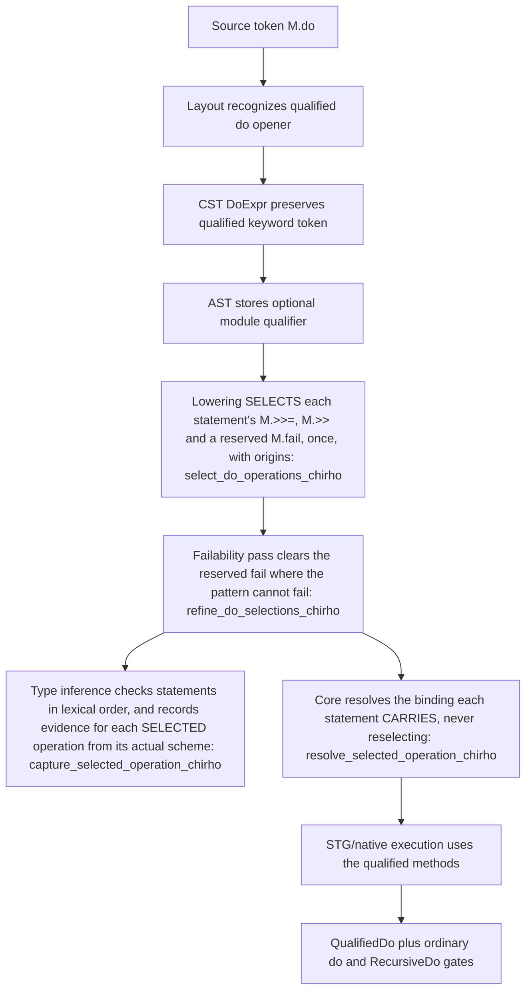
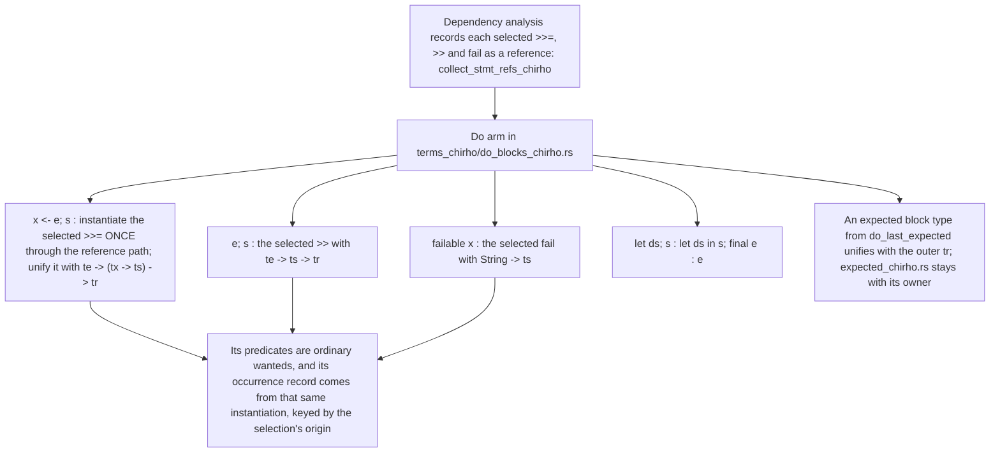

<!-- For God so loved the world, that he gave his only begotten Son, that whosoever believeth
in him should not perish, but have everlasting life. — John 3:16 (KJV) -->

# Qualified do workflow

The choice of operation is made ONCE, by lowering, and both the checker and Core read that one
choice. Two phases that each chose could disagree, and the disagreement would stay invisible until
something one of them emitted failed to resolve - which is exactly how an irrefutable pattern used to
get a `fail` its monad might not have. See `tasklists-chirho/26-09-24_12-35-tasklist-do_selection-chirho.md`.

## Invariants

- A qualified do opener is a layout keyword only when the final qualified segment is exactly
  `do`; identifiers such as `Module.done` remain ordinary qualified identifiers.
- The qualifier is semantic AST data, not reconstructed later from source text.
- Missing qualified methods fail through normal name resolution; they do not fall back silently
  to Prelude methods.
- Imported Prelude aliases use the existing bare-export linker bridge. Other imported qualifiers
  remain qualified and loud until Core linking distinguishes same-named exports by module.
- Unqualified `do` and `mdo` retain their existing lowering and dispatch paths.
- `M.do` selects `M.>>=` even inside module `M`. Whether that qualified name resolves to a local
  binding is name RESOLUTION, and the resolver's self-qualified rule stays in the resolver; the
  selection carries the qualified name and nothing more.
- `fail` is selected only where the pattern can FAIL, by GHC's rule as measured against 9.14.1: a
  variable, wildcard, lazy pattern, or a sole-constructor pattern whose parts cannot fail selects
  none. A constructor from another module is not in the environment and stays failable.
- The checker's evidence covers only an operation whose type fits the monadic shape. An indexed,
  graded or plain-function operator records NO evidence rather than wrong evidence, and keeps the
  dispatch it has today. That evidence reaches no consumer yet: the join drops every role but
  Reference.

## Row 710, in progress: each statement typed through its selected operation

Today's checker unifies every statement with one block-wide `m a` and never types a statement
through the operation it selected, so a QualifiedDo bind of a plain local `a -> (a -> b) -> b`
yields `Num (m (m a))`. The restriction refuses that (E0204) where GHC 9.14.1 prints 5 (row 692
#32742, reference #32778). Row 710 types the translation Core already desugars:

- There is no block-wide `m` and no monadic flag. `do {e}` is `e`, and lets plus a final
  expression are `let ... in e`.
- The observational second instantiation and its ignored unifier go. A plain local bind, a `($)`
  bind (GHC T17594f) and an indexed or graded bind type by their own schemes.
- A statement that carries NO selection (hand-built ASTs, Template Haskell conversion, the
  RecursiveDo knot) keeps today's shape-only typing, statement by statement: `e :: m a`, the rest
  `:: m b`, the block `:: m b`. It gets no wanted, no evidence and no proof, and no spelling
  lookup. Any change to that policy waits for root's word.
- Controls: the c06 qualified non-Monad record control and its execution (5); a `($)` bind; an
  indexed or graded qualified bind; IO and refutable-Maybe MonadFail; an unsigned polymorphic Monad
  do; both let-only positives; the DoBindExact refusal and its pure twin. See
  `tasklists-chirho/26-11-06_22-25-tasklist-selected_do_typing-chirho.md`.
