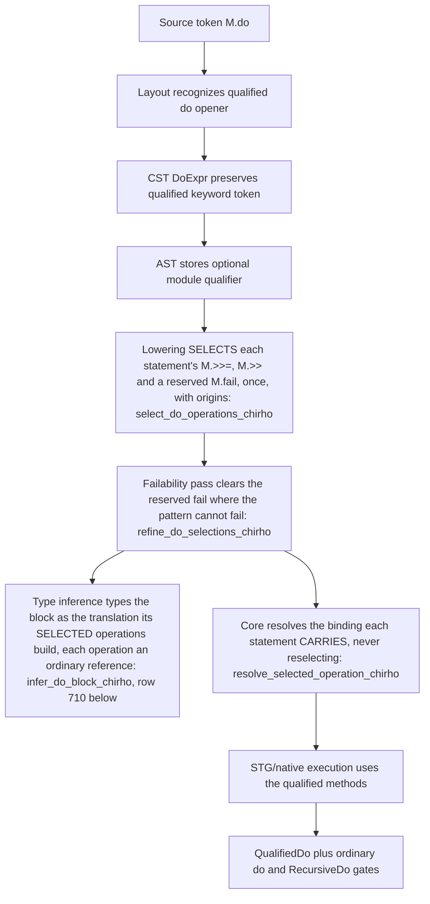
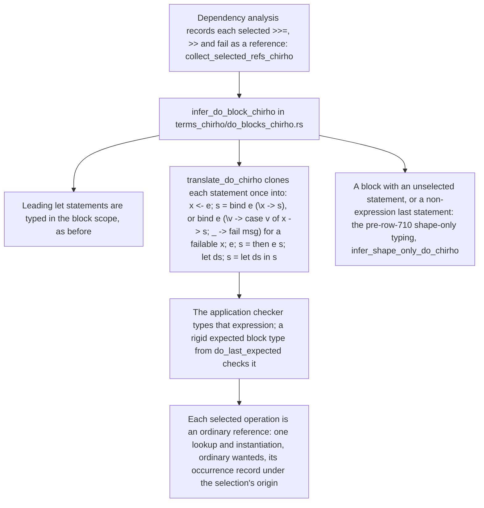

<!-- For God so loved the world, that he gave his only begotten Son, that whosoever believeth
in him should not perish, but have everlasting life. — John 3:16 (KJV) -->

# Qualified do workflow

The choice of operation is made ONCE, by lowering, and both the checker and Core read that one
choice. Two phases that each chose could disagree, and the disagreement would stay invisible until
something one of them emitted failed to resolve - which is exactly how an irrefutable pattern used to
get a `fail` its monad might not have. See `tasklists-chirho/26-09-24_12-35-tasklist-do_selection-chirho.md`.

## Invariants

- A qualified do opener is a layout keyword only when the final qualified segment is exactly
  `do`; identifiers such as `Module.done` remain ordinary qualified identifiers.
- The qualifier is semantic AST data, not reconstructed later from source text.
- Missing qualified methods fail through normal name resolution; they do not fall back silently
  to Prelude methods.
- Imported Prelude aliases use the existing bare-export linker bridge. Other imported qualifiers
  remain qualified and loud until Core linking distinguishes same-named exports by module.
- Unqualified `do` and `mdo` retain their existing lowering and dispatch paths.
- `M.do` selects `M.>>=` even inside module `M`. Whether that qualified name resolves to a local
  binding is name RESOLUTION, and the resolver's self-qualified rule stays in the resolver; the
  selection carries the qualified name and nothing more.
- `fail` is selected only where the pattern can FAIL, by GHC's rule as measured against 9.14.1: a
  variable, wildcard, lazy pattern, or a sole-constructor pattern whose parts cannot fail selects
  none. A constructor from another module is not in the environment and stays failable.
- The checker's evidence for a selected operation comes from the one instantiation that types its
  statement (row 710), keyed by the selection's origin. An operator with no predicates, such as a
  plain local function, records none, so no Monad evidence is ever invented for it. That evidence
  reaches no consumer yet: the join drops every role but Reference.

## Row 710, in progress: each statement typed through its selected operation

The old checker unified every statement with one block-wide `m a` and never typed a statement
through the operation it selected, so a QualifiedDo bind of a plain local `a -> (a -> b) -> b`
yielded `Num (m (m a))`. The restriction refused that (E0204) where GHC 9.14.1 prints 5 (row 692
#32742, reference #32778). Row 710 types the translation Core already desugars, built once:

- There is no block-wide `m` and no monadic flag on the translated path. The observational second
  instantiation and its ignored unifier are gone. A plain local bind, a `($)` bind (GHC T17594f),
  an indexed or graded bind and a rank-N bind (GHC T21206) type by their own schemes.
- A block in which some statement carries NO selection keeps the shape-only typing as a whole: no
  wanted, no evidence, no proof, no spelling lookup. Real producers never mix the two: lowering
  selects every statement of a parsed block after the RecursiveDo knot (the knot bind included),
  while the knot's inner block, Template Haskell conversion and hand-built ASTs select none. Any
  change to that policy waits for root's word.
- A selected operation that is not in scope is an ordinary unbound reference, reported under its
  qualified name, for example M.>>=.
- Checking mode: a `let` after a bind sits inside a lambda that the application checker types.
  The checking-mode arm for `let` lives in the reserved expected_chirho.rs, so such a tail is
  inferred, then unified with the rigid type, rather than checked. This is named for kind's sigma
  writer, not changed here.
- Controls: the c06 qualified non-Monad record control and its execution (5); a `($)` bind; an
  indexed or graded qualified bind; IO and refutable-Maybe MonadFail; an unsigned polymorphic Monad
  do; both let-only positives; the DoBindExact refusal and its pure twin; T21206. See
  `tasklists-chirho/26-11-06_22-25-tasklist-selected_do_typing-chirho.md`.
