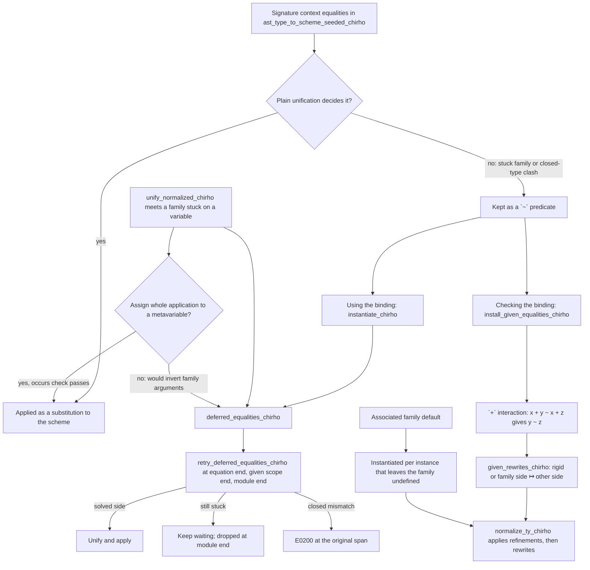
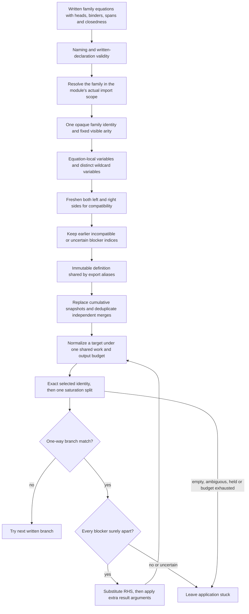
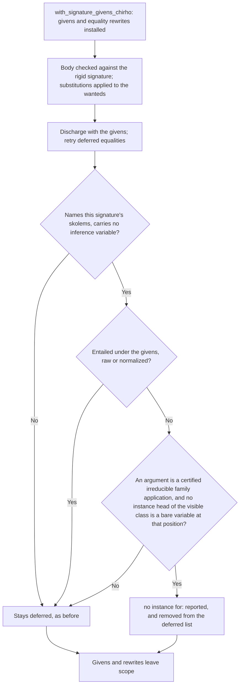

<!-- For God so loved the world, that he gave his only begotten Son, that whosoever believeth
in him should not perish, but have everlasting life. — John 3:16 (KJV) -->

# Stuck type-family equalities and given equalities workflow

A type-family application whose argument is still an unsolved unification variable cannot be
compared with anything yet (`n ~ N t` before `t` is known), and a signature context may state an
equality that unification alone cannot decide (`F a ~ Bool =>`, `Int ~ Bool =>`). Both used to be
reported as mismatches; now the first is *deferred* and the second becomes a *rewrite rule*.

## Invariants

- An associated type family's default is never a general equation of the family: `type Fam a =
  Maybe a` inside a class produces `Fam Int = Maybe Int` for `instance Cls Int`, and nothing for an
  abstract `a`.
- Deferral happens only when a family application is stuck on a *unification variable*
  (`ty_is_stuck_family_on_var_chirho`); a family stuck on a rigid variable is decided by the given
  rewrite rules or reported.
- Structural-unification success is not evidence of injectivity.
  `defer_stuck_family_equality_chirho` also defers `G a ~ G b` rather than deriving
  `a ~ b`; assigning an entire application to a metavariable is still allowed when the
  occurs check passes. The GHC 9.14.1 control is a type-changing record update (T10808)
  where `G T1 = G T2 = Int` while another field changes Char to Bool: checking
  `y = y r1` against the output record's field type meets `G t8 ~ G t7`, both stuck on
  unsolved variables, and deriving `t8 ~ t7` forced the output back to `R T1`
  (observed with an instrumented build, 2026-09-19). Carried from row 484's 327aaef7.
  This is the noninjective default, not implementation of user-written
  [injectivity annotations](https://downloads.haskell.org/ghc/latest/docs/users_guide/exts/type_families.html#injective-type-families).
- Rewrite rules are oriented from the side that cannot otherwise be simplified (a rigid variable
  or a family application) to the other side; two differing closed types (`Int ~ Bool`) also
  become a rule, which is how an insoluble given types its unreachable body.
- Given rewrites and deferred equalities follow the running substitution
  (`apply_subst_all_chirho`), and rules are truncated with the givens they came from.
- `~` never reaches class reasoning: it is skipped by the unsolvable and undeducible checks, and
  instantiating a scheme turns a `~` predicate into a deferred equality, not a class wanted.
- Discharging wanteds at a given scope's end also solves through instances whose contexts the
  givens entail (`pred_entailment_under_givens_chirho`), and improves wanteds by the functional
  dependencies of the givens in scope (`fundep_improve_from_givens_chirho`). A wanted that
  instances settle on their own — the `Num Int` of a literal — is NOT discharged there
  (`givens_discharge_wanted_chirho`): it stays deferred so generalization absorbs it into the
  binding's scheme, which is where the dictionary pass reads the evidence for the body's class
  methods. Discharging it early left `take 5 "hello"` with a bare `fromInteger` at run time.

## Current boundary

- A constraint written with type operators (`a + b ~ a + c`) is mis-lowered by the parser as a
  class constraint headed by `+`; the `+` interaction rule is therefore only reachable through
  the AST shapes the lowering produces today (parser lane).
- Injectivity of user-declared families is not modelled; only the builtin `+` interaction exists.
- Equalities still stuck on an ambiguous variable at the end of the module are dropped rather
  than reported as ambiguity.

## Row 686: identity and ordered reduction

The row 686 combined candidate connects preserved written equations to one immutable family definition. This section describes that candidate's route; the tasklist records its pending combined compiler and corpus gates. A parser carrier or isolated component test does not establish the whole route.

`TypeFamilyRegistryChirho` stores definitions once, with stable branch identities and module-owned export aliases. Open definitions require a cold coherence check. Re-importing the same verified rows keeps that proof; adding unverified rows invalidates it. A closed declaration's first held equation prevents every later fallback from bypassing it. Exact lookup never tries a different qualified, bare or builtin definition when the selected family stays stuck.

The apartness unifier and one-way matcher have different jobs. Apartness freshens each branch's left and right sides together, binds both sides' variables, preserves shared stuck applications and compares the substituted results. Occurs failures, unknown heads and exhausted resources are uncertain. Matching binds only the equation's pattern variables. List, tuple and function sugar shares a canonical view, with arrow multiplicity and promoted-constructor identity preserved.

Promoted names use the separate promoted-constructor identity workflow. Ordinary source type spellings do not acquire nominal authority from a qualifier: an import alias may spell a different transitive module's name. The comparison catalogue therefore leaves raw qualified heads unknown unless a producer supplied an opaque identity. Existing exporter stamps, including unresolved stamps, survive later imports unchanged. Diagnostic rendering writes readable family and promoted names without changing internal equality or keys.

The behavioral controls reuse the existing `typing_integration` and `native_symbol_identity` targets. Their single-module and Cabal project programs are copied byte for byte from fresh GHC 9.14.1 runs, including abstract rejection twins and qualified/re-exported identities. The component suite separately checks finite/uncertain/disjoint comparisons, coherence, snapshot deduplication and resource exhaustion. Final claims require the interpreter, LLVM, true Cranelift and both fixed corpus axes on the same candidate.

## A signature's wanted that nothing in scope can serve (row 686, C08)

`twoChirho :: Proxy a -> Proxy b -> TwoChirho (OpaqueChirho a) (OpaqueChirho b); twoChirho _ _ = 3` leaves the literal's wanted, `Num (TwoChirho (OpaqueChirho a) (OpaqueChirho b))`, resolved and meta-free at the signature scope's end. Discharge keeps it, because no given takes part. The scope then truncates its givens, and the module-end check's rigid branch drops it. GHC 9.14.1 rejects the program with GHC-39999.

- **Placement.** The check runs at the signature scope's end, from `with_signature_givens_chirho` in `solving_chirho/schemes_chirho.rs`, while the givens and equality rewrites are still installed. Top-level and local signed bindings call it. Instance-obligation scopes keep `with_given_preds_chirho`, unchanged. The rule is in `solving_chirho/signature_wanteds_chirho.rs`.
- **The certificate.** It consumes the reducer's `decide_family_with_limits_chirho` through exact registry identities.
  - `NoMatch` certifies a definition that has no equations.
  - Otherwise, `NoMatch` or `Blocked` certifies only when every rigid variable sits inside a nested application that is itself certified. A pattern's local refinement of a bare rigid argument could select an equation.
  - Intrinsic, held, unverified, Unknown and exhausted work never certifies.
- **The class.** Only a bare-variable instance head can match an application that never reduces. Its visibility is trusted for a fully-known class, or for a class the standard seed itself produced (`seeded_class_names_chirho`).
  - That set is captured from the seed producer's output.
  - An ordinary import such as `Data.Proxy` leaves it alone; a whole-environment replacement clears it, and a source declaration of a class removes that name.
  - Boundary: an orphan universal instance in an uncompiled package stays outside this view.
- **Unmodeled pattern evidence.** A constructor's context, and a GADT refinement, are not installed as pattern-local givens: pattern instantiation even defers the context as a wanted.
  - So `unmodeled_pattern_evidence_seen_chirho` is set the first time any pattern matches such a constructor, or one whose scheme is unknown, and the first time a refinement is added.
  - Once set, every later closure in the module stays off, nested signatures included, since a nested signature can inherit the evidence before its own scope begins.
  - Residual: an unrelated later signature can stay unchecked. Installing real pattern-local givens is the later repair.
- **Unchanged:** the module-end rigid refuter, every family blocker, and every other caller. Nothing else calls a stuck family unsolvable.
- **Controls:** `typing_integration_chirho/declarations_chirho/signature_wanteds_chirho.rs`, copied byte for byte from fresh GHC 9.14.1 oracle files: three rejected, and eight accepted, the two constructor-pattern holds among them.
