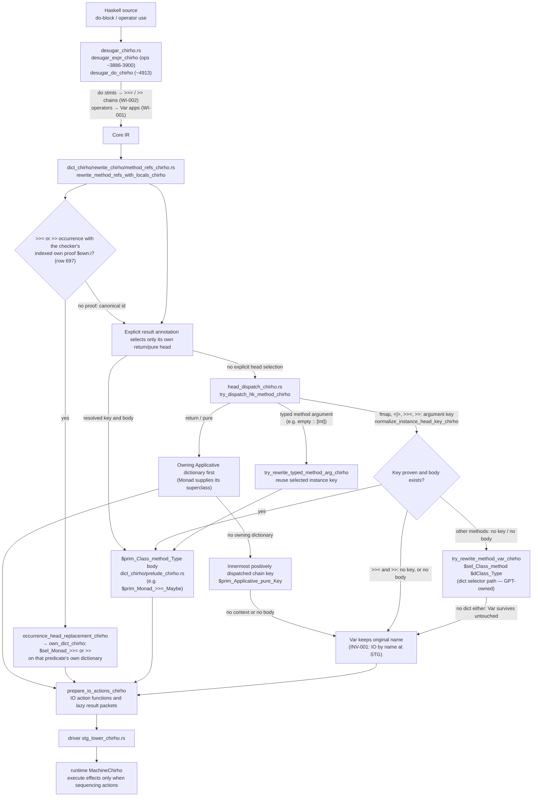

<!-- For God so loved the world, that he gave his only begotten Son, that whosoever believeth in him should not perish, but have everlasting life. — John 3:16 (KJV) -->
# Workflow: typeclass method dispatch (Functor/Applicative/Monad/Alternative)

How a class-method use (`fmap`, `<*>`, `<|>`, `>>=`, `>>`, `return`/`pure`) travels the pipeline,
and where per-type dispatch happens. Functions on this DAG carry a
`// workflow: monadic-dispatch-chirho` comment in code.

Key invariant: concrete dispatch requires a resolved type key and an actual body.
An explicit result annotation selects its own `pure`/`return` application head
before an enclosing dictionary is considered. The focused
`rewrite_chirho/return_chirho.rs` walk does not apply that result's type to argument
subexpressions: `Either String [Int]` outside a list-valued helper cannot change
the helper's dictionary. Mixed Maybe/Either expressions are execution controls.
An enclosing binding's own dictionary is also real evidence and takes precedence
over a syntactic monad-context guess. Both `pure` and `return` use the Applicative
pure selector there; Monad supplies its Applicative superclass. Unknown instances
must not be guessed merely from the result's runtime bits.

`>>=` and `>>` take the dictionary of the predicate that types each use (row 697).
The authority is the checker's own proof, carried by the existing occurrence route:
- The checker captures every use (written, prefix, or a do statement's selection)
  under its own origin. It keys a use at a rigid signature variable as that exact
  predicate, `$own:i`.
- The desugarer mints an occurrence id for each use. It records the use's provenance:
  Reference, or the do statement's Bind or Then.
- For these two operators only, the occurrence join keeps an indexed own proof joined
  by provenance. The dictionary pass serves it as `$sel_Monad_>>=` or `$sel_Monad_>>`
  on that predicate's own dictionary parameter, so two Monad predicates in one binding
  each keep their own.

Every other use goes back to its canonical id:
- A ground key (`IO`, `Maybe`, `[]`) or a user monad gets proven constructor dispatch,
  else INV-001's name fallback, unchanged. An IO chain inside a helper that owns
  another monad's dictionary stays IO's.
- A bare `$own`, a use proved only through a superclass (such as `>>` under
  `MonadIO m`), is an unserved runtime boundary, not a compatible pass.
- No provenance (generated code), or a span-only or position-only match, proves
  nothing.

`return`, `pure` and `fail` keep their shared ids and their existing routes. A
program's own or lexically bound `>>=` or `>>` resolves through scope and is never
minted. The Reader gap was separate: a user instance of a class with a superclass
registered no dictionary under the key its use site carries, so such a caller failed by
that named missing dictionary. Since row 699 a one-parameter head is found under its
constructor when every superclass template matches one context-free instance built here.
The head's slots then hold those dictionaries, and the compiler's own Monad defaults
`>>` from the instance's own `>>=`. Any other head keeps that named failure, never a
module refusal (dictionary-evidence-chirho, Generic instance heads).

The legacy unresolved-name fallback remains for cases with neither evidence nor a
known body; it is not a claim of general polymorphic-monad compatibility. The old
identity-style IO fast-path contract is superseded by reusable action functions:
Core IO operations become dormant action values, and execution yields a distinct
result packet. See testing-chirho/execution-oracles-chirho.md.

See `spec-chirho/prd_chirho.json` work items WI-001 (operators), WI-002 (do-notation),
WI-003 (return/pure position) for the active changes on this DAG.
