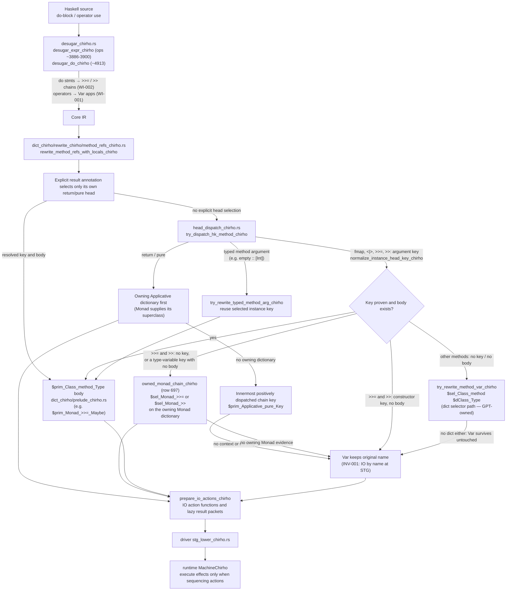

<!-- For God so loved the world, that he gave his only begotten Son, that whosoever believeth in him should not perish, but have everlasting life. — John 3:16 (KJV) -->
# Workflow: typeclass method dispatch (Functor/Applicative/Monad/Alternative)

How a class-method use (`fmap`, `<*>`, `<|>`, `>>=`, `>>`, `return`/`pure`) travels the pipeline,
and where per-type dispatch happens. Functions on this DAG carry a
`// workflow: monadic-dispatch-chirho` comment in code.

Key invariant: concrete dispatch requires a resolved type key and an actual body.
An explicit result annotation selects its own `pure`/`return` application head
before an enclosing dictionary is considered. The focused
`rewrite_chirho/return_chirho.rs` walk does not apply that result's type to argument
subexpressions: `Either String [Int]` outside a list-valued helper cannot change
the helper's dictionary. Mixed Maybe/Either expressions are execution controls.
An enclosing binding's own dictionary is also real evidence and takes precedence
over a syntactic monad-context guess. Both `pure` and `return` use the Applicative
pure selector there; Monad supplies its Applicative superclass. Unknown instances
must not be guessed merely from the result's runtime bits.

`>>=` and `>>` follow the same owner (row 697). When no argument proves their
monad, a binding that owns a `Monad` dictionary selects `$sel_Monad_>>=` or
`$sel_Monad_>>` from it, so the method runs in the caller's monad rather than in
IO's by its name. "No argument proves it" means either no key, or a key whose head
is only a type variable, such as a lambda-bound action of type `m a`.
- The owner is the binding's predicate, or a superclass the pass extracted from one.
  The ground dictionaries seeded for every binding are not evidence.
- A proven constructor key keeps positive body dispatch. With no body, it keeps its
  name.
- Evidence-free code such as `main` keeps INV-001's name fallback. A program's own
  `>>=` or `>>` keeps its own binding.

Limits:
- The owner is chosen per binding, not per occurrence. An unproven IO chain inside a
  binding that owns another monad's dictionary (`liftIO (a >> b)` under `MonadIO m`)
  runs in the owning monad, as `return` there already does.
- Two distinct Monad dictionaries in one binding are not told apart.
- A user instance of a class with a superclass still registers no dictionary under
  the key its use site carries (the Reader gap). Such a caller now fails by that
  named missing dictionary instead of inside IO's bind.

The legacy unresolved-name fallback remains for cases with neither evidence nor a
known body; it is not a claim of general polymorphic-monad compatibility. The old
identity-style IO fast-path contract is superseded by reusable action functions:
Core IO operations become dormant action values, and execution yields a distinct
result packet. See testing-chirho/execution-oracles-chirho.md.

See `spec-chirho/prd_chirho.json` work items WI-001 (operators), WI-002 (do-notation),
WI-003 (return/pure position) for the active changes on this DAG.
