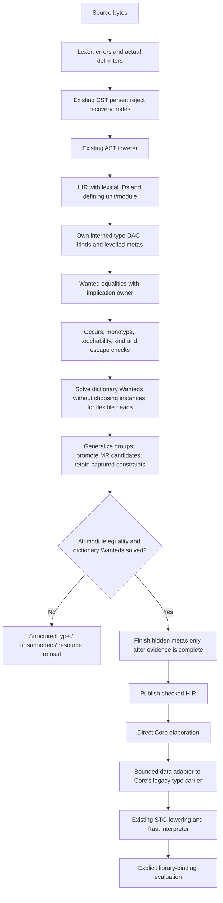

<!-- For God so loved the world, that he gave his only begotten Son, that whosoever believeth in him should not perish, but have everlasting life. — John 3:16 (KJV) -->

# Next: checked source to the interpreter

Implementation scope: isolated `next-pipeline-source-interfaces-chirho` (unit 751), based on `b2a48cba`. The tasklist records its final source identity and evidence. Main compiler crates remain `04116a69`; this is not a main-source landing or release.

The explicit `--pipeline next` path is separate from legacy inference. The current vertical handles library modules with Bool/Char/list/tuple and ordinary algebraic types, rank-1 written signatures, inferred qualified let-polymorphism, ordinary source classes with superclass dictionaries and checked default methods, and constructor-headed instances with variable contexts, application, patterned lambdas/function equations, recursive local bindings, annotations, conditionals and cases. Names come from the existing empty lexical name environment and become module-local IDs carrying their defining unit/module. Only wired Bool/Char constructors are introduced by the compiler; user constructors and classes come from their declarations, with no standard-class interface catalogue.

The unifier follows GHC 9.14.1's separation between touchability and RHS admission (GHC/Tc/Utils/Unify.hs, checkTyEqRhs and touchabilityTest). It is an initial monotype subset, not a port of the complete solver. The type arena's opaque IDs reject another module's references. Metas retain creation kinds/levels; implication scopes retain parent/level/given-equality ownership. Each equality publishes atomically, failures are sticky, and unresolved inner equalities cannot assign an outer meta across a given-equality boundary.

The aggregate allocation ceiling covers type nodes, meta/rigid records, implication frames and wanted/decomposition records. Equal type nodes share one DAG node. HIR and the temporary Core tree adapter have separate whole-module allocation/depth bounds. The reused parser is not yet a generally bounded parser: actual delimiter depth and the resulting CST depth are checked, but recursion through other syntax remains a parser hardening obligation.

Core still stores the legacy TyChirho data enum. The next adapter constructs that data without invoking legacy inference, unification, desugaring or dictionary rewriting. It counts expanded output nodes so a compact DAG cannot silently become an unbounded tree. The new checker itself has no dependency on legacy typing.

The current path does not yet process source-library CPP or validate Main.main's IO contract. Those paths return Unsupported. Source classes currently have one Type-kinded parameter, ordinary methods and constructor heads applied to distinct Type-kinded variables. Compound/equality superclasses, fixed/repeated/flexible instance heads, compound instance contexts, default signatures/numeric defaulting and SCC exports needing impedance matching remain Unsupported. Ordinary data currently has Type-kinded parameters and lazy positional fields. Records, GADTs, constructor contexts, deriving, strict fields and higher-kinded data parameters remain Unsupported. Guards, overloaded patterns, explicit lazy/bang patterns and local pattern bindings also remain Unsupported. CLI run/compile on next refuse rather than delegating. The library eval_binding API names its entry explicitly and is not an IO-main or B-run claim. Full source implication production remains S1 work.

The first-slice frozen bucket and unchanged workloads remain authoritative. Passing these S0 controls does not pass B-check/B-run or show that real GHC.Internal classes have compiled. Default CLI behavior remains legacy.

Unit 742 adds identity-based dependency groups, deeper-level inference before generalization, fresh scheme instantiation, explicit Core TyLam/TyApp and final zonking of hidden unquantified metas. See ghc-implementation-map-chirho.md for the exact GHC correspondence and remaining representation differences. Unit 744 extends that boundary with arena-owned class predicates and explicit dictionary evidence; this is still not GHC's full simplifyInfer.

Unit 743 registers every ordinary data header before reading constructor fields. Constructors carry checked schemes and instantiate freshly in expressions and patterns. Case/lambda/equation rows stay in source order; variable and wildcard patterns use lazy aliases, while constructors inspect fields from left to right. Core constructor tags include defining module, declaration ID and role. Shared fallthrough thunks prevent copying the rest of the matrix into every failure branch. Pattern expansion and copied Core types consume the output allocation/depth ceilings. An unmatched demanded value fails in the existing interpreter; it is never replaced by a successful placeholder value.

Unit 744 retains declaration-owned class/method/instance IDs in HIR and the binding's original restriction form. Predicates use the same type DAG and substitution path. The solver writes each evidence solution in its Wanted's scope, even when an ancestor Given solves it. Class-only Givens do not introduce equality untouchability. The Core boundary allocates evidence IDs afresh at each abstraction site, emits dictionary lambdas and owner-local evidence lets, and builds selectors/instance fields in class declaration order. A missing evidence binder is Invalid. STG spine collection erases type wrappers before selecting local application and closure handling, so a captured dictionary is not cached in a static application-head thunk.

Unit 746 adds written rank-1 signatures with Type-kinded variables and variable-headed source-class contexts. Each declaration receives fresh owned skolems and written Givens. It is checked at its real lexical parent and keeps its declared scheme; inference-group closure generalizes only unsigned members. The existing Core abstraction handles the signature scope's type/dictionary parameters and evidence bindings without another dictionary pass.

In the GHC2021/default profile, an explicit leading forall scopes over the RHS. Its HIR binder IDs stay installed while lowering that RHS, and the checker resolves those IDs through its signature-parent chain. An implicit inner signature captures such an outer variable; an explicit inner forall shadows it. An implicit outer signature does not scope its variables over the RHS. Owned skolems block constraint floating, while predicates on outer captures may still float. Class-only Givens leave outer unification touchable.

Higher-rank arguments, compound written contexts, more general instances, pattern type signatures and the full extension-override profiles remain Unsupported. In particular, the explicit ScopedTypeVariables pragma is not yet admitted by the restricted profile, although the default GHC2021 leading-forall scoping is implemented. Haskell2010 explicit forall is declined instead of silently enabled. Existing large-module Wanted-scan/re-zonking cost remains an open resource defect.

Unit 747 connects constructor-headed instance contexts to the existing evidence terms. HIR retains the instance's own type binder IDs and ordered class predicates. Its Instance scope owns rigid variables and context Givens; each method checks in a child Method scope. In GHC2021 those binders scope over method signatures/annotations; Haskell2010 does not receive that scoping. Generic method occurrences remain selectors; no self Given is added.

Matching is one-way and indexed by class identity plus constructor identity (or tuple arity/function role). An unknown flexible or rigid head selects nothing. The admitted head is a constructor applied to distinct variables; its context predicates mention only those bare variables. Selection therefore produces strictly smaller context subgoals in the original Wanted's scope. The same pass processes newly emitted subgoals, under the shared module ceiling. Evidence checks type-argument kinds, predicate identity, dictionary argument order and lexical scope before publication. A pending child prevents module acceptance even when the parent evidence term is already recorded.

Core abstracts the dfun over its type binders and context dictionaries, in their declared orders, then constructs lazy method fields. Instance applications pass the matching type arguments and child evidence. Positional source data, lists, tuples and functions use this shared rule. Fixed/repeated variable patterns, variable-headed instances, arbitrary instance contexts and overlap selection remain Unsupported. The existing module-wide Wanted scans/re-zonks remain an open large-module cost defect.

Unit 748 adds superclass predicates on the class's own bare Type-kinded variable. Class graph cycles refuse before any Given is produced. The declared class layout is shared by selectors and dfuns: superclass dictionaries first, then methods, both in source order. Hidden selector IDs are declaration-owned, and dfun construction checks the field arity against that layout.

Parameter Givens remain exactly the dictionaries supplied by callers. A separate derived index holds let-bound superclass definitions in the root Given's owning scope. Projection searches on demand with a visited-class BFS, reuses paths by predicate, and accepts only an earlier parameter or validated derived Given from that owner. A solved Wanted can never become a projection source. The original Wanted stays at its own scope and aliases the derived definition, even when the root Given belongs to an ancestor. Derived definitions never add lambda parameters.

After all instance heads register, every declared superclass emits a naked Wanted in the instance scope. Constructor-headed dfuns close it; their strict-subterm context children may use parameter/derived Givens. A direct Given answer to a naked obligation is Invalid in this restricted subset. Inferred contexts remove transitively redundant predicates at the same argument; written contexts retain their declared parameters. All graph/search/evidence work uses the shared allocation ceiling. Arbitrary superclass arguments, equality superclasses, class cycles admitted by extension overrides and default methods remain Unsupported or the named source error, as applicable.

The Given argument index is a module-local prefilter, populated from normalized parameter arguments. A stable absent argument skips both direct and superclass walks; no superclass edge also skips the latter. A mutable low-level Given disables the argument filter monotonically, preserving later unification. Actual ancestor visits are charged in both walks. Controls distinguish the cheap absent-argument case from a deep matching search that exhausts its allowance, and verify that a mutable Given still resolves after unification. The checked graph and argument identities are immutable within this source subset; future equality/family/incremental producers must preserve that cache premise.

Claude2's bounded source review (#33809, #33813, final gate confirmation #33817) found no wrong-evidence or ownership path. Its growth finding and missing-filter finding were corrected and measured with the controls above. Source review did not independently execute gates; its named unread areas remain in the retained note. The current naked-superclass tripwire is valid only for bare-variable instance contexts. Before unit F admits compound contexts it must be replaced by GHC's sc1/sc2 conditions, including permission for a direct parameter Given. Default methods remain the next measured unit.

Unit 749 lowers source defaults through ordinary signed hidden bindings. The shared class/instance where-walk and member partition retain every unattached declaration account; next refuses before checking a module with one. Valid bodies are signature-owned once. Public selectors and top-level names are bound before the default-body pass, so dependency ordering sees later values normally. A fresh class binder is scoped over the body only in GHC2021. The signature checker owns its rigid variable and C a Given and checks the body even when every instance overrides it.

An instance's written method wins by declaration identity. Otherwise HIR references only that method record's default ID. The ordinary solver selects the actual dfun and passes its context; it assumes no self Given. Existing lazy field thunks and Core abstractions handle function and value defaults, mutual defaults and superclass uses. Default signatures and missing-method failure values remain Unsupported. See ghc-implementation-map-chirho.md for GHC correspondence, the measured parser-drop counterexamples and resource limits. Earlier unit-specific statements about unsupported defaults are historical and superseded by this scope.

Unit 750 adds exact Integer expressions under RebindableSyntax. The AST producer retains token spelling by OriginId alongside its compatibility i64 value. The next HIR path requires that account and resolves fromInteger, negate and ifThenElse at their lexical occurrence. RS disables implicit Prelude names. Supported-profile checking precedes exact payload validation, so valid unimplemented lexical profiles decline instead of receiving a false invalid verdict. The sealed Integer type is distinct from every source declaration, and the ordinary application checker supplies all constraints. No Num or defaulting rule is added.

The internal Core literal primitive carries the exact spelling. STG materializes one opaque immutable Rust Integer per code literal, and thunk update retains that value through a private box. Raw token size is bounded at 16,384 bytes; HIR/Core copies also consume aggregate allowances. Every backend without that representation refuses before artifact emission. This supports explicit library-binding evaluation only. Ordinary numeric literals, arithmetic, defaulting, source-library loading and native Integer remain outside the checkpoint. The next brick is checked source interfaces with defining unit provenance, followed by real Num and ordinary literals. See ghc-implementation-map-chirho.md for the producer/runtime DAG and GHC correspondence.

Unit 751 checks home source dependencies in order through independent module arenas. Successful modules project closed interface trees over original names and binder positions. The consumer re-interns those trees, registers the complete declaration/instance union and resolves source spelling through a separate export table. Hidden type dependencies and class/default/dfun children remain attached to their declaration identities. No legacy interface type or shared arena supplies authority. A failed producer publishes no interface, and an unresolved Core link refuses before runtime.

Original names now include namespace and defining unit. Runtime constructor/dictionary and Core type keys are functions of that original name and role, with no module-local index. Object linking resolves imported globals, renumbers bound term/type ids and keeps the entry module's explicit binding names. Actual cross-module matching, default dispatch, superclass projection and exact Integer evaluation execute through the Rust interpreter. CLI next check uses the same source-file dependency path; dump-core additionally links. Plain source imports and default/value-only exports are supported. Imported overlap selection, rich module syntax, package/partial-unit manifests, persisted interface trust, real Num/defaulting and IO-main/B-run remain open. Only complete successful source producers are admitted in this brick. Earlier no-interface scope statements are historical.
