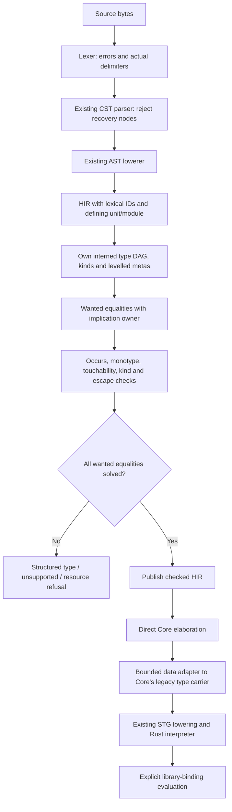

<!-- For God so loved the world, that he gave his only begotten Son, that whosoever believeth in him should not perish, but have everlasting life. — John 3:16 (KJV) -->

# Next: checked source to the interpreter

The explicit `--pipeline next` path is separate from legacy inference. Its current S0 vertical handles library modules with monomorphic Bool/Char/list/tuple types, application, variable lambdas, recursive local bindings, annotations and conditionals. Names come from the existing empty lexical name environment and become module-local IDs carrying their defining unit/module. Only wired Bool/Char constructors are introduced by the compiler; there is no standard-class interface catalogue.

The unifier follows GHC 9.14.1's separation between touchability and RHS admission (GHC/Tc/Utils/Unify.hs, checkTyEqRhs and touchabilityTest). It is an initial monotype subset, not a port of the complete solver. The type arena's opaque IDs reject another module's references. Metas retain creation kinds/levels; implication scopes retain parent/level/given-equality ownership. Each equality publishes atomically, failures are sticky, and unresolved inner equalities cannot assign an outer meta across a given-equality boundary.

The aggregate allocation ceiling covers type nodes, meta/rigid records, implication frames and wanted/decomposition records. Equal type nodes share one DAG node. HIR and the temporary Core tree adapter have separate whole-module allocation/depth bounds. The reused parser is not yet a generally bounded parser: actual delimiter depth and the resulting CST depth are checked, but recursion through other syntax remains a parser hardening obligation.

Core still stores the legacy TyChirho data enum. The next adapter constructs that data without invoking legacy inference, unification, desugaring or dictionary rewriting. It counts expanded output nodes so a compact DAG cannot silently become an unbounded tree. The new checker itself has no dependency on legacy typing.

S0 does not yet generalize lets, elaborate data/classes/instances or evidence, process source-library CPP, or validate Main.main's IO contract. Those paths return Unsupported. CLI run/compile on next refuse rather than delegating. The library eval_binding API names its entry explicitly and is not an IO-main or B-run claim. Solver implication primitives are tested, but full source implication production remains S1 work.

The first-slice frozen bucket and unchanged workloads remain authoritative. Passing these S0 controls does not pass B-check/B-run or show that real GHC.Internal classes have compiled. Default CLI behavior remains legacy.

