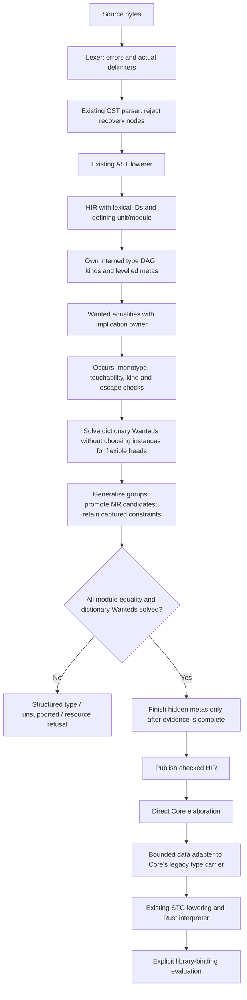

<!-- For God so loved the world, that he gave his only begotten Son, that whosoever believeth in him should not perish, but have everlasting life. — John 3:16 (KJV) -->

# Next: checked source to the interpreter

Implementation scope: isolated `next-pipeline-signatures-chirho` (unit 746), based on `361447d1`. The tasklist records its final source identity and evidence. Main compiler crates remain `04116a69`; this is not a main-source landing or release.

The explicit `--pipeline next` path is separate from legacy inference. The current vertical handles library modules with Bool/Char/list/tuple and ordinary algebraic types, rank-1 written signatures, inferred qualified let-polymorphism, ordinary source classes and ground instances, application, patterned lambdas/function equations, recursive local bindings, annotations, conditionals and cases. Names come from the existing empty lexical name environment and become module-local IDs carrying their defining unit/module. Only wired Bool/Char constructors are introduced by the compiler; user constructors and classes come from their declarations, with no standard-class interface catalogue.

The unifier follows GHC 9.14.1's separation between touchability and RHS admission (GHC/Tc/Utils/Unify.hs, checkTyEqRhs and touchabilityTest). It is an initial monotype subset, not a port of the complete solver. The type arena's opaque IDs reject another module's references. Metas retain creation kinds/levels; implication scopes retain parent/level/given-equality ownership. Each equality publishes atomically, failures are sticky, and unresolved inner equalities cannot assign an outer meta across a given-equality boundary.

The aggregate allocation ceiling covers type nodes, meta/rigid records, implication frames and wanted/decomposition records. Equal type nodes share one DAG node. HIR and the temporary Core tree adapter have separate whole-module allocation/depth bounds. The reused parser is not yet a generally bounded parser: actual delimiter depth and the resulting CST depth are checked, but recursion through other syntax remains a parser hardening obligation.

Core still stores the legacy TyChirho data enum. The next adapter constructs that data without invoking legacy inference, unification, desugaring or dictionary rewriting. It counts expanded output nodes so a compact DAG cannot silently become an unbounded tree. The new checker itself has no dependency on legacy typing.

The current path does not yet process source-library CPP or validate Main.main's IO contract. Those paths return Unsupported. Source classes currently have one Type-kinded parameter, ordinary methods and nullary ground instance heads. Superclasses, context/applied/flexible instances, defaults/defaulting and SCC exports needing impedance matching remain Unsupported. Ordinary data currently has Type-kinded parameters and lazy positional fields. Records, GADTs, constructor contexts, deriving, strict fields and higher-kinded data parameters remain Unsupported. Guards, overloaded patterns, explicit lazy/bang patterns and local pattern bindings also remain Unsupported. CLI run/compile on next refuse rather than delegating. The library eval_binding API names its entry explicitly and is not an IO-main or B-run claim. Full source implication production remains S1 work.

The first-slice frozen bucket and unchanged workloads remain authoritative. Passing these S0 controls does not pass B-check/B-run or show that real GHC.Internal classes have compiled. Default CLI behavior remains legacy.

Unit 742 adds identity-based dependency groups, deeper-level inference before generalization, fresh scheme instantiation, explicit Core TyLam/TyApp and final zonking of hidden unquantified metas. See ghc-implementation-map-chirho.md for the exact GHC correspondence and remaining representation differences. Unit 744 extends that boundary with arena-owned class predicates and explicit dictionary evidence; this is still not GHC's full simplifyInfer.

Unit 743 registers every ordinary data header before reading constructor fields. Constructors carry checked schemes and instantiate freshly in expressions and patterns. Case/lambda/equation rows stay in source order; variable and wildcard patterns use lazy aliases, while constructors inspect fields from left to right. Core constructor tags include defining module, declaration ID and role. Shared fallthrough thunks prevent copying the rest of the matrix into every failure branch. Pattern expansion and copied Core types consume the output allocation/depth ceilings. An unmatched demanded value fails in the existing interpreter; it is never replaced by a successful placeholder value.

Unit 744 retains declaration-owned class/method/instance IDs in HIR and the binding's original restriction form. Predicates use the same type DAG and substitution path. The solver writes each evidence solution in its Wanted's scope, even when an ancestor Given solves it. Class-only Givens do not introduce equality untouchability. The Core boundary allocates evidence IDs afresh at each abstraction site, emits dictionary lambdas and owner-local evidence lets, and builds selectors/instance fields in class declaration order. A missing evidence binder is Invalid. STG spine collection erases type wrappers before selecting local application and closure handling, so a captured dictionary is not cached in a static application-head thunk.

Unit 746 adds written rank-1 signatures with Type-kinded variables and variable-headed source-class contexts. Each declaration receives fresh owned skolems and written Givens. It is checked at its real lexical parent and keeps its declared scheme; inference-group closure generalizes only unsigned members. The existing Core abstraction handles the signature scope's type/dictionary parameters and evidence bindings without another dictionary pass.

In the GHC2021/default profile, an explicit leading forall scopes over the RHS. Its HIR binder IDs stay installed while lowering that RHS, and the checker resolves those IDs through its signature-parent chain. An implicit inner signature captures such an outer variable; an explicit inner forall shadows it. An implicit outer signature does not scope its variables over the RHS. Owned skolems block constraint floating, while predicates on outer captures may still float. Class-only Givens leave outer unification touchable.

Higher-rank arguments, compound written contexts, context/applied instances, pattern type signatures and the full extension-override profiles remain Unsupported. In particular, the explicit ScopedTypeVariables pragma is not yet admitted by the restricted profile, although the default GHC2021 leading-forall scoping is implemented. Haskell2010 explicit forall is declined instead of silently enabled. Existing large-module Wanted-scan/re-zonking cost remains an open resource defect.
