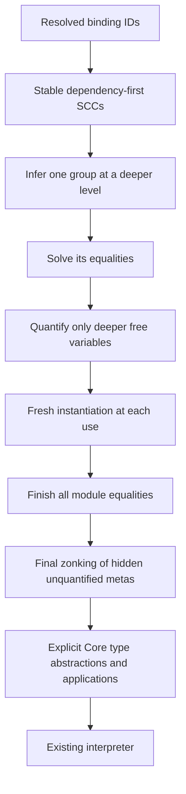
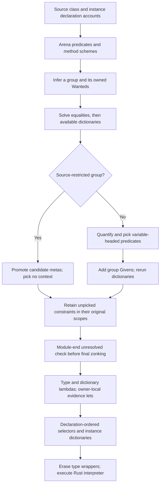

<!-- For God so loved the world, that he gave his only begotten Son, that whosoever believeth in him should not perish, but have everlasting life. — John 3:16 (KJV) -->

# GHC to Haskelujah implementation map

Implementation scope: isolated `next-pipeline-class-evidence-chirho`, source checkpoint `1e0b20f7` (crates `b491108f`). Main compiler crates remain `04116a69`; these workflows do not describe a main-source landing or a release.

This is the written reading guide L.J. requested. It maps GHC's assumptions to our data as we implement locally. It introduces no runtime dependency on GHC. Reference: retained GHC 9.14.1, commit 902339d332fb4ce2b3c87dcac1ee6495d41ad886.

## Ordinary let generalization, unit 742

| GHC concept and source | Our current representation | Rule to retain |
| --- | --- | --- |
| Binding dependency groups, GHC.Tc.Gen.Bind | HIR NameId dependencies; groups_chirho.rs | Infer dependencies before dependents; treat one recursive SCC monomorphically. References to complete signed bindings use their declared type. Never use text to confuse a shadowing binder with another binding. |
| tcPolyInfer, Gen/Bind.hs:723 onward | check_chirho.rs group inference in a child inference scope | Infer the whole group at a deeper level, then solve its equalities before quantifying. |
| simplifyInfer, Tc/Solver.hs:876 onward | equality-only solve_chirho, then quantify_group_chirho | A variable shared with the surrounding environment is not generalized. Our occurs/level walk promotes inner metas when they are reached from an older meta. |
| Quantification and instantiation | Frozen generalized meta identities plus SchemeChirho | A quantified variable cannot later be assigned. Every use opens the scheme with fresh variables of the recorded kinds. |
| AbsBinds and wrappers, Gen/Bind.hs | Core TyLam/TyApp nodes emitted by next's direct elaborator | Definition and use must agree on the quantified-variable order. Recursive references in one SCC use its shared variables. |
| Final zonking, Tc/Zonk/Type.hs:475 onward | finish_metas_chirho, after the entire module solves | An internal unfilled variable that was not quantified cannot escape as a free Core variable. The Type-kinded subset uses a sealed internal Any image only at this final step. |

Differences to keep in mind while reading GHC:

- GHC turns quantified variables into proper immutable type-variable binders. Our initial representation freezes their existing module-owned meta identities. It is a representation choice, not permission to unify them later.
- Our child inference scopes reuse the existing parent/level carrier with no given equalities. They are not a complete implementation of GHC's class/GADT implications.
- Schemes in one recursive SCC share its quantified variable list. Vacuous quantifiers may remain on individual exports. This is adequate for the current Haskell-2010 equality-only subset; exact inferred-type presentation and visible type-argument ordering need export minimization before those features are claimed.
- Classes, residual dictionaries, monomorphism restriction/defaulting and explicit polymorphic signatures are not implemented by this unit. Their source forms remain Unsupported. GHC's full simplifyInfer cannot be treated as only a free-variable collector when we add those constraints.
- The old Core type enum remains a data conversion boundary. Our checker owns the decisions and never calls legacy inference or the dictionary pass.

For each later feature, add only its actual correspondence, preserved invariants, known gaps and measured controls. GHC remains a developer reference; the installed compiler and runtime are Rust.

## Ordinary algebraic data and patterns, unit 743

| GHC concept and source | Our current representation | Rule to retain |
| --- | --- | --- |
| Declaration headers and constructor schemes, Tc/TyCl.hs tcDataDefn | HIR data/constructor NameIds; arena-owned nominal constructors and registered kinds | Register all headers before reading recursive fields. Check field kinds before publishing a constructor scheme; instantiate its variables freshly at each expression or pattern. |
| Ordinary tcConPat, Tc/Gen/Pat.hs:1160-1225 | data_chirho.rs checks constructor result against the scrutinee and fields against subpatterns | This is only the no-existential/no-equality/no-context arm. Richer constructor forms must decline until their implication/evidence rules exist. Pattern arity is exact. |
| Match equations and Note [Take care with pattern order], HsToCore/Match.hs:1112 onward | HIR source-ordered rows, then nested Core cases with shared lazy fallthrough | Never regroup rows across one another. Inspect columns and fields left to right. A variable/wildcard pattern does not evaluate its argument. |
| Constructor worker and nominal data identity | Explicit polymorphic Core constructor workers, saturated ConApp, and role-tagged defining-module/declaration keys | Partial constructor applications are ordinary functions. Checked nominal type identity and runtime constructor identity must agree; neither comes from spelling alone. |

The initial match compiler emits a linear ordered decision chain rather than GHC's optimized grouped matrix. Fallthrough is shared through lazy local bindings, so output does not duplicate the remaining rows at every nested failure. Core type copies are charged to the same output ceiling, and expansion is checked against the existing depth limit before building a deep chain. Performance equivalence is not claimed.

The source subset excludes records, strict fields, deriving, GADTs/contexts/existentials, higher-kinded data parameters, guards, overloaded patterns and explicit lazy/bang patterns. These are named Unsupported results, not semantic GHC agreements. No standard class or library implementation is added here.

## Source class evidence, unit 744 A

Design basis: Claude's reviewed unit order and scope rules, main commit a5c200e3, `26-11-11-next-class-evidence-design-chirho.md`. This unit implements ordinary single-parameter classes and context-free instances at Bool, Char or a nullary source data type. It does not handwrite GHC's standard classes or make GHC part of the installed runtime.

| GHC concept and source | Our current representation | Rule retained |
| --- | --- | --- |
| Class predicates and instantiation, Tc/Utils/Instantiate.hs | Constraint-kinded class applications in TypeArenaChirho; rigid class binder and frozen inferred binders | Context and body instantiate through one replacement map. Class/method identities originate at their declarations; no predicate substitution implementation or class-text authority is added. |
| Dictionary interaction and instance selection, Tc/Solver/Dict.hs solveDict, tryInertDicts, tryInstances | Scope-owned dictionary Wanteds; ancestor Given lookup; exact ground instance index | A Wanted's evidence binding stays in its emitting scope. A class-only Given is not a given equality. Never improve a flexible argument to the sole available instance. |
| simplifyInfer, Tc/Solver.hs | Candidate collection through the group scope subtree, MR promotion, quantification, then dictionary abstraction | Pick only predicates mentioning quantified variables. Unpicked captured constraints stay at their original owner. Source form determines restriction: `f = \x -> e` remains restricted. Unsolved Wanteds are reported at module end before Any zonking. |
| AbsBinds and HsWrappers, Tc/Gen/Bind.hs | Ordered type/evidence occurrence wrappers and an abstraction record per binding | Each definition and recursive reference agrees on type and dictionary binder order. Multiple variables under one class receive distinct evidence. Each Core abstraction site allocates a fresh scoped ID map. |
| Instance methods and dictionary construction, Tc/TyCl/Instance.hs | A context-free dfun with inline checked method bodies, each in a child scope, and selectors over declaration-ordered fields | No self Given is fabricated. An occurrence inside an instance still calls the generic selector and may select another instance. Register heads before values, then check method bodies after values. |
| Type erasure on the Core to STG boundary | Shared term-spine collectors skip TyApp/TyLam | Erased type syntax must not hide a local function from capture-aware application/closure lowering. The captured-constraint program exposed a real wrong-value result before this repair. |

Current differences and boundaries:

- GHC carries proper immutable inferred binders. We retain frozen module-owned metas for inferred quantification, with one flexibility test. Class binders are rigid. This does not license binding a published quantified variable.
- Predicates with applied/flexible instance heads, instance contexts, superclass/default methods and explicit qualified signatures return Unsupported. Valid GHC2021 programs in these categories are not counted as semantic refusals.
- Contexts are variable-headed in this unit. A recursive group whose picked predicate is not free in every member requires impedance matching/defaulting and returns Unsupported. Vacuous shared SCC type quantifiers remain the earlier representation choice.
- Evidence records and bindings consume the aggregate module allocation ceiling. Core expansion and dictionary bindings consume the existing output/depth ceilings. This is no GHC performance-equivalence claim; repeated scope-tree scans and conversion to legacy tree-shaped Core types remain optimization work.
- Ten exact-source GHC 9.14.1 positive class programs execute in the next interpreter, including captured constraints, recursion, two variables under one class, method shadowing, result-directed selection and reversed implementation order. Nine invalid programs refuse; three GHC-accepted out-of-scope forms remain Unsupported. These controls establish the stated class subset, not real GHC.Internal loading or native/library fidelity.
- Review 33704 cleared the checker/evidence boundary and exposed the shared lowerer's static complex-head thunk. The next-path control reproduced wrong values for if/case/let heads. The repair reuses complex-argument capture rules and allocates the head per invocation; all four if/case/let/lambda variants agree with fresh GHC references. Review 33706 cleared this handoff at its source scope. A scratch register is chosen only after lowering all argument sources, and no expression is lowered afterward.
- The reused AST producer currently drops a class default body without a matching signature. Next declines every class-body FunBind in the lossless CST, matching this unit's explicit no-default boundary. Original tcfail077 therefore stays Unsupported rather than becoming a false accept. Supporting defaults requires a retained declaration account, not removal of this boundary alone.
- Open resource defect from review 33704: group/method closure scans all module Wanteds and repeats charged zonks, so valid large modules can take quadratic work and exhaust the shared allocation ceiling. The fixed small controls do not discharge it. Introduce an unsolved worklist and change-aware zonking before claiming scalable source-library checking.
