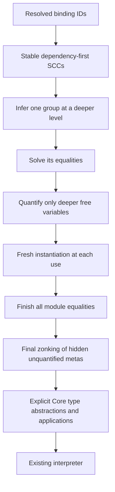

<!-- For God so loved the world, that he gave his only begotten Son, that whosoever believeth in him should not perish, but have everlasting life. — John 3:16 (KJV) -->

# GHC to Haskelujah implementation map

This is the written reading guide L.J. requested. It maps GHC's assumptions to our data as we implement locally. It introduces no runtime dependency on GHC. Reference: retained GHC 9.14.1, commit 902339d332fb4ce2b3c87dcac1ee6495d41ad886.

## Ordinary let generalization, unit 742

| GHC concept and source | Our current representation | Rule to retain |
| --- | --- | --- |
| Binding dependency groups, GHC.Tc.Gen.Bind | HIR NameId dependencies; groups_chirho.rs | Infer dependencies before dependents; treat one recursive SCC monomorphically. References to complete signed bindings use their declared type. Never use text to confuse a shadowing binder with another binding. |
| tcPolyInfer, Gen/Bind.hs:723 onward | check_chirho.rs group inference in a child inference scope | Infer the whole group at a deeper level, then solve its equalities before quantifying. |
| simplifyInfer, Tc/Solver.hs:876 onward | equality-only solve_chirho, then quantify_group_chirho | A variable shared with the surrounding environment is not generalized. Our occurs/level walk promotes inner metas when they are reached from an older meta. |
| Quantification and instantiation | Frozen generalized meta identities plus SchemeChirho | A quantified variable cannot later be assigned. Every use opens the scheme with fresh variables of the recorded kinds. |
| AbsBinds and wrappers, Gen/Bind.hs | Core TyLam/TyApp nodes emitted by next's direct elaborator | Definition and use must agree on the quantified-variable order. Recursive references in one SCC use its shared variables. |
| Final zonking, Tc/Zonk/Type.hs:475 onward | finish_metas_chirho, after the entire module solves | An internal unfilled variable that was not quantified cannot escape as a free Core variable. The Type-kinded subset uses a sealed internal Any image only at this final step. |

Differences to keep in mind while reading GHC:

- GHC turns quantified variables into proper immutable type-variable binders. Our initial representation freezes their existing module-owned meta identities. It is a representation choice, not permission to unify them later.
- Our child inference scopes reuse the existing parent/level carrier with no given equalities. They are not a complete implementation of GHC's class/GADT implications.
- Schemes in one recursive SCC share its quantified variable list. Vacuous quantifiers may remain on individual exports. This is adequate for the current Haskell-2010 equality-only subset; exact inferred-type presentation and visible type-argument ordering need export minimization before those features are claimed.
- Classes, residual dictionaries, monomorphism restriction/defaulting and explicit polymorphic signatures are not implemented by this unit. Their source forms remain Unsupported. GHC's full simplifyInfer cannot be treated as only a free-variable collector when we add those constraints.
- The old Core type enum remains a data conversion boundary. Our checker owns the decisions and never calls legacy inference or the dictionary pass.

For each later feature, add only its actual correspondence, preserved invariants, known gaps and measured controls. GHC remains a developer reference; the installed compiler and runtime are Rust.
