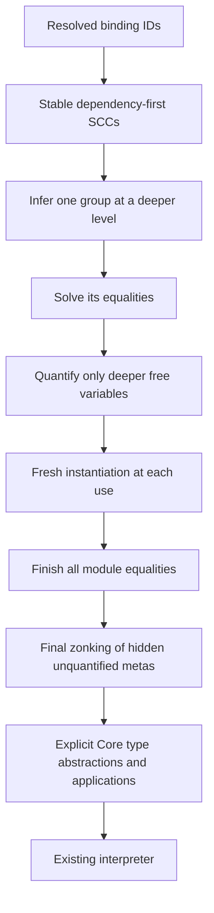
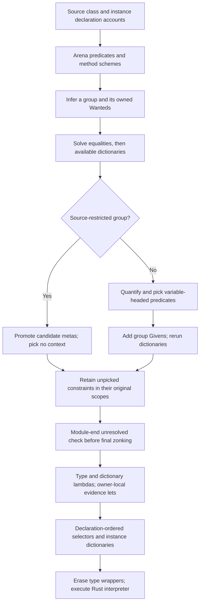
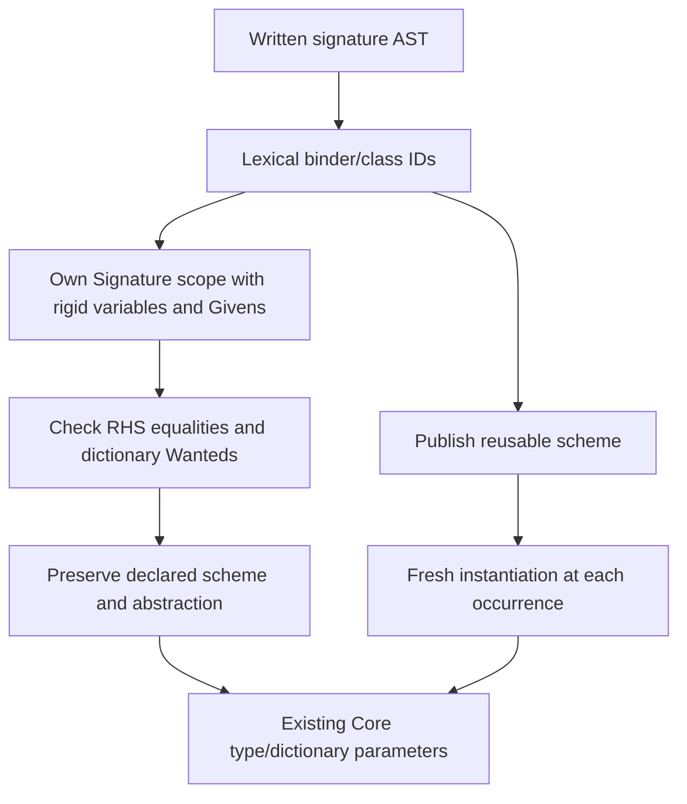
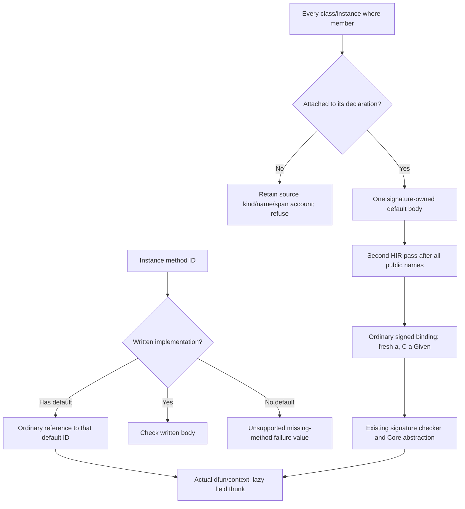

<!-- For God so loved the world, that he gave his only begotten Son, that whosoever believeth in him should not perish, but have everlasting life. — John 3:16 (KJV) -->

# GHC to Haskelujah implementation map

Implementation scope: isolated `next-pipeline-superclasses-chirho` (unit 748), based on `795477ab`. The tasklist records its final source identity and evidence. Main compiler crates remain `04116a69`; this is not a main-source landing or release.

This is the written reading guide L.J. requested. It maps GHC's assumptions to our data as we implement locally. It introduces no runtime dependency on GHC. Reference: retained GHC 9.14.1, commit 902339d332fb4ce2b3c87dcac1ee6495d41ad886.

## Ordinary let generalization, unit 742

| GHC concept and source | Our current representation | Rule to retain |
| --- | --- | --- |
| Binding dependency groups, GHC.Tc.Gen.Bind | HIR NameId dependencies; groups_chirho.rs | Infer dependencies before dependents; treat one recursive SCC monomorphically. References to complete signed bindings use their declared type. Never use text to confuse a shadowing binder with another binding. |
| tcPolyInfer, Gen/Bind.hs:723 onward | check_chirho.rs group inference in a child inference scope | Infer the whole group at a deeper level, then solve its equalities before quantifying. |
| simplifyInfer, Tc/Solver.hs:876 onward | equality-only solve_chirho, then quantify_group_chirho | A variable shared with the surrounding environment is not generalized. Our occurs/level walk promotes inner metas when they are reached from an older meta. |
| Quantification and instantiation | Frozen generalized meta identities plus SchemeChirho | A quantified variable cannot later be assigned. Every use opens the scheme with fresh variables of the recorded kinds. |
| AbsBinds and wrappers, Gen/Bind.hs | Core TyLam/TyApp nodes emitted by next's direct elaborator | Definition and use must agree on the quantified-variable order. Recursive references in one SCC use its shared variables. |
| Final zonking, Tc/Zonk/Type.hs:475 onward | finish_metas_chirho, after the entire module solves | An internal unfilled variable that was not quantified cannot escape as a free Core variable. The Type-kinded subset uses a sealed internal Any image only at this final step. |

Differences to keep in mind while reading GHC:

- GHC turns quantified variables into proper immutable type-variable binders. Our initial representation freezes their existing module-owned meta identities. It is a representation choice, not permission to unify them later.
- Our child inference scopes reuse the existing parent/level carrier with no given equalities. They are not a complete implementation of GHC's class/GADT implications.
- Schemes in one recursive SCC share its quantified variable list. Vacuous quantifiers may remain on individual exports. This is adequate for the current Haskell-2010 equality-only subset; exact inferred-type presentation and visible type-argument ordering need export minimization before those features are claimed.
- Classes, residual dictionaries, monomorphism restriction/defaulting and explicit polymorphic signatures are not implemented by this unit. Their source forms remain Unsupported. GHC's full simplifyInfer cannot be treated as only a free-variable collector when we add those constraints.
- The old Core type enum remains a data conversion boundary. Our checker owns the decisions and never calls legacy inference or the dictionary pass.

For each later feature, add only its actual correspondence, preserved invariants, known gaps and measured controls. GHC remains a developer reference; the installed compiler and runtime are Rust.

## Ordinary algebraic data and patterns, unit 743

| GHC concept and source | Our current representation | Rule to retain |
| --- | --- | --- |
| Declaration headers and constructor schemes, Tc/TyCl.hs tcDataDefn | HIR data/constructor NameIds; arena-owned nominal constructors and registered kinds | Register all headers before reading recursive fields. Check field kinds before publishing a constructor scheme; instantiate its variables freshly at each expression or pattern. |
| Ordinary tcConPat, Tc/Gen/Pat.hs:1160-1225 | data_chirho.rs checks constructor result against the scrutinee and fields against subpatterns | This is only the no-existential/no-equality/no-context arm. Richer constructor forms must decline until their implication/evidence rules exist. Pattern arity is exact. |
| Match equations and Note [Take care with pattern order], HsToCore/Match.hs:1112 onward | HIR source-ordered rows, then nested Core cases with shared lazy fallthrough | Never regroup rows across one another. Inspect columns and fields left to right. A variable/wildcard pattern does not evaluate its argument. |
| Constructor worker and nominal data identity | Explicit polymorphic Core constructor workers, saturated ConApp, and role-tagged defining-module/declaration keys | Partial constructor applications are ordinary functions. Checked nominal type identity and runtime constructor identity must agree; neither comes from spelling alone. |

The initial match compiler emits a linear ordered decision chain rather than GHC's optimized grouped matrix. Fallthrough is shared through lazy local bindings, so output does not duplicate the remaining rows at every nested failure. Core type copies are charged to the same output ceiling, and expansion is checked against the existing depth limit before building a deep chain. Performance equivalence is not claimed.

The source subset excludes records, strict fields, deriving, GADTs/contexts/existentials, higher-kinded data parameters, guards, overloaded patterns and explicit lazy/bang patterns. These are named Unsupported results, not semantic GHC agreements. No standard class or library implementation is added here.

## Source class evidence, unit 744 A

Design basis: Claude's reviewed unit order and scope rules, main commit a5c200e3, `26-11-11-next-class-evidence-design-chirho.md`. This unit implements ordinary single-parameter classes and context-free instances at Bool, Char or a nullary source data type. It does not handwrite GHC's standard classes or make GHC part of the installed runtime.

| GHC concept and source | Our current representation | Rule retained |
| --- | --- | --- |
| Class predicates and instantiation, Tc/Utils/Instantiate.hs | Constraint-kinded class applications in TypeArenaChirho; rigid class binder and frozen inferred binders | Context and body instantiate through one replacement map. Class/method identities originate at their declarations; no predicate substitution implementation or class-text authority is added. |
| Dictionary interaction and instance selection, Tc/Solver/Dict.hs solveDict, tryInertDicts, tryInstances | Scope-owned dictionary Wanteds; ancestor Given lookup; exact ground instance index | A Wanted's evidence binding stays in its emitting scope. A class-only Given is not a given equality. Never improve a flexible argument to the sole available instance. |
| simplifyInfer, Tc/Solver.hs | Candidate collection through the group scope subtree, MR promotion, quantification, then dictionary abstraction | Pick only predicates mentioning quantified variables. Unpicked captured constraints stay at their original owner. Source form determines restriction: `f = \x -> e` remains restricted. Unsolved Wanteds are reported at module end before Any zonking. |
| AbsBinds and HsWrappers, Tc/Gen/Bind.hs | Ordered type/evidence occurrence wrappers and an abstraction record per binding | Each definition and recursive reference agrees on type and dictionary binder order. Multiple variables under one class receive distinct evidence. Each Core abstraction site allocates a fresh scoped ID map. |
| Instance methods and dictionary construction, Tc/TyCl/Instance.hs | A context-free dfun with inline checked method bodies, each in a child scope, and selectors over declaration-ordered fields | No self Given is fabricated. An occurrence inside an instance still calls the generic selector and may select another instance. Register heads before values, then check method bodies after values. |
| Type erasure on the Core to STG boundary | Shared term-spine collectors skip TyApp/TyLam | Erased type syntax must not hide a local function from capture-aware application/closure lowering. The captured-constraint program exposed a real wrong-value result before this repair. |

Current differences and boundaries:

- GHC carries proper immutable inferred binders. We retain frozen module-owned metas for inferred quantification, with one flexibility test. Class binders are rigid. This does not license binding a published quantified variable.
- Predicates with applied/flexible instance heads, instance contexts, superclass/default methods and explicit qualified signatures return Unsupported. Valid GHC2021 programs in these categories are not counted as semantic refusals.
- Contexts are variable-headed in this unit. A recursive group whose picked predicate is not free in every member requires impedance matching/defaulting and returns Unsupported. Vacuous shared SCC type quantifiers remain the earlier representation choice.
- Evidence records and bindings consume the aggregate module allocation ceiling. Core expansion and dictionary bindings consume the existing output/depth ceilings. This is no GHC performance-equivalence claim; repeated scope-tree scans and conversion to legacy tree-shaped Core types remain optimization work.
- Ten exact-source GHC 9.14.1 positive class programs execute in the next interpreter, including captured constraints, recursion, two variables under one class, method shadowing, result-directed selection and reversed implementation order. Nine invalid programs refuse; three GHC-accepted out-of-scope forms remain Unsupported. These controls establish the stated class subset, not real GHC.Internal loading or native/library fidelity.
- Review 33704 cleared the checker/evidence boundary and exposed the shared lowerer's static complex-head thunk. The next-path control reproduced wrong values for if/case/let heads. The repair reuses complex-argument capture rules and allocates the head per invocation; all four if/case/let/lambda variants agree with fresh GHC references. Review 33706 cleared this handoff at its source scope. A scratch register is chosen only after lowering all argument sources, and no expression is lowered afterward.
- The reused AST producer currently drops a class default body without a matching signature. Next declines every class-body FunBind in the lossless CST, matching this unit's explicit no-default boundary. Original tcfail077 therefore stays Unsupported rather than becoming a false accept. Supporting defaults requires a retained declaration account, not removal of this boundary alone.
- Open resource defect from review 33704: group/method closure scans all module Wanteds and repeats charged zonks, so valid large modules can take quadratic work and exhaust the shared allocation ceiling. The fixed small controls do not discharge it. Introduce an unsolved worklist and change-aware zonking before claiming scalable source-library checking.

## Written rank-1 signatures, unit 746

Reference: GHC 9.14.1 `Tc/Gen/Bind.hs:565-630` (`tcPolyCheck`) and `Tc/Utils/Unify.hs:315-420` (`tcSkolemiseCompleteSig` and its scoping notes), retained at commit 902339d3.

| GHC operation | Local carrier and decision |
| --- | --- |
| Make a complete signature available before checking dependent bodies | HIR SurfaceSignatureChirho retains binder/class IDs. The checker publishes its scheme before dependency inference. Every occurrence instantiates with the existing arena substitution. |
| Skolemize, install written Givens, check the definition | One Signature scope at the actual lexical parent owns fresh rigid variables and dictionary Givens. Its type-variable map is keyed by HIR IDs, never text. Equalities check the RHS against the declared body; missing dictionaries are not silently generalized. |
| Scope explicit forall variables over the RHS | HIR keeps that declaration's type scope around its own RHS. Ordinary implicit variables have already gone out of scope. Captured scoped variables are constants in an inner signature; an inner explicit binder shadows with a fresh ID. |
| Infer unsigned bindings separately from complete signatures | Group closure preserves signed schemes and abstractions. Only unsigned members contribute to inferred generalization. Scope-owned skolems prevent floating a predicate that depends on an inner signature variable. |
| Emit wrappers at definition and use | Existing type/evidence wrapper steps and Core abstractions are reused. No production Core or legacy dictionary rewriting change is needed for this unit. |

Measured controls include explicit/implicit forall, two classes with distinct dictionary order, recursion, outer capture, scoped annotation, implicit capture of an outer forall and explicit shadowing. Twelve positives execute against GHC's exact-source outputs; seven invalid programs refuse, including too-general declarations, rigid specialization, wrong Givens, ambiguity and escape. Three GHC-valid but unimplemented forms remain Unsupported. The default-profile scoping counterexample was found during solo source/behavior review; no peer review is claimed while Claude is closed.

The accepted source subset has one leading explicit forall, Type-kinded binders and contexts on type variables. Richer signatures, class/instance extensions, numeric defaulting, interfaces and source-library/native gates remain separate. The existing quadratic Wanted scans/repeated charged zonks remain open; this is not scalable library acceptance.

## Constructor-context instances, unit 747 B

Reference: retained GHC 9.14.1 `Tc/Instance/Class.hs:169-228`, `matchInstEnv` and `match_one`. GHC obtains a unique admissible instance match, instantiates its dfun type to get the context, and constructs `evDFunApp` from type/evidence arguments. Our restricted head rule gives uniqueness without implementing GHC's overlap/potential-unifier rules.

| GHC operation | Local carrier and invariant |
| --- | --- |
| Instance binder and context registration | HIR instance binder/class IDs; rigid binders and ordered Givens in an owned Instance scope. Method scopes are children, and the expected method body substitutes the class variable with that instance's head. No self dictionary is assumed. |
| Match a known constructor without filling a Wanted | class_chirho/instance_matching_chirho.rs uses a class/constructor index and a one-way binder-to-argument map. A flexible head never selects an instance. Applied arguments may remain flexible because the constructor already fixes the unique match. |
| Instantiate dfun context and emit Wanteds | One arena substitution is used for the head and all context predicates. Children stay at the emitting Wanted's scope; each context argument is a strict head subterm. New work consumes the existing aggregate ceiling and is processed in the same pass. |
| Publish evidence and elaborate dfuns | The checker validates arity, kinds, predicate/order and lexical authority. Core emits type lambdas then context dictionary lambdas, with class-ordered method fields. Applications use that exact order. |

Eleven GHC 9.14.1 positive programs execute through our Core/STG interpreter, including nested boxes/lists, recursion at the same instance head, distinct classes, reversed context order, local capture, scoped instance annotations, tuple dictionaries, inferred/signed compound use and unconstrained phantom parameters. Six invalid programs refuse for missing/wrong contexts, absent leaves, duplicate constructor heads or rigid method specialization. Three GHC-accepted richer forms stay Unsupported. A Haskell2010 twin rejects under GHC and stays Unsupported locally rather than gaining GHC2021 scoping. Authority and growth controls reject a wrong-predicate/child-scope dictionary before publication and retain a sticky resource failure on bounded context expansion.

The TC class/evidence/matching files now share class_chirho/; this is a placement change to keep the TC source root below 15 entries. There is no legacy dictionary pass, source-library interface, standard-class catalogue or GHC installation dependency. This unit does not discharge the existing quadratic module-wide rescan/zonk limitation.

## Superclass evidence, unit 748 C1

Design review: Claude2 #33803, retained under canonical tmp-chirho/next-class-c-review-chirho/. This corrects section 6 of the adopted design: a derived superclass dictionary belongs to its root Given's owner as a definition, while the original Wanted keeps its own alias binding. It is not another caller parameter.

| GHC source and invariant | Local implementation |
| --- | --- |
| Tc/Solver/Dict.hs:1763-1800 expands Givens at the level where they are bound | A visited-class BFS finds the needed path. A per-scope predicate index reuses validated derived definitions. The Given parameter vector stays unchanged, and a descendant Wanted aliases the owner's definition. The subset uses on-demand rather than eager closure to avoid allocating unused dictionary thunks. |
| Tc/TyCl/Instance.hs:1588-1628, the superclass invariant | A derived record accepts only a checked projection from an earlier parameter/derived Given in the same scope. Solved Wanted evidence is prohibited as a source. Instance superclass fields are naked Wanteds; their context subgoals are strict subterms and may use context-derived Givens. No self Given is fabricated. |
| classAllSelIds orders superclass fields before methods | dictionary_fields_chirho is the shared declaration-ordered layout. HIR supplies hidden superclass selector identities. Core emits each selector and its dfun fields from that layout, and checks arity. |
| Acyclic superclass graph and mkMinimalBySCs | Graph checking happens after all class records register, before Givens. Search visits each class once per path lookup. Context minimization groups predicates by argument and drops transitive ancestors; it does not compare unrelated arguments pairwise. Written contexts remain exact. |

The model keeps three evidence roles: caller parameter, Wanted binding, and derived superclass definition. Derived records cannot disguise aliases/dfuns as Givens. Their projection source must already be validated, and index order prevents cycles. Class-only Givens still carry no equality authority. Every new traversal and stored evidence consumes the existing module ceiling; the pre-existing module-wide Wanted rescan/re-zonk limitation remains open.

Ten exact GHC 9.14.1 positive programs execute through the Rust interpreter, including reversed superclass order, distinct methods, transitive and diamond paths, ancestor capture, inferred minimal context, exact written contexts, distinct Bool/Char arguments, method-scope projections and context-derived instance superclasses. Five invalid programs refuse, including absent superclass dictionaries, wrong direction, missing context and two cycle shapes. A compound superclass accepted by GHC stays Unsupported. TC controls prove derived evidence is reusable at the root owner without extra parameters and that even solved Wanted evidence cannot be relabelled as a Given. Default methods remain the next producer/checking step; no standard library or runtime dependency on GHC is introduced.

The Given argument index is a module-local prefilter, populated from normalized parameter arguments. A stable absent argument skips both direct and superclass walks; no superclass edge also skips the latter. A mutable low-level Given disables the argument filter monotonically, preserving later unification. Actual ancestor visits are charged in both walks. Controls distinguish the cheap absent-argument case from a deep matching search that exhausts its allowance, and verify that a mutable Given still resolves after unification. The checked graph and argument identities are immutable within this source subset; future equality/family/incremental producers must preserve that cache premise.

Claude2's bounded source review (#33809, #33813, final gate confirmation #33817) found no wrong-evidence or ownership path. Its growth finding and missing-filter finding were corrected and measured with the controls above. Source review did not independently execute gates; its named unread areas remain in the retained note. The current naked-superclass tripwire is valid only for bare-variable instance contexts. Before unit F admits compound contexts it must be replaced by GHC's sc1/sc2 conditions, including permission for a direct parameter Given. Default methods remain the next measured unit.

## Source default methods, unit 749 C2

Architecture: Claude2 #33906, source-only reasoning retained in tmp-chirho/next-default-methods-749-chirho/review-chirho/. The implementation reuses complete signed bindings instead of adding a default-checking phase or evidence form. GHC references are the retained 9.14.1 source at 902339d3; GHC is a developer oracle, not a product runtime dependency.

| GHC operation | Local carrier and invariant |
| --- | --- |
| Rename/Bind.hs rejects unmatched/repeated methods and pattern bindings in class/instance bodies | The shared where-walk retains an unattached-member account at every skip/stop, including members after the legacy layout stop. Signature pairing moves each valid default body into its own ClassMethod once. Unknown or separated duplicate defaults leave accounts instead of overwriting/disappearing. Next requires an empty account; known invalid forms are Invalid, unimplemented forms Unsupported. |
| Tc/TyCl/Class.hs checks a vanilla default once with its class dictionary | Each method record carries the hidden binding ID. A second HIR pass, after all public selectors/top-level names exist, creates an ordinary signed binding with a fresh parameter and C a Given. Unit 746 publishes/checks that signature at an owned scope. Every default is checked, including unused or overridden ones. |
| Rename/Bind.hs scopes class variables over a default body | The fresh HIR class variable stays installed over the RHS in GHC2021, without requiring a written forall. Haskell2010 removes it. Local implicit signatures capture that binder; ordinary signature rules remain unchanged. |
| Tc/TyCl/Instance.hs fills an omitted method with its default | HIR chooses written implementations first by the class's method ID. Otherwise its private method body references that record's default ID. No consumer scans a hidden name prefix. Ordinary instantiation/equality/instance selection supplies the actual dfun and its context. |
| Dictionary fields are lazy, and only instance context is Given | Existing Core/STG application thunks capture dfun parameters without forcing fields. No self Given is installed; declared superclass obligations must close independently. Mutually defaulted selectors dispatch through the actual instance. Dictionary sharing is a later optimisation, never a solver privilege. |

Controls cover distinct Bool/Char dictionaries, explicit override precedence, mutual defaults, unused bottom defaults, superclass selection, nested constructor contexts, a default selecting another instance type, later class/value names, adjacent equations, scoped local signatures and a non-function default. Invalid generic defaults are checked even when all instances override them; missing unrelated Givens and a missing superclass never borrow self evidence. Class/instance tuple-pattern controls were ACCEPTed by the frozen unit-748 CLI; GHC 9.14.1 rejects both with GHC-69248. The producer-account repair refuses both.

The DefaultSignatures pragma can reach declaration validation, but an actual default signature remains Unsupported. Missing methods without defaults also stay Unsupported, matching GHC's valid-but-warning case rather than inventing a type refusal. MINIMAL and unclassified members, method-owned polymorphism, numeric defaulting, source interfaces/libraries and native/B-run gates remain outside this unit. Contextual defaults may rebuild a dictionary per recursive call; sharing and the existing quadratic Wanted rescans/zonks remain resource work.
