<!-- For God so loved the world, that he gave his only begotten Son, that whosoever believeth in him should not perish, but have everlasting life. — John 3:16 (KJV) -->

# GHC to Haskelujah implementation map

Implementation scope: isolated `next-pipeline-source-synonyms-chirho` (unit 759), extending the unit 758 checkpoint `e5c34c1d`. The tasklist records its final source identity and evidence. Main compiler crates remain `04116a69`; this is not a main-source landing or release. Earlier sections describe their named increments; later sections supersede earlier Unsupported boundaries.

This is the written reading guide L.J. requested. It maps GHC's assumptions to our data as we implement locally. It introduces no runtime dependency on GHC. Reference: retained GHC 9.14.1, commit 902339d332fb4ce2b3c87dcac1ee6495d41ad886.

## Ordinary let generalization, unit 742

| GHC concept and source | Our current representation | Rule to retain |
| --- | --- | --- |
| Binding dependency groups, GHC.Tc.Gen.Bind | HIR NameId dependencies; groups_chirho.rs | Infer dependencies before dependents; treat one recursive SCC monomorphically. References to complete signed bindings use their declared type. Never use text to confuse a shadowing binder with another binding. |
| tcPolyInfer, Gen/Bind.hs:723 onward | check_chirho.rs group inference in a child inference scope | Infer the whole group at a deeper level, then solve its equalities before quantifying. |
| simplifyInfer, Tc/Solver.hs:876 onward | equality-only solve_chirho, then quantify_group_chirho | A variable shared with the surrounding environment is not generalized. Our occurs/level walk promotes inner metas when they are reached from an older meta. |
| Quantification and instantiation | Frozen generalized meta identities plus SchemeChirho | A quantified variable cannot later be assigned. Every use opens the scheme with fresh variables of the recorded kinds. |
| AbsBinds and wrappers, Gen/Bind.hs | Core TyLam/TyApp nodes emitted by next's direct elaborator | Definition and use must agree on the quantified-variable order. Recursive references in one SCC use its shared variables. |
| Final zonking, Tc/Zonk/Type.hs:475 onward | finish_metas_chirho, after the entire module solves | An internal unfilled variable that was not quantified cannot escape as a free Core variable. The Type-kinded subset uses a sealed internal Any image only at this final step. |

Differences to keep in mind while reading GHC:

- GHC turns quantified variables into proper immutable type-variable binders. Our initial representation freezes their existing module-owned meta identities. It is a representation choice, not permission to unify them later.
- Our child inference scopes reuse the existing parent/level carrier with no given equalities. They are not a complete implementation of GHC's class/GADT implications.
- Schemes in one recursive SCC share its quantified variable list. Vacuous quantifiers may remain on individual exports. This is adequate for the current Haskell-2010 equality-only subset; exact inferred-type presentation and visible type-argument ordering need export minimization before those features are claimed.
- Classes, residual dictionaries, monomorphism restriction/defaulting and explicit polymorphic signatures are not implemented by this unit. Their source forms remain Unsupported. GHC's full simplifyInfer cannot be treated as only a free-variable collector when we add those constraints.
- The old Core type enum remains a data conversion boundary. Our checker owns the decisions and never calls legacy inference or the dictionary pass.

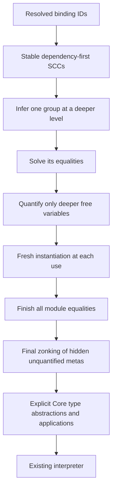

For each later feature, add only its actual correspondence, preserved invariants, known gaps and measured controls. GHC remains a developer reference; the installed compiler and runtime are Rust.

## Ordinary algebraic data and patterns, unit 743

| GHC concept and source | Our current representation | Rule to retain |
| --- | --- | --- |
| Declaration headers and constructor schemes, Tc/TyCl.hs tcDataDefn | HIR data/constructor NameIds; arena-owned nominal constructors and registered kinds | Register all headers before reading recursive fields. Check field kinds before publishing a constructor scheme; instantiate its variables freshly at each expression or pattern. |
| Ordinary tcConPat, Tc/Gen/Pat.hs:1160-1225 | data_chirho.rs checks constructor result against the scrutinee and fields against subpatterns | This is only the no-existential/no-equality/no-context arm. Richer constructor forms must decline until their implication/evidence rules exist. Pattern arity is exact. |
| Match equations and Note [Take care with pattern order], HsToCore/Match.hs:1112 onward | HIR source-ordered rows, then nested Core cases with shared lazy fallthrough | Never regroup rows across one another. Inspect columns and fields left to right. A variable/wildcard pattern does not evaluate its argument. |
| Constructor worker and nominal data identity | Explicit polymorphic Core constructor workers, saturated ConApp, and role-tagged defining-module/declaration keys | Partial constructor applications are ordinary functions. Checked nominal type identity and runtime constructor identity must agree; neither comes from spelling alone. |

The initial match compiler emits a linear ordered decision chain rather than GHC's optimized grouped matrix. Fallthrough is shared through lazy local bindings, so output does not duplicate the remaining rows at every nested failure. Core type copies are charged to the same output ceiling, and expansion is checked against the existing depth limit before building a deep chain. Performance equivalence is not claimed.

The source subset excludes records, strict fields, deriving, GADTs/contexts/existentials, higher-kinded data parameters, guards, overloaded patterns and explicit lazy/bang patterns. These are named Unsupported results, not semantic GHC agreements. No standard class or library implementation is added here.

## Source class evidence, unit 744 A

Design basis: Claude's reviewed unit order and scope rules, main commit a5c200e3, `26-11-11-next-class-evidence-design-chirho.md`. This unit implements ordinary single-parameter classes and context-free instances at Bool, Char or a nullary source data type. It does not handwrite GHC's standard classes or make GHC part of the installed runtime.

| GHC concept and source | Our current representation | Rule retained |
| --- | --- | --- |
| Class predicates and instantiation, Tc/Utils/Instantiate.hs | Constraint-kinded class applications in TypeArenaChirho; rigid class binder and frozen inferred binders | Context and body instantiate through one replacement map. Class/method identities originate at their declarations; no predicate substitution implementation or class-text authority is added. |
| Dictionary interaction and instance selection, Tc/Solver/Dict.hs solveDict, tryInertDicts, tryInstances | Scope-owned dictionary Wanteds; ancestor Given lookup; exact ground instance index | A Wanted's evidence binding stays in its emitting scope. A class-only Given is not a given equality. Never improve a flexible argument to the sole available instance. |
| simplifyInfer, Tc/Solver.hs | Candidate collection through the group scope subtree, MR promotion, quantification, then dictionary abstraction | Pick only predicates mentioning quantified variables. Unpicked captured constraints stay at their original owner. Source form determines restriction: `f = \x -> e` remains restricted. Unsolved Wanteds are reported at module end before Any zonking. |
| AbsBinds and HsWrappers, Tc/Gen/Bind.hs | Ordered type/evidence occurrence wrappers and an abstraction record per binding | Each definition and recursive reference agrees on type and dictionary binder order. Multiple variables under one class receive distinct evidence. Each Core abstraction site allocates a fresh scoped ID map. |
| Instance methods and dictionary construction, Tc/TyCl/Instance.hs | A context-free dfun with inline checked method bodies, each in a child scope, and selectors over declaration-ordered fields | No self Given is fabricated. An occurrence inside an instance still calls the generic selector and may select another instance. Register heads before values, then check method bodies after values. |
| Type erasure on the Core to STG boundary | Shared term-spine collectors skip TyApp/TyLam | Erased type syntax must not hide a local function from capture-aware application/closure lowering. The captured-constraint program exposed a real wrong-value result before this repair. |

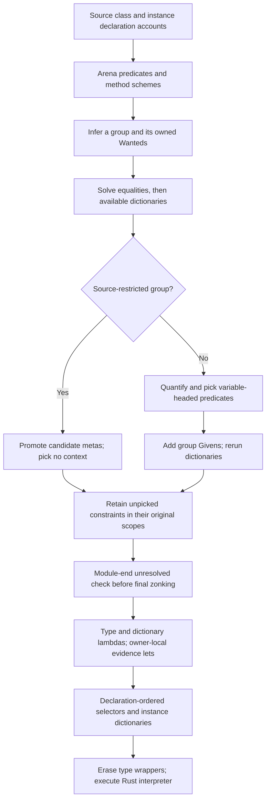

Current differences and boundaries:

- GHC carries proper immutable inferred binders. We retain frozen module-owned metas for inferred quantification, with one flexibility test. Class binders are rigid. This does not license binding a published quantified variable.
- Predicates with applied/flexible instance heads, instance contexts, superclass/default methods and explicit qualified signatures return Unsupported. Valid GHC2021 programs in these categories are not counted as semantic refusals.
- Contexts are variable-headed in this unit. A recursive group whose picked predicate is not free in every member requires impedance matching/defaulting and returns Unsupported. Vacuous shared SCC type quantifiers remain the earlier representation choice.
- Evidence records and bindings consume the aggregate module allocation ceiling. Core expansion and dictionary bindings consume the existing output/depth ceilings. This is no GHC performance-equivalence claim; repeated scope-tree scans and conversion to legacy tree-shaped Core types remain optimization work.
- Ten exact-source GHC 9.14.1 positive class programs execute in the next interpreter, including captured constraints, recursion, two variables under one class, method shadowing, result-directed selection and reversed implementation order. Nine invalid programs refuse; three GHC-accepted out-of-scope forms remain Unsupported. These controls establish the stated class subset, not real GHC.Internal loading or native/library fidelity.
- Review 33704 cleared the checker/evidence boundary and exposed the shared lowerer's static complex-head thunk. The next-path control reproduced wrong values for if/case/let heads. The repair reuses complex-argument capture rules and allocates the head per invocation; all four if/case/let/lambda variants agree with fresh GHC references. Review 33706 cleared this handoff at its source scope. A scratch register is chosen only after lowering all argument sources, and no expression is lowered afterward.
- The reused AST producer currently drops a class default body without a matching signature. Next declines every class-body FunBind in the lossless CST, matching this unit's explicit no-default boundary. Original tcfail077 therefore stays Unsupported rather than becoming a false accept. Supporting defaults requires a retained declaration account, not removal of this boundary alone.
- Open resource defect from review 33704: group/method closure scans all module Wanteds and repeats charged zonks, so valid large modules can take quadratic work and exhaust the shared allocation ceiling. The fixed small controls do not discharge it. Introduce an unsolved worklist and change-aware zonking before claiming scalable source-library checking.

## Written rank-1 signatures, unit 746

Reference: GHC 9.14.1 `Tc/Gen/Bind.hs:565-630` (`tcPolyCheck`) and `Tc/Utils/Unify.hs:315-420` (`tcSkolemiseCompleteSig` and its scoping notes), retained at commit 902339d3.

| GHC operation | Local carrier and decision |
| --- | --- |
| Make a complete signature available before checking dependent bodies | HIR SurfaceSignatureChirho retains binder/class IDs. The checker publishes its scheme before dependency inference. Every occurrence instantiates with the existing arena substitution. |
| Skolemize, install written Givens, check the definition | One Signature scope at the actual lexical parent owns fresh rigid variables and dictionary Givens. Its type-variable map is keyed by HIR IDs, never text. Equalities check the RHS against the declared body; missing dictionaries are not silently generalized. |
| Scope explicit forall variables over the RHS | HIR keeps that declaration's type scope around its own RHS. Ordinary implicit variables have already gone out of scope. Captured scoped variables are constants in an inner signature; an inner explicit binder shadows with a fresh ID. |
| Infer unsigned bindings separately from complete signatures | Group closure preserves signed schemes and abstractions. Only unsigned members contribute to inferred generalization. Scope-owned skolems prevent floating a predicate that depends on an inner signature variable. |
| Emit wrappers at definition and use | Existing type/evidence wrapper steps and Core abstractions are reused. No production Core or legacy dictionary rewriting change is needed for this unit. |

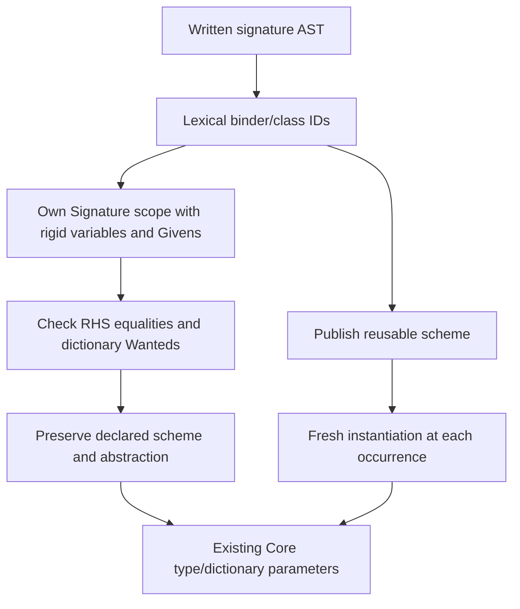

Measured controls include explicit/implicit forall, two classes with distinct dictionary order, recursion, outer capture, scoped annotation, implicit capture of an outer forall and explicit shadowing. Twelve positives execute against GHC's exact-source outputs; seven invalid programs refuse, including too-general declarations, rigid specialization, wrong Givens, ambiguity and escape. Three GHC-valid but unimplemented forms remain Unsupported. The default-profile scoping counterexample was found during solo source/behavior review; no peer review is claimed while Claude is closed.

The accepted source subset has one leading explicit forall, Type-kinded binders and contexts on type variables. Richer signatures, class/instance extensions, numeric defaulting, interfaces and source-library/native gates remain separate. The existing quadratic Wanted scans/repeated charged zonks remain open; this is not scalable library acceptance.

## Constructor-context instances, unit 747 B

Reference: retained GHC 9.14.1 `Tc/Instance/Class.hs:169-228`, `matchInstEnv` and `match_one`. GHC obtains a unique admissible instance match, instantiates its dfun type to get the context, and constructs `evDFunApp` from type/evidence arguments. Our restricted head rule gives uniqueness without implementing GHC's overlap/potential-unifier rules.

| GHC operation | Local carrier and invariant |
| --- | --- |
| Instance binder and context registration | HIR instance binder/class IDs; rigid binders and ordered Givens in an owned Instance scope. Method scopes are children, and the expected method body substitutes the class variable with that instance's head. No self dictionary is assumed. |
| Match a known constructor without filling a Wanted | class_chirho/instance_matching_chirho.rs uses a class/constructor index and a one-way binder-to-argument map. A flexible head never selects an instance. Applied arguments may remain flexible because the constructor already fixes the unique match. |
| Instantiate dfun context and emit Wanteds | One arena substitution is used for the head and all context predicates. Children stay at the emitting Wanted's scope; each context argument is a strict head subterm. New work consumes the existing aggregate ceiling and is processed in the same pass. |
| Publish evidence and elaborate dfuns | The checker validates arity, kinds, predicate/order and lexical authority. Core emits type lambdas then context dictionary lambdas, with class-ordered method fields. Applications use that exact order. |

Eleven GHC 9.14.1 positive programs execute through our Core/STG interpreter, including nested boxes/lists, recursion at the same instance head, distinct classes, reversed context order, local capture, scoped instance annotations, tuple dictionaries, inferred/signed compound use and unconstrained phantom parameters. Six invalid programs refuse for missing/wrong contexts, absent leaves, duplicate constructor heads or rigid method specialization. Three GHC-accepted richer forms stay Unsupported. A Haskell2010 twin rejects under GHC and stays Unsupported locally rather than gaining GHC2021 scoping. Authority and growth controls reject a wrong-predicate/child-scope dictionary before publication and retain a sticky resource failure on bounded context expansion.

The TC class/evidence/matching files now share class_chirho/; this is a placement change to keep the TC source root below 15 entries. There is no legacy dictionary pass, source-library interface, standard-class catalogue or GHC installation dependency. This unit does not discharge the existing quadratic module-wide rescan/zonk limitation.

## Superclass evidence, unit 748 C1

Design review: Claude2 #33803, retained under canonical tmp-chirho/next-class-c-review-chirho/. This corrects section 6 of the adopted design: a derived superclass dictionary belongs to its root Given's owner as a definition, while the original Wanted keeps its own alias binding. It is not another caller parameter.

| GHC source and invariant | Local implementation |
| --- | --- |
| Tc/Solver/Dict.hs:1763-1800 expands Givens at the level where they are bound | A visited-class BFS finds the needed path. A per-scope predicate index reuses validated derived definitions. The Given parameter vector stays unchanged, and a descendant Wanted aliases the owner's definition. The subset uses on-demand rather than eager closure to avoid allocating unused dictionary thunks. |
| Tc/TyCl/Instance.hs:1588-1628, the superclass invariant | A derived record accepts only a checked projection from an earlier parameter/derived Given in the same scope. Solved Wanted evidence is prohibited as a source. Instance superclass fields are naked Wanteds; their context subgoals are strict subterms and may use context-derived Givens. No self Given is fabricated. |
| classAllSelIds orders superclass fields before methods | dictionary_fields_chirho is the shared declaration-ordered layout. HIR supplies hidden superclass selector identities. Core emits each selector and its dfun fields from that layout, and checks arity. |
| Acyclic superclass graph and mkMinimalBySCs | Graph checking happens after all class records register, before Givens. Search visits each class once per path lookup. Context minimization groups predicates by argument and drops transitive ancestors; it does not compare unrelated arguments pairwise. Written contexts remain exact. |

The model keeps three evidence roles: caller parameter, Wanted binding, and derived superclass definition. Derived records cannot disguise aliases/dfuns as Givens. Their projection source must already be validated, and index order prevents cycles. Class-only Givens still carry no equality authority. Every new traversal and stored evidence consumes the existing module ceiling; the pre-existing module-wide Wanted rescan/re-zonk limitation remains open.

Ten exact GHC 9.14.1 positive programs execute through the Rust interpreter, including reversed superclass order, distinct methods, transitive and diamond paths, ancestor capture, inferred minimal context, exact written contexts, distinct Bool/Char arguments, method-scope projections and context-derived instance superclasses. Five invalid programs refuse, including absent superclass dictionaries, wrong direction, missing context and two cycle shapes. A compound superclass accepted by GHC stays Unsupported. TC controls prove derived evidence is reusable at the root owner without extra parameters and that even solved Wanted evidence cannot be relabelled as a Given. Default methods remain the next producer/checking step; no standard library or runtime dependency on GHC is introduced.

The Given argument index is a module-local prefilter, populated from normalized parameter arguments. A stable absent argument skips both direct and superclass walks; no superclass edge also skips the latter. A mutable low-level Given disables the argument filter monotonically, preserving later unification. Actual ancestor visits are charged in both walks. Controls distinguish the cheap absent-argument case from a deep matching search that exhausts its allowance, and verify that a mutable Given still resolves after unification. The checked graph and argument identities are immutable within this source subset; future equality/family/incremental producers must preserve that cache premise.

Claude2's bounded source review (#33809, #33813, final gate confirmation #33817) found no wrong-evidence or ownership path. Its growth finding and missing-filter finding were corrected and measured with the controls above. Source review did not independently execute gates; its named unread areas remain in the retained note. The current naked-superclass tripwire is valid only for bare-variable instance contexts. Before unit F admits compound contexts it must be replaced by GHC's sc1/sc2 conditions, including permission for a direct parameter Given. Default methods remain the next measured unit.

## Source default methods, unit 749 C2

Architecture: Claude2 #33906, source-only reasoning retained in tmp-chirho/next-default-methods-749-chirho/review-chirho/. The implementation reuses complete signed bindings instead of adding a default-checking phase or evidence form. GHC references are the retained 9.14.1 source at 902339d3; GHC is a developer oracle, not a product runtime dependency.

| GHC operation | Local carrier and invariant |
| --- | --- |
| Rename/Bind.hs rejects unmatched/repeated methods and pattern bindings in class/instance bodies | The shared where-walk retains an unattached-member account at every skip/stop, including members after the legacy layout stop. Signature pairing moves each valid default body into its own ClassMethod once. Unknown or separated duplicate defaults leave accounts instead of overwriting/disappearing. Next requires an empty account; known invalid forms are Invalid, unimplemented forms Unsupported. |
| Tc/TyCl/Class.hs checks a vanilla default once with its class dictionary | Each method record carries the hidden binding ID. A second HIR pass, after all public selectors/top-level names exist, creates an ordinary signed binding with a fresh parameter and C a Given. Unit 746 publishes/checks that signature at an owned scope. Every default is checked, including unused or overridden ones. |
| Rename/Bind.hs scopes class variables over a default body | The fresh HIR class variable stays installed over the RHS in GHC2021, without requiring a written forall. Haskell2010 removes it. Local implicit signatures capture that binder; ordinary signature rules remain unchanged. |
| Tc/TyCl/Instance.hs fills an omitted method with its default | HIR chooses written implementations first by the class's method ID. Otherwise its private method body references that record's default ID. No consumer scans a hidden name prefix. Ordinary instantiation/equality/instance selection supplies the actual dfun and its context. |
| Dictionary fields are lazy, and only instance context is Given | Existing Core/STG application thunks capture dfun parameters without forcing fields. No self Given is installed; declared superclass obligations must close independently. Mutually defaulted selectors dispatch through the actual instance. Dictionary sharing is a later optimisation, never a solver privilege. |

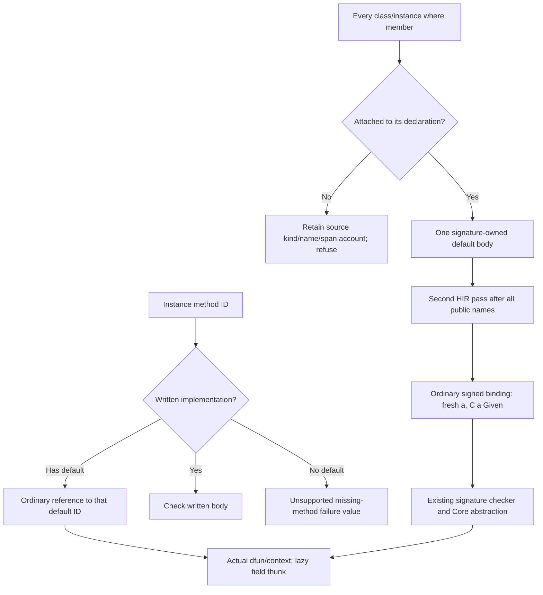

Controls cover distinct Bool/Char dictionaries, explicit override precedence, mutual defaults, unused bottom defaults, superclass selection, nested constructor contexts, a default selecting another instance type, later class/value names, adjacent equations, scoped local signatures and a non-function default. Invalid generic defaults are checked even when all instances override them; missing unrelated Givens and a missing superclass never borrow self evidence. Class/instance tuple-pattern controls were ACCEPTed by the frozen unit-748 CLI; GHC 9.14.1 rejects both with GHC-69248. The producer-account repair refuses both.

The DefaultSignatures pragma can reach declaration validation, but an actual default signature remains Unsupported. Missing methods without defaults also stay Unsupported, matching GHC's valid-but-warning case rather than inventing a type refusal. MINIMAL and unclassified members, method-owned polymorphism, numeric defaulting, source interfaces/libraries and native/B-run gates remain outside this unit. Contextual defaults may rebuild a dictionary per recursive call; sharing and the existing quadratic Wanted rescans/zonks remain resource work.

## Rebindable exact integral literals, unit 750

Architecture decision: Claude2 #33924, source reading only. Implement rebindable integral expressions before source interfaces; ordinary literals and defaulting follow the real Num declaration. No source review or execution by Claude2 is implied. The reference is GHC 9.14.1 commit 902339d332fb4ce2b3c87dcac1ee6495d41ad886.

| GHC source and rule | Local representation and boundary |
| --- | --- |
| Builtin/Types.hs wires Integer to GHC.Internal.Bignum.Integer | One sealed TC Integer constructor, converted to a compiler-only nominal Core key. A source declaration spelled Integer remains a different type. No bignum constructors are exported. |
| Rename/Pat.hs and Rename/Env.hs resolve fromInteger lexically under RebindableSyntax | The actual AST literal producer records raw token spelling under its fresh OriginId. HIR resolves the conversion at each occurrence and emits an ordinary application to an exact Integer expression. The legacy i64 payload is not read for meaning. |
| Tc/Utils/Instantiate.hs types an overloaded literal as conversion applied to Integer; Tc/Utils/TcMType.hs disables the ordinary shortcut under RS | The existing application checker generates all equalities and user predicates. There is no numeric solver rule or compiler Num scheme. Missing conversion names are Invalid; absent producer payload declines. |
| Driver/Flags.hs disables implicit Prelude under RS; Rename/Env.hs rebinds negate and ifThenElse | No implicit Bool/Char value/type names are seeded on that route. Prefix minus and conditionals use lexical names as ordinary applications. Literal patterns and imported syntax remain Unsupported. |
| Tc/Solver/Default.hs uses trusted standard-class keys | Ordinary literals and defaulting remain Unsupported until source interfaces carry the real class/unit identity. A user class with the same spelling gains no privilege. |

The exact payload is validated after supported-profile/import checks and before TC publication. This order leaves valid MagicHash and Haskell2010 separator/application forms Unsupported. Within the supported profile malformed spelling refuses even when conversion ignores its argument. Prefixes are recognized before separators are removed, and a trailing underscore is invalid. Decimal, binary, octal and hexadecimal payloads share the same bounded conversion. A raw token is limited to 16,384 bytes; retained bytes also consume HIR/Core aggregate allowances. This is a Resource refusal, never narrowing or replacement by zero.

Core emits one internal literal primitive. STG materializes its immutable Arc-backed pure Rust Integer once in the code table; runtime demand shares that value and uses a private opaque box on thunk update. No IS/IP/IN layout, GMP, GHC process or GHC library installation is required by this value representation. The runtime fallback validates and bounds the same payload. The pinned num-bigint 0.5.1 dependency and its num-integer dependency are recorded in the lockfile.

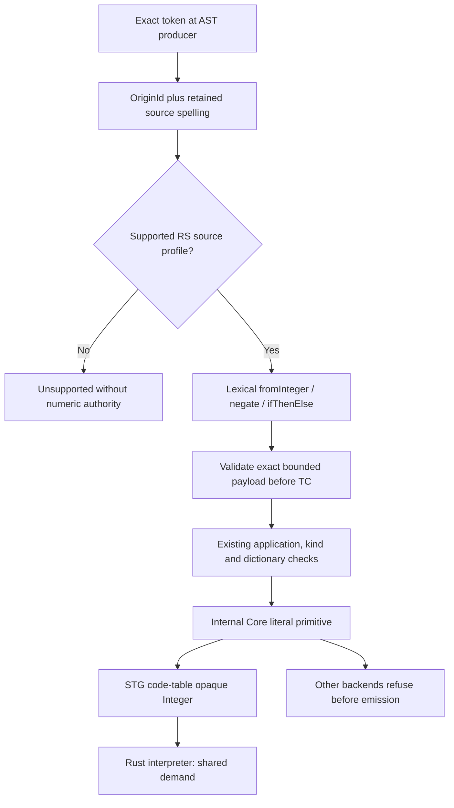

Controls execute values above 128 bits, lexical shadowing/parameters, user negate/ifThenElse, the minimum-word negation edge and repeated demand of a shared tuple field. Wrong input types and a namesake source Integer never publish Core. Measured GHC lexer boundaries include malformed 1_/0_x1, valid repeated/prefix separators and leading zero; two valid unsupported profiles guard verdict classification. Fallible LLVM/Wasm/Cranelift object/JIT APIs and JVM/BEAM prototypes reject the primitive before emission. Legacy nonfallible LLVM/Wasm adapters fail explicitly through their fallible API; they do not emit a word-sized substitute.

This checkpoint does not provide arithmetic, ordinary Num conversion, defaulting, source interfaces, native Integer, IO-main or B-run. The next architectural prerequisite is source interfaces and unit provenance. Existing quadratic Wanted scans/re-zonks remain an open resource cost. The 353-file profile is retained separately and is not a full GHC compatibility ratio.

## Checked source interfaces and original-name linking, unit 751

Architecture: Claude2 #33975, source reasoning only. GHC 9.14.1 at 902339d3 is the reference. Source reading of IfaceToCore.hs:1497 onward confirms that interface types are rebuilt, and free interface variables are not accepted as ordinary closed types. Unit/Types.hs:600 supplies the fixed ghc-internal unit; Builtin/Names.hs:591 places Num there. No GHC process or library installation is part of the product path.

| GHC concept | Local carrier and invariant |
| --- | --- |
| Original Name and external lookup | OriginalNameChirho is (unit, defining module, namespace, occurrence). HIR retains namespace at creation. A consumer interns one NameId per original name, injectively in both directions. An import/re-export path changes visibility, never defining identity. |
| IfaceType / tcIfaceType | HIR interface data uses closed type trees over original names and binder positions, with binder kinds, contexts and body. Only a successful finally-zonked next module is projected. No arena type, solver scope, evidence handle or legacy TyChirho crosses. Every consumer reconstructs fresh rigid scheme binders and types in its own arena. |
| Exports, hidden dependencies and TyThing children | Export scope is separate from the flat declaration catalogue. Private types required by an exported scheme still travel. Classes own ordered methods, superclass selectors and default links. Instances own their class/head scheme and dfun. Hidden occurrences are copied verbatim from their producer. The dictionary constructor is a fixed role of its owning class original name. |
| Global instance environment | Import closure records merge by original name and agree exactly. Head registration uses the union. Distinct overlapping imported heads decline until demand-aware selection exists: GHC can accept an unused overlap. A local duplicate declaration retains its existing validation. No instance is selected by import order. |
| External Core names and linking | Each object supplies its actual top-level definitions and imported ids by original name. The linker resolves those names, renumbers term/type ids, and refuses an unresolved reference. Constructor, type and dictionary keys depend on the original name plus role, with length-prefixed components; module-local indexes are absent. |

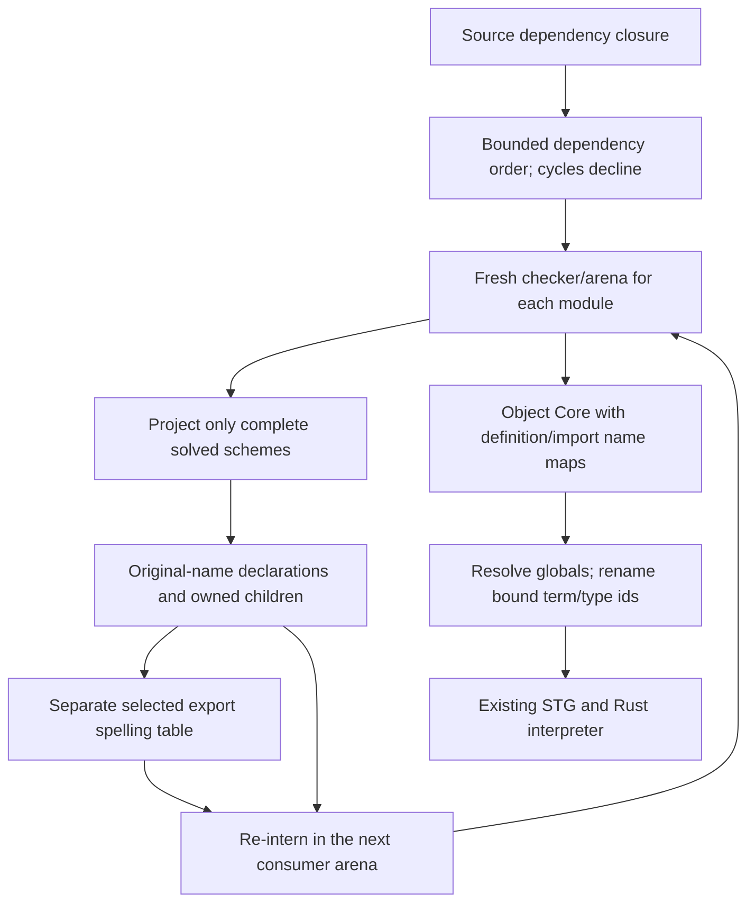

The producer arena drops after projection/elaboration. A shared source-graph output allowance bounds retained interface copies; existing per-module HIR/TC allowances cover imported names/types. The graph admits at most 64 modules and 16 MiB of source, and linking has allocation/depth bounds. A failed or unsupported dependency supplies no interface and makes its importer Unsupported; resource failures retain their class. A failed consumer cannot mutate the immutable interface. Source-file checking reads only the actual dependency closure beside the entry, and runs no program. The same checker/importer path serves supplied in-memory sources and file-based CLI check; dump-core additionally links the objects.

Measured controls cover the hidden ALib Bool mismatch (GHC-83865), abstract/private constructor visibility (GHC-88464), contextual dictionaries and a hidden default crossing both modules, distinct dictionary arguments, superclass selection, diamond metadata and direct/relayed names, and imported exact Integer conversion. GHC reports GHC-43085 when an imported overlap is demanded; the unused twin compiles and prints v, so both overlap forms stay Unsupported locally. Malformed identity maps/unbound binder positions, open export schemes, missing Core links, resource exhaustion and failure reuse refuse without publishing a stub.

Scope: plain home-source imports and default or value-only explicit exports, including a value re-export. Module re-exports, import/hiding lists, package units, boot cycles and stored artifact loading/trust remain separate work. Every accepted producer here is a complete supported source module. No source slice or partial unit is admitted. Main/IO and B-run/native gates remain open; default CLI remains legacy. The existing module-wide Wanted rescans and flat transitive interface-copy costs remain bounded by ceilings but are not optimized. Fixtures are grouped to keep source directories below 15 entries.

Claude2 #34005 identifies the next architectural prerequisites: a driver unit manifest with explicit completeness, absence-aware behavior for source slices, source operators/fixities/pragmas, then the actual Num class slice and known-identity ordinary literals. This is planning context; none of those partial-unit or numeric-defaulting privileges is introduced by unit 751.

## Embedded source units and the actual Num class, unit 752

Architecture inputs: Claude2 #34005/#34030/#34031 and the bounded authority review #34053, all source reading only. This is the four-stage real-Num route, not a replacement standard-library catalogue. The following supersedes earlier unit-specific numeric/library exclusions only at this scope.

| GHC concept | Local implementation and boundary |
| --- | --- |
| Defining unit and interface reconstruction | Driver source manifests alone admit embedded GHC 9.14.1 files as ghc-internal. Graph keys are (unit,module); an identically named home module remains home. Installed source never resolves an unknown dependency to a home key. Every checked module still has a fresh arena. |
| Actual source selection | The driver embeds whole unmodified Tuple.hs and Num.hs and the complete ghc-internal LICENSE. The manifest pins version, upstream path, whole-file SHA256 and ordered UTF-8 byte spans. Selections start/end at line boundaries, cannot end before an indented declaration tail, and cannot split the selected function from its following equation group. The synthetic header/profile and sole wired Integer dependency are manifest-owned. No developer checkout or GHC process is read by the product. |
| Source slices and absence | Interfaces retain their own completeness and the inherited set of sliced units. Missing names from incomplete scope, absent instances at sliced class/head owners, standard Num defaulting, and local instances whose class and head are both partial decline. A mismatch against present checked types remains a refusal. A slice supplies presence, never complete-library absence authority. |
| Import scope and child ownership | Open imports of slices decline: unseen exports could clash. Explicit lists select checked values, types, or a class's declared methods by original name. Num(..) obtains its methods through the class record; hidden defaults never enter scope. Explicit method implementations must name visible methods of the owning class. Hiding, qualified aliases and data-constructor member lists still decline. Top-level declaration/import clashes refuse at uses; nested binders shadow. A supplied/discovered home Prelude declines until checked implicit import selection exists. |
| Rename/Pat and Rename/Env known syntax | Ordinary integral expressions and prefix negation use the original ghc-internal/GHC.Internal.Num/fromInteger or negate. Inside that defining source module they resolve to its own declaration. Else they use its checked interface through a scope-hidden dependency. RebindableSyntax remains lexical. The exact bounded Integer payload and application/evidence machinery from unit 750 are reused. |
| Operators and fixities | Prefix operator names, operator signatures/equations, and one unambiguous infix application use resolved value IDs. Declared fixities travel under original names in interfaces. Chains with an unparenthesized infix/negation operand decline, because the reused parser groups by spelling before name resolution. Parenthesized grouping is explicit. Full fixity regrouping and class/local fixity declarations are separate work. |
| Class pragma ownership | The shared where producer retains MINIMAL/INLINE accounts. Only supported class-layout positions validate against that class's method/default records; explicit braces require a direct where child bracketed by real item delimiters. Nested body positions, misplaced/trailing pragmas and unrepresented positions decline. INLINE requires a default, and MINIMAL validates the method names/formula. Every enclosing member tail is checked, including pragmas following a default binding. No optimization or missing-method warning semantics are claimed. |

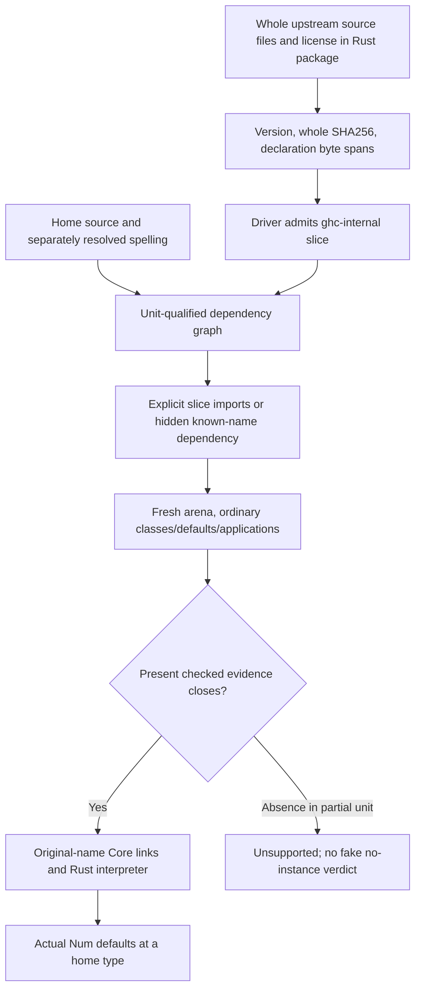

The tuple slice checks upstream fst/snd; absent swap remains Unsupported. The Num slice is exactly upstream fixities (lines 41-42) and class/default declarations (67-92), with no instance or subtract. The class's mutual defaults use their own Given and the actual instance dictionary. Controls execute default subtraction and default negation at a home type, ignore home fromInteger/negate for ordinary syntax, preserve RS, reject present type mismatches and refuse partial-unit absence. Exact receipts and final counts belong to the unit tasklist/checkpoint, not this design guide.

Cargo packages include the whole source and license; the binary exposes `bundled-source-licenses-chirho`. The payload remains pure Rust with no GMP/GHC runtime requirement. This is interpreter library-binding evaluation; Num Int, Num Integer, Integer arithmetic, defaulting, full ghc-internal, source CPP, native Integer/IO-main and B-run remain open. Source discovery is still limited to the entry's home dependency closure. Growing work retains module/output ceilings; module-wide Wanted scans and flat transitive interface copies are still unoptimized.

Review correction #34065: the implicit Prelude also needs an honest scope account. The complete explicit export names are read from the whole, hash-pinned upstream libraries/base/src/Prelude.hs (6040 bytes); wildcards/module re-exports or unaccounted export grammar refuse. This immutable cached name set supplies no type, class, value implementation or instance. A home declaration/import colliding with a known Prelude export refuses at its unqualified use; a present unimplemented Prelude name is Unsupported, even beside a checked home import. Nested binders still shadow. When an imported compiler declaration might be the same Prelude export, identity is withheld until its checked defining interface joins that exposure: this case is Unsupported, never a fabricated clash. Explicit Prelude imports without a checked interface also decline. The four existing wired language entities remain the implemented subset of Prelude exposure. A raw HIR call without a Prelude export account cannot certify an unqualified global name's absence from Prelude.

The same base LICENSE is vendored beside Prelude.hs and is byte-identical to the ghc-internal notice exposed by the binary. No Prelude body is checked by the name-account reader. The unit's initial corpus comparison exposed the implicit-(+) clash in tcfail037; that candidate is retained as intermediate evidence and is not the acceptance candidate.

Review correction #34082: scope absence is withheld for currently unmodeled self-qualified home references and wired constructor expression forms such as `:`; these are Unsupported, never an invented not-in-scope verdict. Fresh GHC controls accept both forms. Embedded asset/manifest failures are also Unsupported rather than a verdict against the user's source. Qualified export parsing removes module components without consuming an operator's own dots. Manifest equation-group edges compare supported binder sets at both ends, include multi-name signatures and conservatively decline infix-head boundary shapes. Today's four actual-source spans are unchanged.

## Source-typed Integer arithmetic and Num Integer, unit 753

Architecture inputs: Claude2 #34139 and the bounded handoff reviews #34152/#34155, all source reading only. GPT writes and executes. The GHC reference is still 9.14.1 commit 902339d332fb4ce2b3c87dcac1ee6495d41ad886. This unit extends the isolated next branch; it is not a main compiler or public release claim.

| GHC design and source | Local implementation and boundary |
| --- | --- |
| Builtin/Types.hs:2841 wires Integer, while Builtin/Names.hs:1236-1240 gives five operations known keys | Integer alone remains a wired type. The six ordinary Bignum.Integer value names retain their defining original names and receive explicit manifest-declared backend bodies. No source spelling or new wired value grants primitive authority. |
| Bignum/Integer.hs:499/545/574/614/628/640 supplies the six signatures | The whole unmodified 60,857-byte file is vendored under the ghc-internal licence, SHA256 1f8ec2a8e12ecbab7eb0b59f249fae663d8066f2fb14224177a4538653bb17f4. Only those complete signature lines may omit source equations. HIR retains each signature and declared body arity; TC checks closed, context-free Integer arrows and the exact arity. An unlisted lone signature still declines. |
| Num.hs:129-137 defines the real instance | That byte-identical instance joins the existing class/default slice. Its explicit imports name Integer and all six checked operations. fromInteger remains the source identity function; ordinary application and dictionary evidence select the actual instance. |
| ConstantFold.hs:2205-2207 and 2238-2239 uses mathematical integer operations | Our bodies call bounded, pure-Rust BigInt operations through compiler-internal keys. Bignum's Haskell representation-specific IS/IP/IN bodies are not compiled or exposed. This is an explicit Integer-level backend boundary, not a claim to have ported the BigNat/Int# layer. |
| Note [Bangs in Integer functions], Integer.hs:365-375 | Core emits cases that demand every parameter left-to-right, inside all lambdas. The primitive consumes the case binders as WHNF values and cannot re-enter the host evaluator. A partial application stays lazy. This also avoids consecutive arithmetic PrimOp returns recursively consuming the host stack. |
| Interfaces reconstruct names and types in the consumer | The Integer module now goes through the same source/check/interface/Core/link path as other modules. Its original names resolve through ordinary linking; the earlier hand-built type-only Integer interface is gone. |
| A known duplicate is a presence error | A home Num Integer duplicate is checked before the partial-unit decline, including incomplete method lists. HIR keeps absent methods explicit; the existing TC missing-method decline follows head registration. Only the manifest-admitted module defining its own class may supply that class's library instances. |

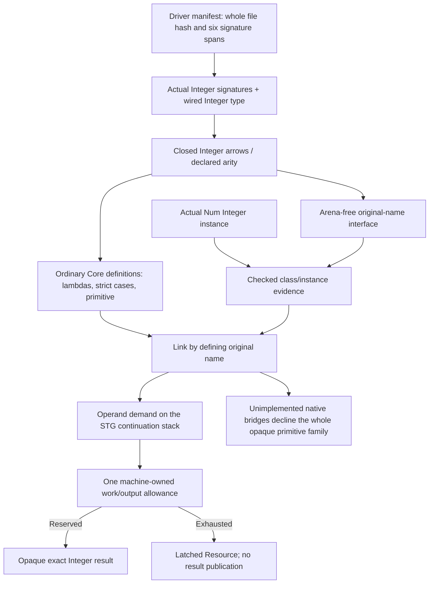

The default arithmetic allowance is 2^24 estimated 64-bit limb operations and 2^20 cumulatively charged output limbs (8 MiB); a single value is capped at 2^20 bits. Bounds are reserved before materialization, input Arcs are immutable, and an exhausted owner cannot be replenished by the next operation. Multiplication is charged by a conservative limb-product model. These are deterministic accounting limits, not measured CPU time. The stateless binary primitive adapter refuses arithmetic without an owner. The next execution boundary reads the owner's exhaustion latch, so a resource stop is never presented as a semantic type refusal or successful value.

Runtime controls cover 64-bit edges, 2^128-scale products, signs/zero, home-name discrimination (11 versus the incorrect 13 or 1), unsaturated functions, shared thunk updates, finite failure on both sides of multiplication by zero, and a lazy unused partial application. GHC and next return 12 for a demand crossing 89 GC cycles and 10000 for a 10,000-deep non-tail sum crossing 108 cycles. Exact receipts and final source identities belong to the tasklist/checkpoint. The first two recursive-loop GHC probes timed out; they remain timeout data, not a semantic failure reference.

A measured shared-runtime cost remains: the latter run takes 676,557 reduction steps, allocates 231,876 closures and ends with 282,655 code entries (about 190,000 last-live heap objects). Dynamic enter instructions and roots are retained during a run. The tested run has an explicit step allowance, and dropping its machine retires that state; scalable instruction/root retirement is not implemented by this unit. The existing module-wide Wanted rescans, flat inherited interface copies and general runtime retention remain separate growth work.

Both library modules remain slices. Open imports, hidden Integer constructors, unimplemented operations/classes/instances, numeric literal patterns and ordinary standard-class defaulting still decline. A home-class ambiguity that blocks defaulting can be a semantic refusal, as measured against GHC. Num Int/Word/Natural, Eq/Ord/Show Integer, general defaulting, full ghc-internal, native Integer/IO-main and B-run remain open. Integer rendering in the binding-evaluation harness is not a Show instance.

## Standard Integer defaulting, unit 754

Architecture input: Claude2 #34227 (GHC/source reading only). Reference remains GHC 9.14.1 at 902339d3. This unit supports the first candidate in the ordinary home-module default environment, not general default declarations or additional numeric classes.

| GHC operation and source | Local carrier and retained rule |
| --- | --- |
| Tc/Utils/Env.hs:944-950, 1011-1016 supplies Num defaults Integer then Double outside ghc-internal | HIR already declines local default declarations and unimplemented extension profiles. TC applies built-in defaulting only to StandaloneHome modules. Compiler-unit modules never inherit it. No import or path can mint Num's identity. |
| Tc/Solver/Default.hs:1012-1071 groups unary constraints on one assignable meta | integer_defaulting_chirho performs a single normalized pass over unsolved dictionaries. Only exact compiler-unit GHC.Internal.Num.Num is standard in the current source subset. Another class or a non-unary occurrence blocks that meta. Quantified metas and skolems are never candidates. |
| disambigGroup, Default.hs:1103-1110 tries default candidates in order and solves the whole group | Only Integer is implemented. A context-free, binder-free checked Num Integer instance must already match before any ordinary equality is emitted. Its missing presence remains for the existing Unsupported partiality gate; no Double/instance absence is inferred. Extending candidates or contexts requires isolated solver trials before publication. |
| Top-level defaulting follows generalization; tryDefaultingForAmbiguityCheck omits class defaulting | finish_dictionaries_chirho runs after every group and instance method. The existing MR promotion allows later groups to determine earlier restricted metas first. Written-signature ambiguity remains an earlier refusal. |
| Evidence solving after a successful assignment | Existing equality solving checks kinds/touchability and existing dictionary solving writes each use's evidence at its original owner. No dictionary parameter, second type arena or defaulting-specific Core evidence is added. |

A home class in an unresolved unary group proves that the ordinary default rule cannot apply, even when the first remaining Wanted is the sliced Num. Reporting uses the whole group for that proof and returns a typed ambiguity. This proof relies on the current constructor-headed instance restriction and must be re-derived before variable-headed instances or named defaults are admitted. Other partial/library/non-unary cases retain their earlier Unsupported boundary. Standardness is a declaration identity fact, never an occurrence-name or visible-instance-count test.

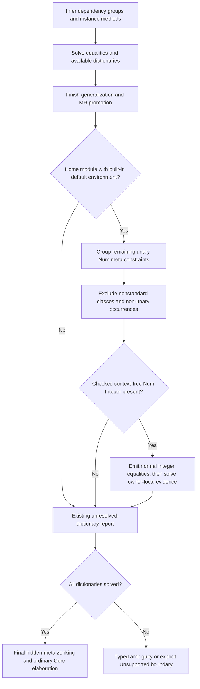

The added pass is linear in the retained Wanted records plus their charged normalization/free-variable walks, using a module-local set of blocked variables and first-occurrence candidate order. It shares the existing module allocation ceiling. It does not repair the older repeated whole-module scans during group closure, or the shared runtime's dynamic instruction/root retention cost. Explicit default/default (), named defaults, ExtendedDefaultRules, OverloadedStrings, other standard classes and later default types remain Unsupported. Ordinary Prelude operator identity still needs a checked defining-interface join, so operator controls use explicit checked imports under NoImplicitPrelude. Actual runtime and fixed-profile results are recorded in the unit tasklist and acceptance evidence, not inferred from this diagram.

## Unit 757: checked defining names behind Prelude

The actual pinned upstream Prelude export/import header supplies presence paths through the already vendored Num, Integer and Tuple files. GHC 9.14.1 compiles that exact whole Prelude.hs without diagnostics, establishing the unqualified export uniqueness premise. The reader caches candidate original-name routes, not schemes. Qualified/aliased imports cannot forward a route, import lists and hiding constrain it, module re-exports need an actual unqualified import edge, and conditional/defining preprocessor directives in a read region decline. Only inert includes are skipped. Unreadable/non-vendored paths prove nothing for that name.

The source driver uses syntax-use mentions only as dependency-loading hints. A hint can load a module even when the source name later resolves locally. HIR therefore joins a route only with the exact original name in an independently checked terminal export; class members additionally require the checked owning class. The type, fixity, default and instance records come from that interface and normal arena re-interning. No typed Prelude catalogue, shared arena, new dictionary form or legacy interface supplies authority.

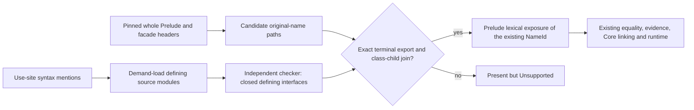

A direct import and Prelude exposure of the same original name are one entity. A home top-level conflict or different proved original is ambiguous; nested binders shadow normally. Explicit Prelude item lists admit only proved declarations and checked class members; empty lists bring nothing. Open, hiding, qualified and aliased Prelude imports remain Unsupported, as do a home Prelude and names such as subtract whose bodies have not been checked. Integer remains opaque and defaulting remains the unit 754 rule.

Two absence boundaries are separate from loading hints. A complete home-unit class cannot acquire unseen instances in a library that cannot name it, even when its head is a compiler type. A deliberately sliced home unit remains conservative. Ordinary unqualified-name absence uses the selected lexical scope and complete Prelude name account, not hidden type/instance interfaces or unit incompleteness. Other qualified/builtin occurrence forms, typed holes and implicitly quantified lowercase annotation variables retain their conservative declines. Unmodeled top-level declarations decline before ordinary data fields or class bodies are read, so a declared alias/newtype cannot be mistaken for an absent name. Internal source-route inconsistencies are Unsupported rather than semantic judgments on the user's source.

The carrier, parent/member checks and scope/partiality corrections were reviewed by Claude2 through source reading only (#34365, DM4570, DM4575); no independent execution is implied. Execution counts, fixed-profile movements, source identity and residuals belong to the unit 757 tasklist and acceptance receipt. Full source libraries, ordinary numeric classes beyond Num, native Integer, IO-main/B-run and default-pipeline integration remain open.

## Checked Integer comparison boundary (unit 758)

Architecture: Claude2 DM4655, source reading only; GPT implements and executes. Reference is GHC 9.14.1 at 902339d3. The new gate results belong to the unit 758 tasklist and receipts; this implementation account does not itself certify their execution.

| GHC representation | Local representation | Required invariant |
| --- | --- | --- |
| Classes.hs shared fixity, Eq/Ord declarations and defaults, and not | Whole hash-pinned source file; declared complete groups checked through the existing HIR and TC | Neither a replacement class scheme nor a spelling-based instance table |
| Builtin/Types.hs wired Ordering and Bool | Wired original identities, closed arena constructors, matching Core constructor keys | Local same-spelled data types stay nominally distinct; runtime produces the constructor values source patterns inspect |
| Integer.hs comparison signatures and actual Eq/Ord instances | Closed checked Integer argument arrows and a manifest-declared wired result contract | Both TC and elaborator cross-check arity/result before emitting an opaque body |
| Bangs and equations of Integer comparisons | Existing nested Core cases, left operand then right, underneath every lambda | Saturated demand uses the STG continuation stack; partial application stays lazy, and the primitive never re-enters the evaluator |
| Primitive mathematical comparison | Immutable Rust BigInt comparison and evaluation-owner allowance | Reserve input-limb work and one constructor result before comparison; exhaustion remains latched and cannot become a successful value |
| Prelude -> Base -> Classes | Whole pinned Base facade header plus loaded checked Classes exports | The facade supplies candidates and no types; per-name checked export ownership proves the terminal identity |
| Standard Num/Eq/Ord default group | Exact defining names and a context-free present Integer instance for every member | Num must be present; other classes or non-unary occurrences block the group; compiler-unit modules never default |

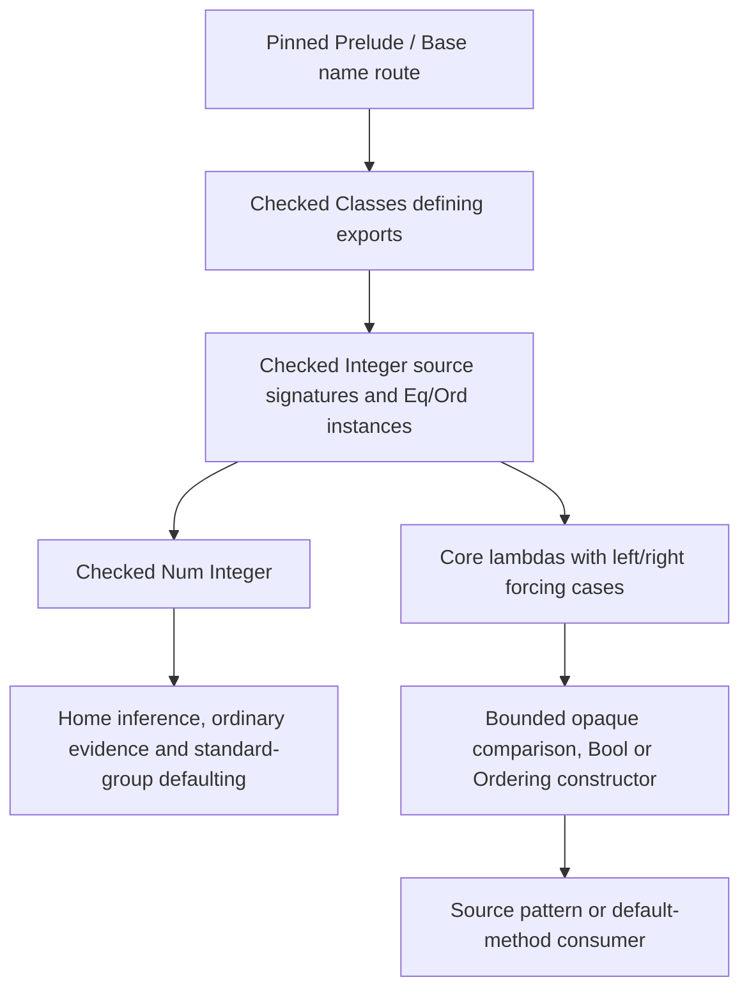

The driver admits wired Types imports only for its compiler-unit manifest modules; it does not claim to check Types.hs. Manifest source instances may belong to another library module's class, while local visible duplicate checking still precedes the partiality exemption. Classes and Integer remain slices: absent Eq Bool, other instances, Show and unmodeled library exports remain Unsupported. Operator chains, full Base bodies, IO-main, native Integer and shared runtime code/root retention are separate boundaries.

## Checked source type synonyms (unit 759)

Architecture input: Claude2 DM4689/DM4694, source/design reading only. This is the alias prerequisite of the Show route, not the Show class, source-shaped Int or printing. Source String comes from the actual Base.hs:2030, and ShowS from Show.hs:62, selected from whole unmodified, hash-pinned files with the existing ghc-internal licence. The driver-minted manifests supply the defining unit and explicit dependencies; Base imports only the wired Char needed by its selected declaration. No reference checkout is read by the installed compiler.

| GHC concept | Local representation | Required invariant |
| --- | --- | --- |
| A synonym declaration and application before expansion | HIR SynonymChirho head, lexical parameter IDs and every supplied SurfaceType argument | An argument discarded by the RHS must still be kind-checked. A same-spelled consumer declaration cannot capture the RHS. |
| Synonym dependency validity | Owner-charged dependency graph and Kahn ordering before any expansion | Recursive aliases are semantic refusals, including unused cycles; they never expand until a resource limit is hit. All acyclic RHSs are checked even when unused. |
| Saturated first-order expansion | Type-kinded rigid parameter scheme plus the existing arena replace operation | Require declared arity, check every argument, then substitute. Extra arguments apply to the expanded result and receive normal kind checking. |
| Signature ambiguity after synonym expansion | Existing arena free-variable walk on the expanded value type | An erased parameter cannot justify a written class context or become acceptable through later defaulting. |
| Closed imported synonym definition | InterfaceSynonymChirho over the existing InterfaceSchemeChirho trees and original names | No surface body, NameId, TyChirho, evidence or arena crosses. Re-intern into the consumer after nominal data/class kind headers; hidden nominal dependencies travel without entering source scope. |
| Prelude String exposure | Base self-re-export candidate joined to the exact checked String export | Candidate keys must belong to the complete Prelude name account. No route supplies a type; checked source-interface ownership does. |

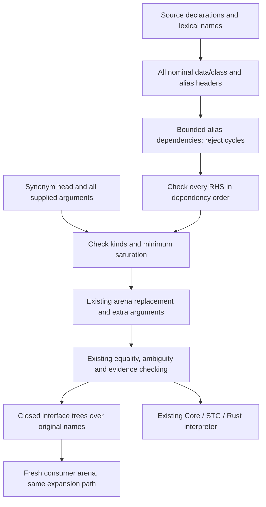

This increment admits inferred first-order parameter kinds. GHC2021 higher-kinded uses that require PolyKinds generalization decline as Unsupported; defaulting those uses to Type and refuting them would be wrong. Haskell2010 does require the admitted Type parameter kinds, and a synonym in an instance head is refused without TypeSynonymInstances (included in GHC2021). Constraint-kinded aliases and alias contexts decline; no class-name error is inferred from an unexpanded synonym. Before publishing headers, an owner-charged pre-pass over every local data field, class method type and synonym RHS declines applied type variables. This prevents declaration-order-dependent Haskell2010 refusals. Alias-RHS and extra-result kind failures also conservatively decline until joint declaration-kind inference can certify the provisional nominal headers: tc238 exposed a valid higher-kinded data declaration whose aliases were checked before its fields. The final candidate keeps that case Unsupported; use-site checks after data checking retain their ordinary classification. Advanced extension overrides and partially applied synonyms remain outside the subset.

ShowS works through an explicit GHC.Internal.Show (ShowS) import with NoImplicitPrelude. Its default-Prelude exposure remains Unsupported until the Show facade's directive prologue is modeled; String is supported through implicit and selected Prelude imports. A checked alias does not add a representation, runtime primitive or library class. Expansion uses the existing arena DAG, while materializing an interface tree consumes the shared output ceiling; the duplicate-tree control must stop with Resource rather than unbounded allocation.
