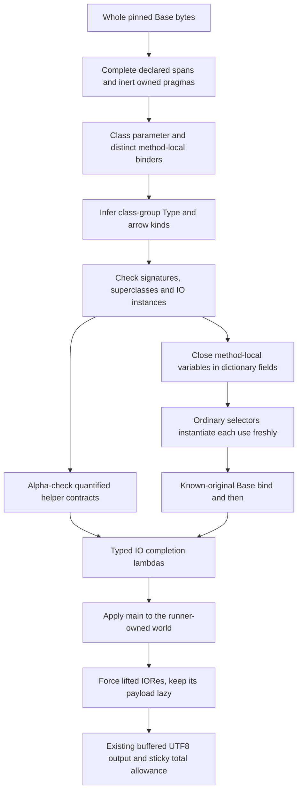
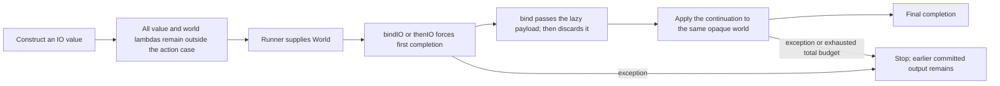

<!-- For God so loved the world, that he gave his only begotten Son, that whosoever believeth in him should not perish, but have everlasting life. - John 3:16 (KJV) -->

# Actual-source IO sequencing Chirho

Unit764 continues the explicit next interpreter after unit763. This document describes a provisional source candidate; it is not an executed acceptance receipt. The existing canonical compiler and native/backend/release holds are unchanged. GPT is the sole implementation writer and canonical ledger writer; Claude2 reviews source only.

The HIR crate, checker crate and driver next module forbid unsafe_code, following L.J.'s November17 safe-Rust requirement. The complete driver --tests Cargo check passed with zero compiler diagnostics on source basis68b490a3, enforcing that policy in the checked targets. It did not build or execute the test binary. The first complete18-test IO entry then timed out during compilation with no recorded test outcomes; all18remain unproven for this candidate. The [source candidate record](source-candidate-chirho.json) binds the checked bytes and retains those distinct results.

The library path is the pinned GHC9.14.1 Base declaration group: Functor, Applicative, Monad, their defaults, IO instances, id/const/(.), ap/liftM2 and (<**>). Every instance method remains checked source. Only returnIO, bindIO and thenIO substitute the State#/unboxed-tuple layout; their exact compiler-unit original names and quantified contracts own those bodies. Existing hPutStr'/stdout providers and source print/putStrLn retain unit763's output path.

Installation and compilation ease and the integrated IDE remain product requirements. Existing CLI/package/editor/GUI/LSP/MCP components are retained and need explicit integration and end-to-end validation with the new checker before default-path replacement. Compiler algorithms are implemented in Rust while library declarations remain Haskell source. Any later replacement of C/Cmm runtime helpers is separate work, with no unsafe-code or FFI expansion authorized by this IO sequencing unit.

Ordinary do uses GHC.Internal.Base.(>>=)/(>>) by original identity. Its defining checked interface is a hidden dependency even under NoImplicitPrelude; loading it does not expose return, pure or other lexical Prelude names. In Base itself, helpers resolve the already-declared own selectors instead of introducing a self import. A home spelling of (>>=) cannot capture ordinary do. RebindableSyntax and qualified/recursive/applicative do remain outside this cut.

Statements lower in lexical order. A variable or wildcard bind creates a lambda over the remaining statements, a let scopes its recursive local group over the remainder, and the final statement must be an expression. Refutable binds decline until the source MonadFail route exists. The declaration kind safeguard continues to reject unmodeled higher-kinded data/synonym producers before their consumers can give an order-dependent wrong verdict. Unresolved PolyKinds require Unsupported rather than a guessed Type kind.

No new output opcode, second string carrier, nested force or output-budget reset is introduced. Each completed hPutStr' commits and clears its own pending buffer; later actions use the same latched machine allowance. A later failure discards only pending text and retains earlier committed text. A returned undefined payload may remain unevaluated at both bind and main completion.

Class kinds finish in superclass dependency order. Haskell2010 defaults each completed group's open kinds to Type; GHC2021 open kinds decline until PolyKinds is modeled. Signature locals follow the same edition boundary. Only explicit forall binders in GHC2021 scope over a method default or value body. A private monomorphic Main entry instantiates the original main scheme without changing recursive uses of that scheme.

Data headers retain conservative open-parameter evidence under GHC2021. Field positions that require Type pin parameters; known constructor positions propagate that evidence through local declarations and checked interfaces. Unresolved higher-kind applications decline. A recursive Haskell2010 nominal group also declines if a non-Type group argument would make its provisional header unsafe. This preserves existing Type uses while preventing a false kind refusal. General PolyKinds, higher-kinded data parameters and parameterized partial synonyms remain outside this cut.

Verification is staged through exact frozen candidate receipts and ordinary shared-consumer admission. The prepared GHC r4 batch contains 61 serial children: one version check, 34 fixture compiles and 26 piped runs, with 10 seconds per child (610 summed ceilings plus 30 seconds for admission/custody/closure). This is a scheduling disclosure, not a hard aggregate watchdog. The 34 fixture sources and four tool/manifest inputs form 38 pins. Source drafting preceded fresh GHC measurement because the actual selected consumer held the boundary; predictions remain unmeasured. The complete focused Rust entry has18declarations:11new sequencing/kind/scope controls and7existing IO regressions. A fresh340sproposal preserves that entire entry, with300sfor the child and40sfor disclosed escalation/admission/custody/closure; it is prepared and unadmitted. Later broad tests/profile/reference/package evidence must retain their actual scope and all prior failures. A formatted source file, delivered review or scheduling offer proves no compiled behavior.
