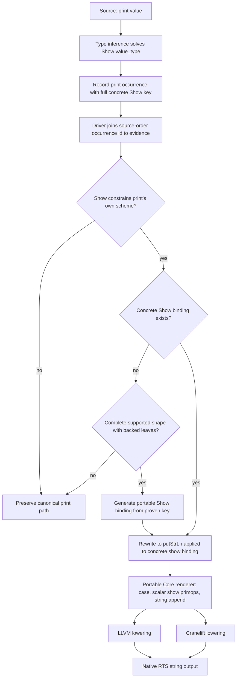
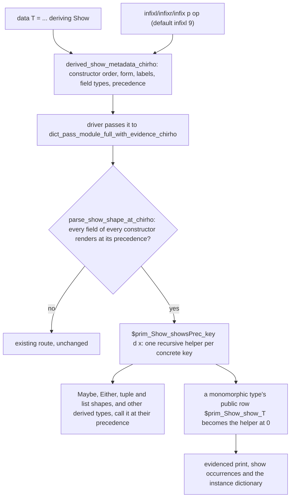

<!-- For God so loved the world, that he gave his only begotten Son, that whosoever believeth
in him should not perish, but have everlasting life. — John 3:16 (KJV) -->

# Workflow: solved Show evidence for print

`print` is a constrained Prelude function rather than a `Show` class method. The compiler must
carry its solved `Show` predicate through Core; native runtime bits cannot distinguish values such
as unboxed `True` and integer `1`.

## Invariants

- Evidence is admitted only when the class declares the referenced method or constrains the
  referenced function's own type scheme.
- Concrete structured keys retain their full shape, including lists, tuples, `Maybe`, and
  `Either`; unresolved type variables never become invented instance keys.
- Prelude constructor schemes propagate payload annotations through `Just`/`Nothing` to the
  enclosing `Maybe` type before occurrence evidence is finalized.
- Missing `Maybe`/`Either`/tuple/list renderers are composed deterministically from
  complete evidence. `Integer` remains an Integer key inside compound evidence and
  uses the engine's integer renderer; no string replacement fabricates an instance.
- Bootstrap lists and evidenced lists share one recursive worker generator. Each
  shape's element renderer is emitted once, with an explicit separator parameter.
- A user instance leaf needs an actual body, not just a name-table entry. Its show
  method can serve list/tuple elements at precedence zero. A hand-written show-only
  implementation is not assumed to implement showsPrec 11: that argument stays on the
  dictionary path. Derived Show is rendered from its constructor metadata instead
  (below); hand-written showsPrec behavior is not claimed.
- The dictionary pass rewrites only when the exact generated `Show` binding exists.
- Structured renderers use backend-neutral Core rather than interpreter-only compound primops.
- Scalar show primops used by portable Core have matching STG mappings, including `showChar#`.
- The RTS records allocation kind out of band before interpreting thunk headers; constructor
  payload bits cannot masquerade as thunk state.
- String append owns borrowed input bytes before any allocation that can trigger collection.

## Derived Show (row 533, 2026-10-25)

gpt_chirho #28285, #28295. The derived instance supplies `show`, the class's only method. Its
precedence comes from constructor metadata, rendered in Core with GHC's derived rules:

- **Rules:**
  - prefix `C a1 a2` is parenthesized above 10, with fields at 11, and a bare `C` has no fields;
  - a record `C {l = a}` is parenthesized above 10, with fields at 0 and labels in declaration order;
  - a binary symbolic constructor `a1 op a2` is parenthesized above its precedence p, with both
    operands at p + 1 whatever the associativity.
- **Fail-closed:** a key with any field no shape renders (an unknown type, a hand-written
  show-only instance at 11, a function) keeps its existing route; nothing defaults to Int or to
  the runtime space heuristic. A recursive type is admitted when everything else in it renders.
- **Code:**
  - `crates/haskelujah-typing-chirho/src/deriving_chirho/show_chirho.rs` (the instance and the metadata);
  - `crates/haskelujah-core-chirho/src/dict_chirho/show_chirho/derived_chirho.rs` (the renderer);
  - the `DerivedChirho` shape in `show_chirho/shape_chirho.rs`.
- **Tests:**
  - end to end, `tests/dictionary_evidence_chirho/derived_show_chirho.rs`;
  - infix structure, in `show_chirho/derived_tests_chirho.rs`;
  - metadata, in `deriving_chirho/show_tests_chirho.rs`.
- **Seam:** unit 517 can describe NonEmpty `:|` as infixr 5 through the same metadata, without
  touching the renderer.
- **Not claimed:**
  - the runtime precedence methods (`showsPrec`, `shows`, `showParen` as functions) and the class defaults;
  - a hand-written show-only instance at nested precedence (C01);
  - a type with parameters reached through a dictionary;
  - newtypes (S09), standalone deriving, and GADT, prefix-symbolic and backtick constructor declarations.
