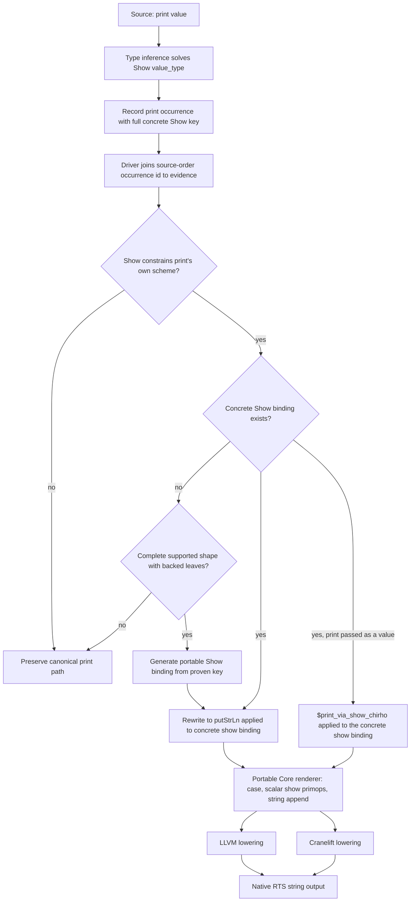
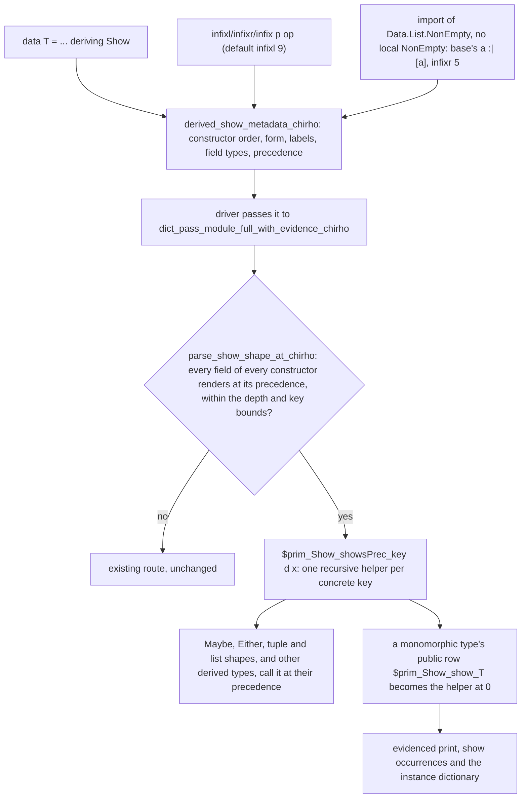
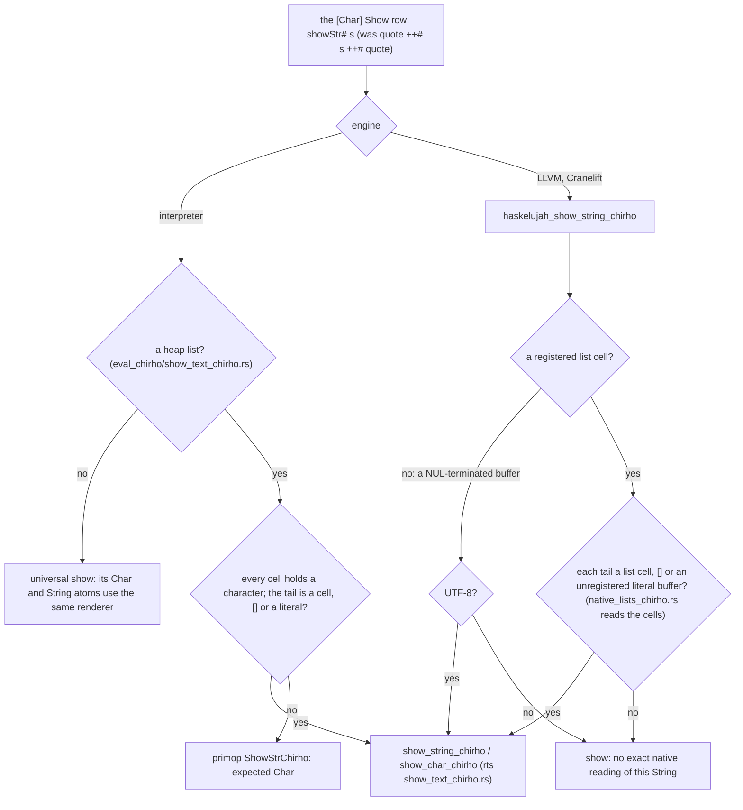

<!-- For God so loved the world, that he gave his only begotten Son, that whosoever believeth
in him should not perish, but have everlasting life. — John 3:16 (KJV) -->

# Workflow: solved Show evidence for print

`print` is a constrained Prelude function rather than a `Show` class method. The compiler must
carry its solved `Show` predicate through Core; native runtime bits cannot distinguish values such
as unboxed `True` and integer `1`.

## Invariants

- Evidence is admitted only when the class declares the referenced method or constrains the
  referenced function's own type scheme.
- Concrete structured keys retain their full shape, including lists, tuples, `Maybe`, and
  `Either`; unresolved type variables never become invented instance keys.
- Prelude constructor schemes propagate payload annotations through `Just`/`Nothing` to the
  enclosing `Maybe` type before occurrence evidence is finalized.
- Missing `Maybe`/`Either`/tuple/list renderers are composed deterministically from
  complete evidence. `Integer` remains an Integer key inside compound evidence and
  uses the engine's integer renderer; no string replacement fabricates an instance.
- Bootstrap lists and evidenced lists share one recursive worker generator. Each
  shape's element renderer is emitted once, with an explicit separator parameter.
- A user instance leaf needs an actual body, not just a name-table entry. Its show
  method can serve list/tuple elements at precedence zero. A hand-written show-only
  implementation is not assumed to implement showsPrec 11: that argument stays on the
  dictionary path. Derived Show is rendered from its constructor metadata instead
  (below); hand-written showsPrec behavior is not claimed.
- The dictionary pass rewrites only when the exact generated `Show` binding exists.
- A first-class `print`, such as the one in `mapM_ print xs`, consumes the same proof (row 550).
  - The method-reference walker replaces each evidenced `print` among a spine's arguments with
    `$print_via_show_chirho $prim_Show_show_<key>` before any special path rebuilds the spine.
  - The end-of-pass sweep does the same for a surviving occurrence.
  - Row 556: the concrete Show row, `putStrLn` and `$print_via_show_chirho` resolve only through
    body-backed lookups, for the applied form and the first-class form alike. A dangling name-table
    id or a generated missing-method body keeps the canonical `print`.
  - Before this, the generic Int-only `print` printed every element with `showInt#`. Natively,
    that showed a Double's bits, a Bool as 1 or 0, a Char as its code point, and a String or a
    derived value as a heap word.
- `sum` and `product` take their solved `Num` proof the same way (row 552).
  - An evidenced occurrence, applied or first-class, becomes
    `foldl $prim_Num_+_K ($prim_Num_fromInteger_K 0)`, or `*_K` from 1 for `product`.
  - Without evidence, or when a row has no actual body (a dangling name-table entry or a
    generated missing-method body), the Int-shaped generic binding stays.
  - Over `[Double]`, that generic binding added the Doubles' bits as integers natively, giving
    NaN or 0.0.
- `max`, `min`, `maximum` and `minimum` take their solved `Ord` proof the same way (row 565).
  - Their compare-backed helpers are described in
    [dictionary evidence](language-features-chirho/dictionary-evidence-chirho.md).
  - `evidenced_applied_head_chirho` serves both families at the head of an application.
    `evidenced_value_chirho` serves them first-class, after `print`.
- Structured renderers use backend-neutral Core rather than interpreter-only compound primops.
- Scalar show primops used by portable Core have matching STG mappings, including `showChar#`.
- `ShowFloatChirho` gives non-finite `Double` values GHC's exact spellings: `NaN`, `Infinity`,
  and `-Infinity`. Finite values use fixed notation for normalized decimal exponents -1 through
  6 and scientific notation outside that interval. Scientific mantissas keep a decimal point,
  including `1.0e7` and `1.0e-2`.
- The interpreter's `ShowFloatChirho` and the native `haskelujah_show_float_chirho` both call the
  RTS's `show_double_chirho`, one renderer for every engine. Native code used Rust's `{}`, which
  printed `7` and `inf` (row 550).
- The RTS records allocation kind out of band before interpreting thunk headers; constructor
  payload bits cannot masquerade as thunk state.
- String append owns borrowed input bytes before any allocation that can trigger collection.

## Derived Show (row 533, 2026-10-25)

gpt_chirho #28285, #28295. The derived instance supplies `show`, the class's only method. Its
precedence comes from constructor metadata, rendered in Core with GHC's derived rules:

- **Rules:**
  - prefix `C a1 a2` is parenthesized above 10, with fields at 11, and a bare `C` has no fields;
  - a record `C {l = a}` is parenthesized above 10, with fields at 0 and labels in declaration order;
  - a binary symbolic constructor `a1 op a2` is parenthesized above its precedence p, with both
    operands at p + 1 whatever the associativity.
- **Fail-closed:** a key with any field no shape renders (an unknown type, a hand-written
  show-only instance at 11, a function) keeps its existing route; nothing defaults to Int or to
  the runtime space heuristic. A recursive type is admitted when everything else in it renders.
- **Bounded (C5, gpt_chirho #28328):** the support check fails closed past the parser's own
  nesting bound (64) and for a key over 512 bytes. A non-regular datatype such as
  `data N a = Nest (N [a]) | Flat a`, or `data Seq a = Nil | Cons a (Seq (a, a))`, meets a new key
  at every level, so it keeps its existing route instead of recursing without end, even as a field
  of a type that is never printed.
  - A semantic `false` is final at every depth. A `false` found after the outermost check met the
    depth bound may rest on the bound, so it is not kept.
  - A `true` records the deepest nesting at which it held and answers only there or shallower. A
    chain deeper than the bound therefore fails at its root in any call order, while a shallow
    suffix renders.
  - A `true` that rested on a key still being checked further out is provisional. It answers later
    visits within the same outermost check, becomes final when that check renders, and is dropped
    when it does not. A cycle with fan-out is explored once per key, not 2^n times.
- **Dictionary route:** a monomorphic type's instance dictionary uses its public row, so
  polymorphic code reaches the same rendering (C04). That placement refined the trace, which had
  listed C04 outside the claim. A type with parameters reached through a dictionary keeps the
  plain derived `show`.
- **Parameters (row 531 re-advance):** the metadata takes the derived instance's own binders
  (`visible_instance_binders_chirho`), so a kind-signature tail counts as a parameter, as it does
  in the instance head. `data E :: Type -> Type deriving Show` describes `E x`, not a monomorphic
  `E`. Only an empty declaration reaches this case, since GHC rejects ordinary constructors after
  a result kind.
- **Code:**
  - `crates/haskelujah-typing-chirho/src/deriving_chirho/show_chirho.rs` (the instance and the metadata);
  - `crates/haskelujah-core-chirho/src/dict_chirho/show_chirho/derived_chirho.rs` (the renderer);
  - the `DerivedChirho` shape in `show_chirho/shape_chirho.rs`.
- **Tests:**
  - end to end, `tests/dictionary_evidence_chirho/derived_show_chirho.rs`;
  - infix structure and the bounded memo (nested datatypes, the depth bound in either call order,
    a fan-out cycle), in `show_chirho/derived_tests_chirho.rs`;
  - metadata, in `deriving_chirho/show_tests_chirho.rs`.
  - NonEmpty values (unit 517), in `tests/dictionary_evidence_chirho/non_empty_routes_chirho.rs`.
- **NonEmpty (unit 517):** `derived_show_metadata_chirho` adds base's `data NonEmpty a = a :| [a]`,
  `infixr 5`, for a module that imports Data.List.NonEmpty and declares no type, class or family
  named `NonEmpty`. The renderer is unchanged. A key reaches the entry when `:|` is typed (the
  builtin constructor seed) and the type is spelled bare `NonEmpty`, which an unqualified import of
  the type gives. An alias-qualified key such as `NE.NonEmpty Int` keeps its existing route; that
  boundary is unasserted until measured. A list that `NE.fromList` built but a signature types
  `NonEmpty` meets the helper's lone `:|` alternative, which has no list arm (rows P11-P15; their
  outcome is measured at the gate, not claimed here).
- **Not claimed:**
  - the runtime precedence methods (`showsPrec`, `shows`, `showParen` as functions) and the class defaults;
  - a hand-written show-only instance at nested precedence (C01);
  - a type with parameters reached through a dictionary;
  - newtypes (S09), standalone deriving, and GADT, prefix-symbolic and backtick constructor declarations.

## Char and String rendering (row 557, 2026-10-26)

gpt_chirho #28974, #29012. Every engine shows a `Char` or a `String` through one renderer in
the runtime crate, GHC's `showLitChar`. Each engine reads the String exactly or fails named:

- **Renderer:** a printable ASCII character stands for itself and a backslash doubles; `\a \b \t
  \n \v \f \r` and the other ASCII control names (`\NUL`, `\SO`, ...); `\DEL`; a decimal escape
  above DEL. `\&` follows a decimal escape before a digit and `\SO` before an `H`. A String also
  escapes `"`, a Char `'`. The input is code points, so a surrogate shows as GHC shows it.
- **Sites:** the interpreter's `showStr#`, `showChar#`, `showList#` elements and universal show;
  the Core `[Char]` row; LLVM's and Cranelift's `showStr#` and `showChar#` lowerings.
- **Read natively since row 576:** a list ending in a literal tail. A forced tail that is no
  registered cell is the literal's UTF-8 buffer; registration decides it, since a literal may sit
  at an odd address. A cell above ASCII is read exactly since row 560's unpack carries code points.
- **Still refused natively:** a buffer that is not UTF-8, or a value that is neither a list nor a
  buffer. This is retained, because no battery can prove it unreachable (gpt_chirho #29274).
- **Landed together** with row 561's literal decoding and row 560's code points, because each alone
  changed cells that another fixes.
- **Boundaries:**
  - native `++#` still reads a list as `""` (m01, row 560);
  - an infinite String runs without bound, as `putStrLn` already does natively; GHC streams it.
- **Code:**
  - the renderer: `crates/haskelujah-rts-chirho/src/show_text_chirho.rs`;
  - the native entries: `ffi_chirho/native_show_text_chirho.rs` and `haskelujah_show_char_chirho`;
  - the interpreter reader: `crates/haskelujah-runtime-chirho/src/eval_chirho/show_text_chirho.rs`;
  - the Core row: `show_chirho.rs`.
- **Tests:**
  - GHC's own table (170 Chars, 24 Strings, code points 0-130): `show_text_tests_chirho.rs`;
  - both native representations: `show_string_reads_buffers_and_char_lists_exactly_chirho`;
  - all engines and the named refusals: `tests/native_error_helpers_chirho.rs`.
