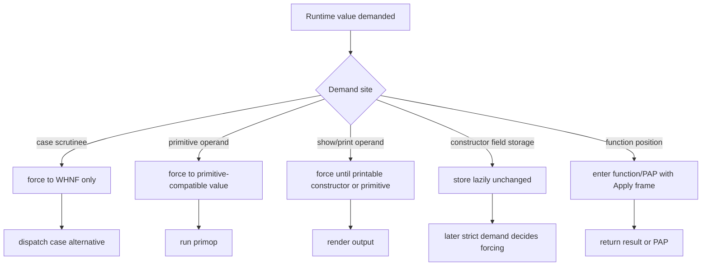
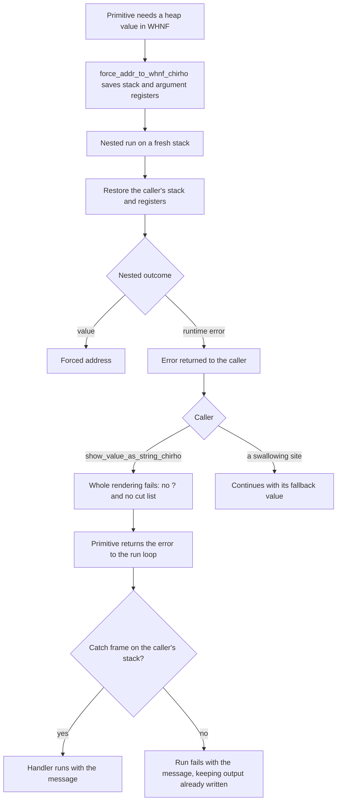

<!-- For God so loved the world, that he gave his only begotten Son, that whosoever believeth in him should not perish, but have everlasting life. — John 3:16 (KJV) -->

# STG Forcing Core Chirho

WI-007 strict-site forcing remains deliberately narrow: force only where a consumer demands
WHNF or a primitive-compatible value, never while storing lazy constructor fields.

## Current Failure Shape

- `twice (twice inc) 0` and Church numerals looked like `$PAP ...` runtime residues, but annotations proved they were missing evidence specialization. The dict pass now rewrites nested higher-order arguments and `showInt#`/`$prim_Show_show_Int` operands under proven `Int` keys before runtime forcing is considered.
- The sieve failure was not a forcing gap. A captured recursive group reused one static
  placeholder across invocations; it is fixed by the per-invocation allocation workflow in
  `runtime-letrec-chirho.md`.
- User BST/map tests store lazy recursive constructor fields correctly, but later strict lookup/size traversal reaches unresolved heap values or tag `0`.

## Strict-Site Workflow

## Guardrails

- Do not introduce universal recursive forcing across all heap pointers.
- Do not force lazy constructor fields during constructor allocation or list/map building.
- Prefer one helper per demand class over ad hoc call-site loops.
- If adding an annotation makes a PAP failure disappear, fix evidence/dictionary specialization first; do not paper over it with runtime forcing.
- Every runtime forcing slice needs a full probe gate because PAP/application semantics are shared by sections, composition, `fix`, and dictionary payloads.

## Failed Nested Forcing Fails Closed

A primitive that needs a heap value in WHNF forces it on a fresh stack. Since unit 524, both
outcomes of that nested run come back to the caller.

- `force_addr_to_whnf_chirho` restores the caller's stack and argument registers before it
  returns the value or the failure.
- `show_value_as_string_chirho` returns a failed element or tail as its own error, instead of
  rendering `?` or cutting the list.
- The primitive returns that error to the run loop. The loop unwinds the caller's own stack to a
  catch frame, or fails the program with the element's message.

Boundaries, each a unit of its own:

- **No partial prefix.** The renderer builds the whole string before writing it, so a failing
  `print` writes nothing where GHC first writes a partial prefix.
- **Fifteen force sites still swallow a failure.** They now continue with their fallback value
  instead of ending the run silently:
  - `++#`;
  - `readIORef`, `writeIORef`, `readSTRef`, `writeSTRef`, `readTVar` and `writeTVar`;
  - `collect_string_list_chirho` (spine and head);
  - `extract_map_pairs_chirho` (two sites);
  - `collect_set_from_list_chirho`;
  - `force_to_prim_chirho`;
  - `collect_map_from_list_chirho` (two sites).
- **Three nested runs still return a failure before restoring the caller's state:** `interact`,
  `modifyIORef` and `modifySTRef`.
- **`showList#` never forces an element.** It renders an unresolved one as `?`.
- **`show` of a caught `ErrorCall` quotes the message.** We print `caught "boomChirho"` where GHC
  prints `caught boomChirho`, on every build.
- **Blackholes are not measured.** A thunk whose forced evaluation failed may stay blackholed;
  forcing it again is untested.
