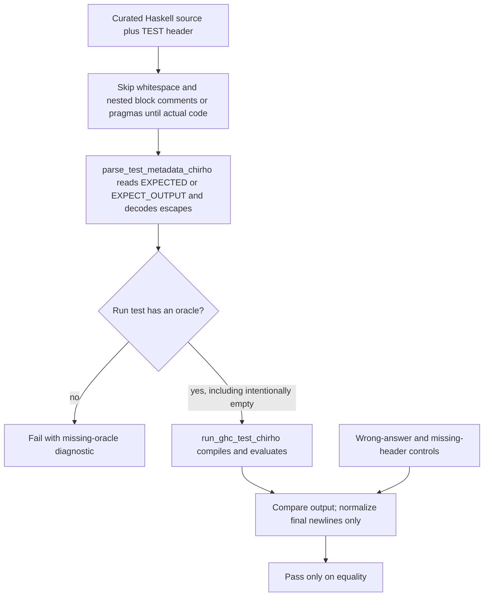
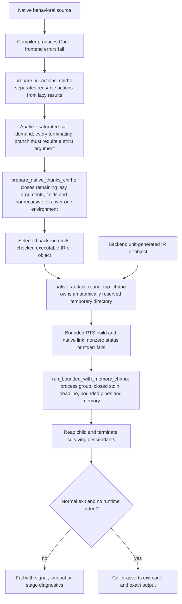
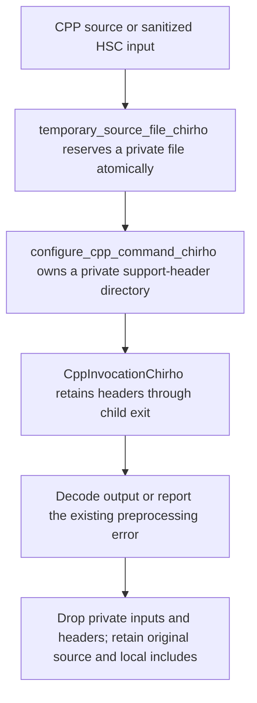
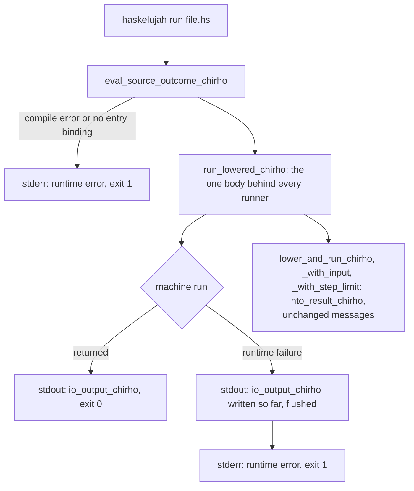

<!-- For God so loved the world, that he gave his only begotten Son, that whosoever believeth in him should not perish, but have everlasting life. — John 3:16 (KJV) -->

# Execution oracles and native round trips

The typecheck corpora, interpreted curated programs and native round trips are
different evidence. None substitutes for another. A native compiler/linker failure
or a crashed child is a failed test, never an absent optional result that passes.

Before this repair, fourteen run tests used the recognized EXPECT_OUTPUT header;
five hundred used EXPECTED and their answers were not compared. Both spellings
are supported, and no expected output is inferred from the implementation under
test. When an oracle disagrees, unchanged source is run with the named reference
GHC version before choosing a compiler repair or an input/oracle correction.

The first header repair still compared only 512 of the intended 514 execution
oracles: T527 and T536 begin with a LANGUAGE pragma and were misclassified as
compile-only. Metadata now spans the complete comment/pragma prologue. A wrong
oracle behind a blank line, pragma or nested comment must fail; an oracle after
actual code cannot supply missing metadata. The curated gate independently checks
that every declared execution directive survives discovery.

The complete 2026-09-09 GHC 9.14.1 reference run is recorded, with per-source hashes
and observed output, in `test-data-chirho/curated-oracles-chirho`. It is independent
of Haskelujah's execution gate and does not certify later edits to those sources.
All 514 declared execution programs matched after 24 previously invalid inputs
received explicit Prelude hiding or a required Int annotation; no output oracle
changed in that second reference pass. These are our curated inputs, not the
938/767 upstream typecheck corpora.

Backend unit tests use this same artifact runner, not a second linker/child helper.
A PID plus wall-clock timestamp is not an exclusive reservation: simultaneous
workers can write and execute the same path. The owner remains alive through
linking, execution and child cleanup; failure unwinds through the same cleanup.

Ordinary generated executions have a 15-second budget. The unchanged
100-million-step scale test names its separate 60-second budget. The native RTS
is optimized in debug compiler builds while retaining debug checks and information.

These execution bounds do not by themselves bound in-process compilation.
The bulk failure was reduced to T2045: shared case suffixes grew during
desugaring, before LLVM. `desugar_chirho/patterns_chirho/matches_chirho.rs` now lowers each row
once, preserving source order and sharing lazy failure continuations. The
`codegen_scaling_chirho` integration target separately bounds full T2045
compilation in a child (90 seconds, 1 GiB sampled physical memory on macOS,
address-space limit on other Unix targets) and checks synthetic
8/16/32-row Core size against source size. A missing END marker is not success.

## Demand ownership at the execution boundary

This is the contract for the repaired paths, not a claim that every native
primitive, recursive binding, or FFI adapter has been audited.

| Boundary | Demand owner and permitted representation |
| --- | --- |
| Ordinary lazy argument, nonrecursive let, lazy constructor field | The producer may hand over a thunk. Binding, capturing, or storing it must not evaluate it. The consuming operation decides when to demand it. |
| Case scrutinee or function position | The consumer enters to weak-head normal form before reading a constructor tag or applying a function. Inspecting a constructor does not force its fields. |
| IO action value versus execution | An action contains a function. Sharing or demanding the action to WHNF does not execute that function. Sequencing executes it anew on each use, returning an IO-result packet without demanding the payload. STG case binders share the current invocation's scrutinee; they never recompute it with stale registers. |
| Pattern fallthrough | Try alternatives in source order. An unselected suffix, including terminal failure, remains unevaluated. Tail-position let lowering has the same initialization contract as ordinary let lowering. |
| Native numeric primitive or C string operation | The adapter forces precisely the operands the strict operation consumes before interpreting their bits or passing a raw pointer to C. putStr/putStrLn and file-path/content boundaries must not pass a thunk address to libc. |
| STG Read primitives | `resolve_primitive_operands_chirho` materializes packed strings or lazy character lists at the strict Read consumer. Demanded character/tail errors propagate rather than producing a parsed truncated prefix. This does not make storing a string or returning it from IO strict. |
| List-to-C-string packing | Demand each spine cell and character head as consumed; preserve a GC root for the remaining list while demanding an allocating character computation. Do not interpret a thunk pointer as a character code. |
| Native thunk entry/update | Follow indirections to WHNF, preserve all 64 result bits, and memoize without confusing state with payload. Root active evaluations across allocation. |
| Native GC roots | Allocation-registry membership is required before dereference. Raw allocation addresses are legitimate roots during field initialization; the tagged-value policy must not be imposed on the root API. Cranelift roots the list the runtime unpacks from a String buffer, at a case on a literal, an `unpack` application and the `unpack#` primop (row 595). Both backends keep roots for the process lifetime: Cranelift never pops, and LLVM pops only construction temporaries. Scoped root frames are a separate bounded-growth residual. |
| STG allocation safepoints | The heap-index interpreter must include the newly allocated object until it has been published into a register or return continuation. Its pending-root list is distinct from native pointer tagging. Forced-GC allocation controls must collect and still use the result. |
| STG executable code | Static heap references in instructions and their capture sources are roots too. Index instructions once per outer execution, then only newly appended instructions at safepoints. Rebuild for a later outer run so removed code does not retain constants. This does not turn every allocated object into a permanent root. |

`native_thunks_chirho` prepares both native backends from the same immutable Core
input. Lifted computations receive one packed environment, including when there
are more captures than a direct call trampoline accepts. This does not claim
general recursive non-function lets or knot tying are solved. Saturated-call
demand proofs become explicit Core cases; partial calls and unproved arguments
stay lazy. The analysis descends a finite function-parameter lattice. Unknown
primitives/callees supply no argument proof, and constructors demand no fields.
Ignored, conditional, partially applied and recursively unused arguments are
execution controls against accidental eagerness, not IR-spelling assertions.

A reference to a nullary global is a lazy producer too (row 588). That means a top-level binding
of arity 0, or a builtin of arity 0 (`undefined`, `getLine`).
- Both backends compiled such a reference as a call for its value wherever it stood. So a lazy
  argument or constructor field ran a CAF nothing had demanded: `length [undefined, undefined]`
  failed natively, and a self-recursive CAF overflowed the stack.
- The lazy boundaries now suspend it as a thunk over the function's address, entered by the
  arity-0 trampoline. Those boundaries are `compile_lazy_value_chirho` and
  `lower_lazy_value_chirho`. Cranelift's constructor fields now share the latter instead of an
  inline copy.
- A strict position keeps the direct call.
- Each suspension allocates one thunk. A CAF is still not shared between references: natively it
  is recomputed for each one.

The shared-source behavioral controls live in `codegen_scaling_chirho`
(three pattern programs) and `native_laziness_chirho` (field demand, reusable
IO actions and nullary globals in lazy positions), plus `io_actions_chirho` (action WHNF, repeated input and list-shared
actions, plus input/bind/numeric/list-print contracts moved from backend name
stubs). Each requires STG, LLVM and Cranelift to match an independently
specified output or stage-qualified runtime error. The other two scaling tests measure resource growth, not
three-engine execution. `show_precedence_chirho` separately checks eight STG
oracles and a nested-Just native oracle. The 126 native round trips are not
126 three-engine comparisons. Agreement alone could hide a shared wrong answer;
the independent oracle is the correctness criterion.

Low-level Core IO fixtures contain real effect primitives rather than functions
named `putStrLn` or `print` whose bodies return zero. Four LLVM closure cases now
execute in a focused test module; they do not assert temporary registers. The
benchmark harness retains evaluation errors and its ten-case correctness gate
requires every answer, not an arbitrary nine of ten. A GC code-root control
requires both retention of a code-only constant and collection after retirement.

The IO-action execution lowering is shared by STG and the two native backends;
the Wasm execution path has not been migrated to this representation. The tasklist
records its provisional gate status. The Unix address-space-limit test is compiled
conditionally; macOS execution does not establish a Linux runtime result.

STG primitive lowering has an explicit optional lookup rather than an unknown-name
fallback to addition. The emitter preserves supported aliases and gives an unknown
primitive a named demand-time error. Its control distinguishes unsupported arithmetic
from a real addition result; an unexecuted branch remains lazy.

A spelling reaches an IO primitive only for an id the program does not own (#32355).
The lowering has four reference paths: a bare reference, an application's head, an
argument, and a constructor field. Each asks one facade, `is_io_primop_chirho`, which
refuses its spelling for:
- a lambda parameter or captured argument slot;
- a let, where or case binder the lowering holds;
- a top-level binding outside the module's record of what the compiler generated,
  `CoreProvenanceChirho::compiler_bindings_chirho`. An empty record grants nothing: a
  binding missing from it stays the program's. Every producer that reaches the interpreter
  keeps that record. The dictionary pass records every row it generates, including the
  prelude rows spelled like IO primitives (`print`, `newIORef`, `runST`, `seq`, `force`,
  ...), and the IO-action preparation records its wrappers. The multi-module interpreter
  merge (`merge_interpreter_modules_chirho`) moves each module's provenance with its ids:
  the same offset as its bodies, joined, and through the same final remap, with the root's
  entry alone (#32375). Its generated `force` and `deepseq` therefore keep their
  primitives; their Core bodies use `seq#`, which the interpreter has no primitive for;
- another program module's export (`imported_references_chirho`).

Such an id keeps its own lookup, or its named missing-binding error. A free canonical
reference and a generated binding keep the primitive. The interpreter's IO-action
preparation, `prepare_io_actions_chirho`, likewise manufactures no primitive for a program
import (#32361). An unlinked import therefore fails closed by name instead of borrowing
the Prelude's body; that refusal is not a claim that imports run. The native preparation
keeps its positive `builtin_references_chirho` rule.

The controls are:
- `stg_lower_chirho/primitives_chirho/binding_ownership_tests_chirho.rs`: all four paths,
  the explicitly generated and the genuinely free cases, a program binding beside an empty
  record, the imported cases, and a real import from its producer to both interpreter
  consumers;
- `project_chirho/multi_module_tests_chirho.rs`: the merge's exact transport (offsets,
  record, final remap, root entry), a dependency's own `seq` and `undefined` beside the
  generated `force` and `deepseq`, and an unimported namesake beside the root's Prelude
  `undefined`, which still prints the dependency's 7 and then fails as the Prelude's does;
- W3 and W4 on every engine (W4's GHC reference matches), and native symbol identity's B7,
  a program's own top-level `undefined`, now on the interpreter too.

The merge's linker (its Phase 2 and 3) links a builtin reference, as the module's
provenance records it, only to a compiler body of its name (#32386), as the native merge
does (row 628). A program namesake in another module supplies no link, so a free
`undefined`, `error` or `throw`, which no generated row binds, stays the builtin. An import
links through the shared import linker, and every other reference keeps the prior route to
the first definition of its name.

Generated MaybeT helpers preserve the underlying monadic action. They accept the
call-site Monad dictionary; pure is selected from its Applicative superclass,
and bind from Monad itself. The same helper body is tested with IO, Maybe and
list dictionaries. IORef modification similarly sequences readIORef before
writeIORef; an action is never substituted for the value it will produce.

## Fixture and discovery boundaries

Mandatory package-source regressions use licensed slices under
`test-data-chirho/package-fixtures-chirho`, not an untracked checkout cache.
Parser CPP controls consume pinned GHC-preprocessed inputs; driver preprocessing
tests consume raw upstream sources. These slices are not complete packages, and
an optional whole-package test that returns early without its cache is not proof
of package compilation. In-process source canaries remain filesystem-blind;
repository-root CLI tests separately exercise module discovery and precedence.

## Preprocessor resource ownership

File-based sanitized inputs stay beside the source, preserving local include and
package-discovery roots. In-memory inputs use system temporary storage. Each
invocation owns its MachDeps/HsBaseConfig headers; package-version flags remain
per-command. The unused globally rewritten MIN_VERSION header is gone. Concurrent
tests require each worker's distinct macro result, real local/support includes,
and cleanup on a named CPP error. The legacy in-memory preprocessing fallback
policy is unchanged; this ownership repair does not claim to redesign it.

## A failed run keeps its stdout (O1, 2026-10-18)

GHC's top handler flushes stdout before it reports an uncaught exception, so
`print 1 >> error "boom"` prints `1` and then fails. The STG machine buffers a
program's stdout in `io_output_chirho`, and every runner used to drop the
machine with its buffer on a runtime failure: no failing run could show the
lines before its failure, whatever the program printed. `RunOutcomeChirho`
keeps the machine beside the run's result. `haskelujah run` prints the kept
output, flushes, and only then reports the failure. The three runners share one
body and keep their signatures and messages as compatibility wrappers.

Boundaries this does not cross: the REPL still prints output only for a run
that returned, and retries any failure as `print (...)`; `hPutStrLn stderr`,
`hFlush` and `exitWith` fail as missing STG bindings; the doubled
`runtime error: runtime error:` prefix is unchanged.
