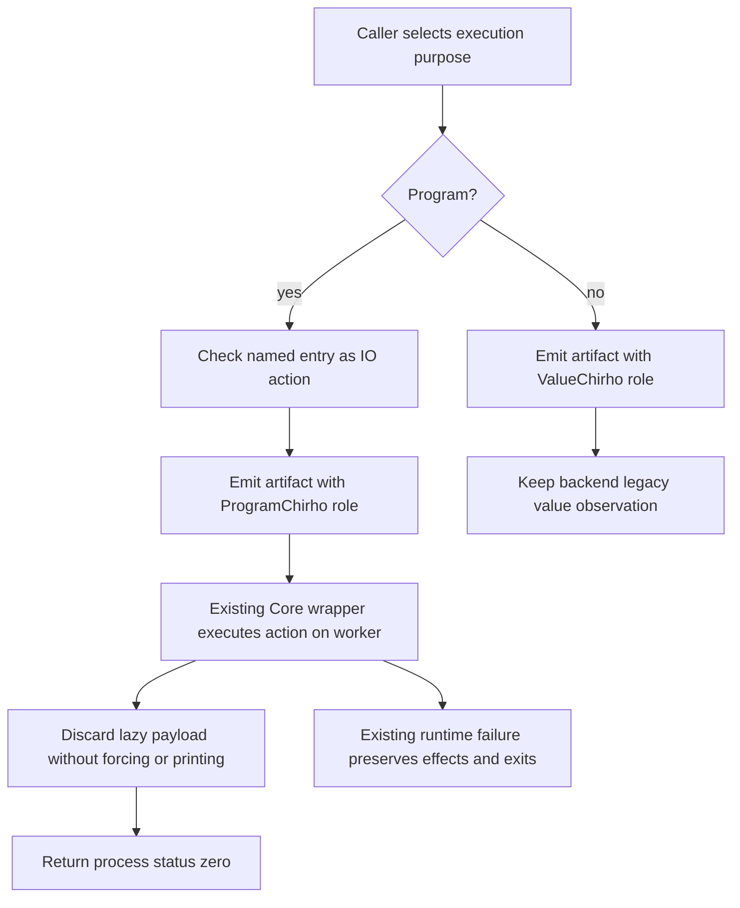

<!-- For God so loved the world, that he gave his only begotten Son, that whosoever believeth in him should not perish, but have everlasting life. — John 3:16 (KJV) -->

# Native program and value execution, unit 706 Chirho

This source checkpoint starts at `7075a7df`. The caller's program purpose already reaches inference; unit 706 retains a distinct `NativeExecutionRoleChirho` through native artifact emission. It does not implement entry dictionary application, alter defaulting or change the RTS worker/root-frame protocol.

The compatibility backend APIs remain value-purpose entry points. Explicit role APIs serve the program harness, native CLI emission and Cabal executable artifacts. The LLVM legacy name-based IO heuristic remains confined to value-purpose compatibility; it cannot select a program launcher's policy. Cranelift value purpose retains its existing scalar exit observation. A native program's payload never becomes a process status.

The emitted controls compile and run independently on LLVM and Cranelift: `IO Int` returning 7, an action printing 1 then returning 5, an unused failing payload, a pure value, and an action failing after a visible effect. A separate effectful generic-entry control stays mandatory. A generic `return 7` with empty stdout proves no dictionary application: the launcher can discard a still-polymorphic function without executing an action. The row 692 entry-dictionary consumer seam remains open until the effectful control independently passes for the named consumer. Native success would not establish interpreter entry-dictionary behavior. Cabal frontend propagation of the root IO obligation remains a separate named seam; this unit selects the executable artifact role without silently adding that frontend behavior.

## Pending sole-scheduler packet

No Cargo, Rust compiler, backend verifier, linker, native program or GHC command belongs to source preparation. After an explicit sole-scheduler grant, run the driver integration target `native_entry_role_chirho` on this exact candidate, using its own freshly built RTS snapshot. Retain each named test's stdout/status/stderr and candidate/tool identities; do not count empty output as action execution. Then rerun row 692's preserved restriction controls without changing their expected outputs. The row 704 root-lifetime/growth packet remains independently owned and unchanged.

## Assembly boundary

The LLVM executable-launcher region and Cranelift C-main wrapper extracted here are byte-identical between `7075a7df` and frozen row 704 commit `39a5a806`. Shared codegen module/import insertion context may need a textual merge, but every row 704 frame/return/handoff hunk must survive. The harness runtime-snapshot body is unchanged from `7075a7df`; preserve `99898c26`'s independent RTS build policy during assembly. The independently reported row 704 nested-PAP native failure is not repaired or reclassified by this unit.
