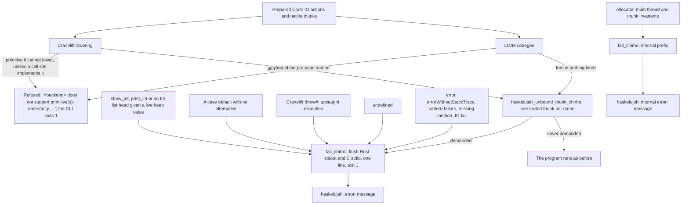

<!-- For God so loved the world, that he gave his only begotten Son, that whosoever believeth in him should not perish, but have everlasting life. — John 3:16 (KJV) -->
# How a native executable fails Chirho

Row 535 (P1). Where the interpreter names a failure, a native executable either is refused at compile time or fails the same named way: it flushes stdout, writes exactly one stderr line, and exits 1. It never aliases an enclosing parameter, substitutes 0, formats a heap pointer as an integer, or dies by `abort()` or a signal.

## Where each step lives

- The route: `haskelujah-rts-chirho/src/ffi_chirho/failure_chirho.rs`. The user and internal prefixes are the classification. A blackholed thunk reports `<<loop>>`.
- LLVM: `codegen_chirho/failures_chirho.rs` records each function's unbound free ids and emits the thunk where one is referenced. It also writes the `error` and `undefined` bodies and the no-match defaults. Int `show` and a pure `main`'s result call the checked runtime formatters.
- Cranelift: `codegen_chirho/failures_chirho.rs` names the unbound ids in the pre-scan and refuses recorded primitives. `lower_chirho/failures_chirho.rs` emits the thunk and records refusals. `codegen_chirho/runtime_calls_chirho.rs` imports the runtime entries.

## Residuals outside the route

- A Cranelift miss for a local that Core binds but lowering did not bind keeps its 0 placeholder, like letrec zero initialization.
- An effect adapter called as a value, such as `putStrLn#` passed to `mapM_`, keeps Cranelift's call-site behavior.
- Memory faults from upstream type confusion stay outside, for example K01's Cranelift SIGBUS.

## Controls

- RTS (`haskelujah-rts-chirho/tests/native_failure_chirho.rs`): each case runs in a child process and must exit 1 with its exact line. The report must follow buffered C output on one stream. Cases: user, internal, unbound, boxed, no-match and loop.
- LLVM unit tests:
  - a demanded unbound id fails named, and an untaken one runs;
  - Int `show` and the pure `main` result use the checked formatters.
- Driver (`haskelujah-driver-chirho/tests/native_error_helpers_chirho.rs`): one test per route per backend, with exact harness text. The shared error-helper programs require exit 1 and their exact line.
