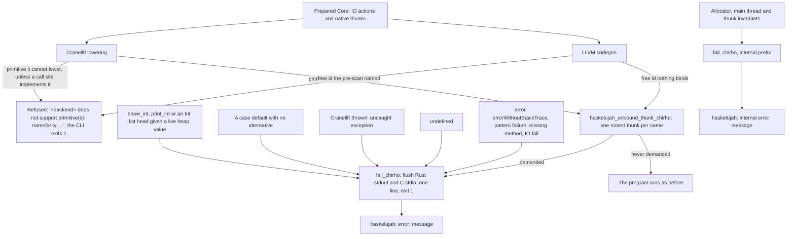
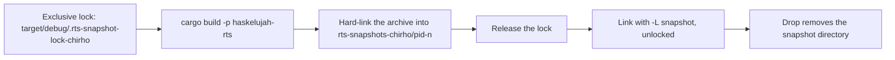

<!-- For God so loved the world, that he gave his only begotten Son, that whosoever believeth in him should not perish, but have everlasting life. — John 3:16 (KJV) -->
# How a native executable fails Chirho

Row 535 (P1). Where the interpreter names a failure, a native executable either is refused at compile time or fails the same named way: it flushes stdout, writes exactly one stderr line, and exits 1. It never aliases an enclosing parameter, substitutes 0, formats a heap pointer as an integer, or dies by `abort()` or a signal.

## Where each step lives

- The route: `haskelujah-rts-chirho/src/ffi_chirho/failure_chirho.rs`. The user and internal prefixes are the classification. A blackholed thunk reports `<<loop>>`.
- LLVM: `codegen_chirho/failures_chirho.rs` records each function's unbound free ids and emits the thunk where one is referenced. It also writes the `error` and `undefined` bodies and the no-match defaults. Int `show` and a pure `main`'s result call the checked runtime formatters.
- Cranelift: `codegen_chirho/failures_chirho.rs` names the unbound ids in the pre-scan and refuses recorded primitives. `lower_chirho/failures_chirho.rs` emits the thunk and records refusals. `codegen_chirho/runtime_calls_chirho.rs` imports the runtime entries.
- A refusal fires on any primitive in a compiled body, called or not. A reachable Prelude `Ord` dictionary compiles `compare#` and `compareChar#`, so Cranelift lowers both as LLVM does (`lower_chirho/ordering_chirho.rs`: LT, EQ and GT tags). Row 535's gate r1 was refused without them.
- Row 538 removes integer `^#` from the refused set. LLVM and Cranelift both call `haskelujah_pow_int_chirho`, the RTS implementation of the interpreter's wrapping integer-power convention. The P06 driver control runs once through the interpreter and both native backends and requires GHC's `1024`.
- Row 540 removes `fromIntegral#` from the native refused set. LLVM and Cranelift both convert signed `i64` to `double`, then bitcast the result into the backends' uniform `i64` value representation. The saved P03 control requires `3.5` through the interpreter and both native backends.
- Row 539 removes `compareFloat#` and `compareStr#` from the refused set. Both backends now lower all four compare primitives through one Ordering selection: less gives LT, equal gives EQ, and anything else gives GT.
  - LLVM does this in `emit_compare_chirho`, and Cranelift in `lower_chirho/ordering_chirho.rs`.
  - Double uses ordered tests, so a NaN gives GT and -0.0 equals 0.0, as on GHC.
  - String calls C `strcmp`, through the import `eqStr#` already uses. Its unsigned bytes order UTF-8 by code point.
  - Without the `strcmp` import, Cranelift refuses `compareStr#`.
  - Driver controls:
    - Compare2 requires GHC's `GT GT LT GT` through the interpreter and both native backends.
    - A GHC-measured edge program covers NaN, -0.0, the empty string, a prefix, non-ASCII and a computed `show`. Row 542's interpreter correction promotes the same control to all three engines.
- Row 541 removes `newIORef#`, `readIORef#`, and `writeIORef#` from the native refused set. Both backends call the same RTS allocation-kind-checked mutable cell implementation; its initial payload is rooted across allocation and remains visible to native GC traversal. The saved P01 control requires `2` through the interpreter and both native backends.
- Row 544 removes `toUpper#` from LLVM's refused set and routes both native backends through `haskelujah_char_to_upper_chirho`, which shares the interpreter's first-scalar Unicode convention. Native String output has two representations: aligned NUL-terminated buffers for literals and `show`, and registered low-bit-tagged `[Char]` cells after list operations. `haskelujah_put_str_ln_chirho` packs only the tagged-list form before printing. The saved P02 control requires `ABC` through the interpreter and both native backends.
- Row 545 removes `mapFromList#` and `mapSize#` from the refused set only for the representation-safe boundary. The shared RTS validates a native association-list spine, copies an empty or singleton `fromList`, and counts it without inspecting key bits. Each backend passes its existing `$tuple2` tag into that one validation call; the Map route never changes global tuple tags. A second pair fails named because generated Core has erased `Ord k`; treating every key as signed `i64` would silently misorder legal `Double` maps. `mapToList#` remains a compile-time refusal, so P04 stays closed while saved P05 requires `1` through the interpreter and both native backends.
- Row 547 adds the ordered `<=.#` and `>=.#` beside `<.#` and `>.#`: LLVM `fcmp ole` and `oge`, and Cranelift `LessThanOrEqual` and `GreaterThanOrEqual`. A NaN on either side gives False. The dictionary pass emits them for Double operands of the desugarer's Int ordering primops (language-features-chirho/dictionary-evidence-chirho). Cranelift already classified `<.#` and `>.#` as Bool where it prints, and now also `<=.#` and `>=.#`. LLVM's show classifier had none of them; it now has all four and `eqFloat#`.
- Row 562 removes `round#`, `truncate#`, `floor#`, and `ceiling#` from the native refused set. Both backends force the `Double` operand, preserve its complete IEEE bit pattern, and call the same RTS conversions. The RTS applies the named rounding direction and derives the low 64 integer bits from the IEEE exponent and significand. That makes ordinary inputs, exact half ties, NaN, infinities, and finite out-of-range values deterministic without LLVM poison, Cranelift saturation, or the ambient floating-point rounding mode. GHC 9.14.1 gives zero for non-finite inputs and wraps finite integers to the machine `Int`; the native controls pin both. The interpreter's exceptional-input casts remain a separately named saturation residual.
- Through the CLI, a Cranelift refusal reads `cranelift compilation failed: Cranelift does not support primitive(s): …`, because the CLI wraps every Cranelift compile error (`haskelujah-cli-chirho/src/main.rs:816`). LLVM's refusal prints bare. The driver controls call the backends directly, so they see the bare line on both.

## The native link's RTS archive (row 568)

Every native compile first runs `cargo build -p haskelujah-rts`. Even a no-op build replaces `target/debug/libhaskelujah_rts.a`, with a new inode and the same mtime. So parallel compiles from one tree could lose the archive mid-link, failing with `ld: library 'haskelujah_rts' not found` or `file cannot be open()ed, errno=2`. Row 565's gate r2 hit this.

- **The helper.** `rts_snapshot_chirho` is in `haskelujah-driver-chirho/src/native_link_chirho/rts_snapshot_chirho.rs`.
  - A later build replaces the shared path but not the snapshot's inode.
  - Directories older than ten minutes, left by a killed process, are retired under the lock.
  - A build outside the lock, such as a plain `cargo build`, can still leave the path missing for an instant. The hard link waits up to five seconds for it.
- **Callers:**
  - the CLI's LLVM and Cranelift links;
  - the test harness's native round trips, which build once per process, inside the lock;
  - the driver's in-crate Cranelift stdin test.
- **Measured.** A loop replaced the archive as cargo does, but held the gap open 10 ms in every 30. Under it, main lost the archive in 28 of 96 parallel compiles, and the snapshot path in none.

## Residuals outside the route

- A Cranelift miss for a local that Core binds but lowering did not bind keeps its 0 placeholder, like letrec zero initialization.
- An effect adapter called as a value, such as `putStrLn#` passed to `mapM_`, keeps Cranelift's call-site behavior.
- Both native backends print a whole `Double` without its `.0`: `print (7.0 :: Double)` gives `7`, where GHC and the
  interpreter give `7.0`. This is a formatting gap, not a route failure; row 548 measured it on 2026-10-26.
- Memory faults from upstream type confusion stay outside the route.
  - K01's Cranelift run, a SIGBUS at the base, now fails named with R2's line (measured at gate r3).
  - The likely reason, which is an inference and not an established cause: its `show` path reaches the checked runtime formatter before the old fault.

## Controls

- RTS (`haskelujah-rts-chirho/tests/native_failure_chirho.rs`): each case runs in a child process and must exit 1 with its exact line. The report must follow buffered C output on one stream. Cases: user, internal, unbound, boxed, no-match and loop.
- LLVM unit tests:
  - a demanded unbound id fails named, and an untaken one runs;
  - Int `show` and the pure `main` result use the checked formatters.
- Driver (`haskelujah-driver-chirho/tests/native_error_helpers_chirho.rs`): one test per route per backend, with exact harness text. The shared error-helper programs require exit 1 and their exact line.
  - The R1 unbound-name fixtures use `realToFrac`, which still needs its Real and Fractional dictionaries. Row 548 bound
    the first fixture's `scanl1`, with `foldl1` and `until`, in `dict_chirho/prelude_chirho/report_folds_chirho.rs`. Its
    controls print GHC's answers on all three engines, and an empty `foldl1` fails named as GHC's does.
