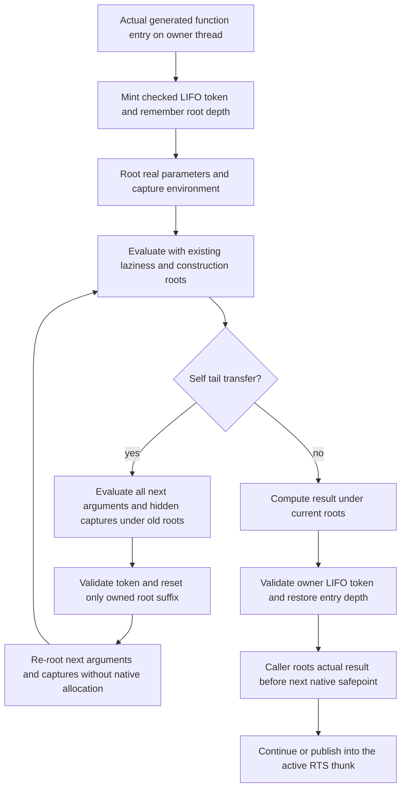
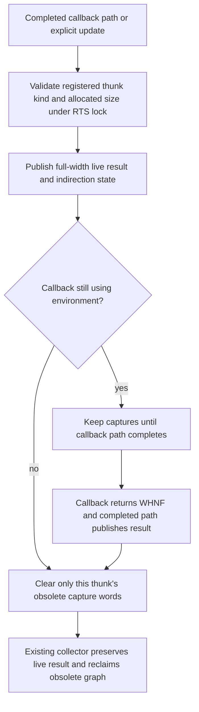

<!-- For God so loved the world, that he gave his only begotten Son, that whosoever believeth in him should not perish, but have everlasting life. — John 3:16 (KJV) -->

# Native root lifetimes Chirho

Row 704 is prepared source, not a measured repair. It follows the preserved row 702 allocation/root measurement, which demonstrates real native retention despite correct stdout. No CAF or collector/representation policy changes belong here.

The token is control data, never a Haskell value or guessed stack depth. A stale, non-top or foreign-thread token and any pop below an active entry depth fail before roots are removed. Reset retains its token; restore closes it. Native reset/restore and root pushes do not call native allocation/collection. Result handoff does not demand values or alter their bits. The registry continues to validate raw or tagged root addresses; immediate pushes and pops remain balanced.

Actual generated sites covered are ordinary/lifted function entries and returns, both self-tail loops, direct and indirect calls including curried intermediates, PAP wrappers, and arity-zero-through-eight thunk trampolines. LLVM's builtin/show/foreign adapters use the same explicit writer helpers at their actual emission sites. The C main launcher carries status or a scalar across its worker join and does not mint a frame on the wrong thread; its scalar printer performs no native allocation. Raw interior fvs pointers and mark/reset tokens supply no value-root permission. The active RTS thunk owns its environment while the trampoline and target run; actual update happens before another native allocation.

Acceptance requires unchanged row 702 envelope execution with real allocations/collections, plus emitted constructor/captured-closure/nested-PAP results held across allocation pressure. Those outputs remain independently specified; cross-engine agreement alone is insufficient. Local validator tests prove invalid authority cannot remove roots. A separate one-test RTS integration process checks hand-framed callback return, actual thunk update, explicit collection, child survival and subsequent retirement. It avoids sharing the existing lib tests' unrelated private global locks and does not claim to exercise emitted backend instructions.

Preserve positive/error/effect neighbors and exact source/tool/own-RTS identities at the actual scheduler gate. Any newly exposed unsupported shape, pre-existing failure or incomplete exercise remains separate from a root-lifetime pass. Existing cold retirement and row 702 artifact hashes remain immutable.

## Evaluated thunk capture retirement Chirho

The frozen `39a5` behavioral gate measured flat root high-water marks while post-GC objects still grew at both scales in both backends. Its emitted next-counter thunk captures a box containing the previous counter. Updating the thunk into an indirection left those old capture slots visible to the existing conservative collector. This source path explains retention without changing the meaning of the frozen growth assertions; repair benefit remains unmeasured until the new gate runs.

Publication and retirement share the existing collector lock, use the allocation registry as authority, and contain no native allocation or collection. An aliased returned capture remains reachable through the result word before its old environment edge is removed. Explicit update during an active callback does not prove the environment is dead. The one-process `native_thunk_retirement_chirho` RTS integration test exercises real collections and post-update environment reads; it is protocol proof, not emitted-code proof. Its same-source old-update negative control must compile and fail semantically before acceptance. The original driver growth and surviving-value controls supply the separate emitted-code evidence.
