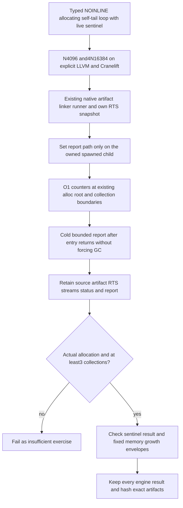

<!-- For God so loved the world, that he gave his only begotten Son, that whosoever believeth in him should not perish, but have everlasting life. — John 3:16 (KJV) -->

# Native runtime measurement Chirho

This workflow observes the existing native runtime without changing its root lifetimes, CAF sharing, representation or collection policy. It is proposed and unexecuted at the first source checkpoint. Neither an expected RED nor a source commit is a runtime measurement.

The semantic live set is one retained two-field sentinel plus the current iteration's bounded temporary state. Both sentinel fields are checked each iteration, so dead-object retirement cannot pass by dropping the retained object. A factory that was optimized away cannot pass the allocated-object/byte lower bound. The envelope compares root-depth high-water and post-collection live objects/bytes with coarse fixed slack; output alone, process completion or an external memory ceiling is insufficient. Sampling post-GC high-water catches return-only cleanup that still retains every self-tail loop iteration.

The ordinary artifact path clears any inherited measurement-report environment on its child. The measured path sets it to a fresh private directory. The RTS uses create_new and writes only a fixed set of integer fields, leaving stdout/exit unchanged even if report creation fails; the parent then rejects the missing/partial report. Reading is bounded to 4096 bytes. No normalizer waives a product failure. The private artifact directory survives measurement errors and assertion failures; the gate owner folds its hashes/raw findings before explicit retirement.

Existing per-process native RTS state is observed cumulatively. No reset or forced collection is injected. Native root-lifetime or CAF repairs require a separate later handoff and behavioral gate.
