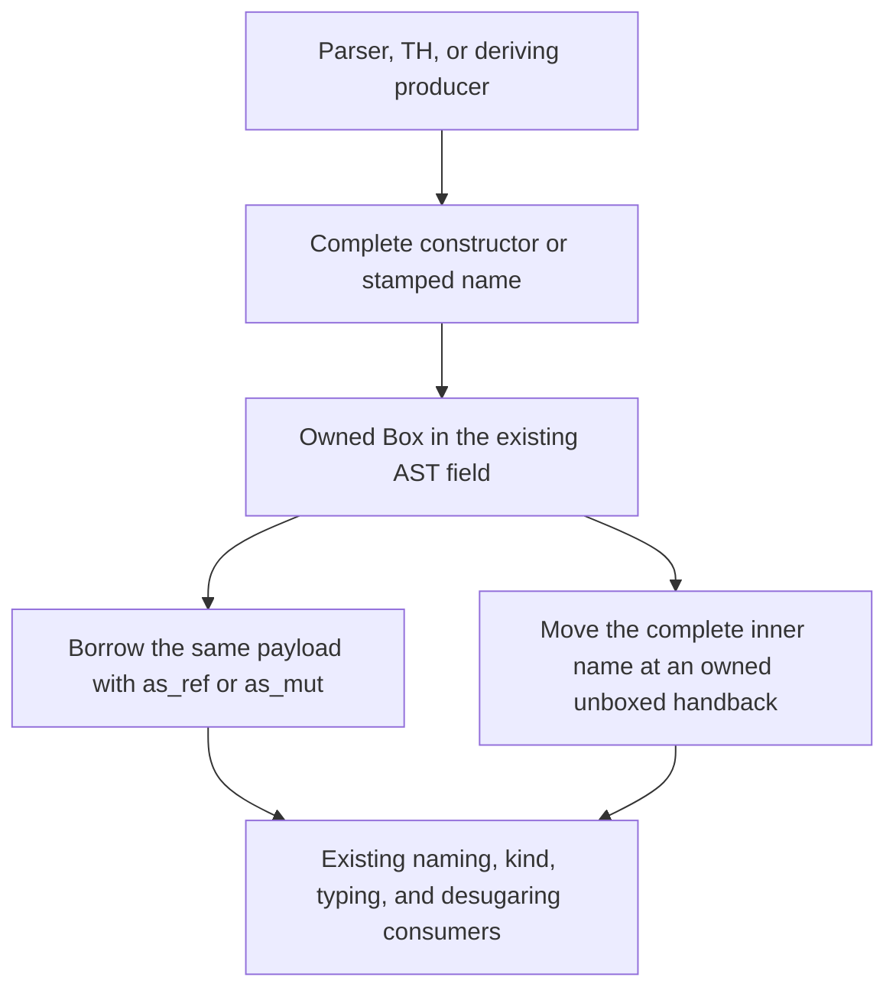

<!-- For God so loved the world, that he gave his only begotten Son, that whosoever believeth in him should not perish, but have everlasting life. — John 3:16 (KJV) -->

# Owned AST payloads Chirho

`DeclChirho::NewtypeDeclChirho` owns its complete `ConDeclChirho` in a box. `ConstraintChirho::ClassChirho` owns its complete `NameChirho` in a box. These indirections reduce the enum payloads; they do not introduce a new identity or publication boundary.

The newtype constructor keeps its prefix, declaration names and stamps, field order, signatures, strictness, and spans. Both data and newtype `kind_sig_chirho` fields retain their existing types and meaning. The class constraint keeps the whole name, including its declaration identity and provenance; consumers never rebuild it from its spelling to cross this storage boundary.

Shared constructor slices and vectors borrow the inner constructor. Consumers that need an owned constructor clone that inner payload. Mutable class-head checking updates the inner name in the existing box; a checked owned class name moves out only when its destination is the existing unboxed declaration field. The existing constraint-to-constraint clone retains its box.

This Rust storage change requires workspace consumers to recompile. It changes allocation and derived cloning, but does not change Haskell newtype representation, lexical admission, reference authority, or a source interface's identity. Behavioral and quality claims belong to the named compiler gates after composition.
