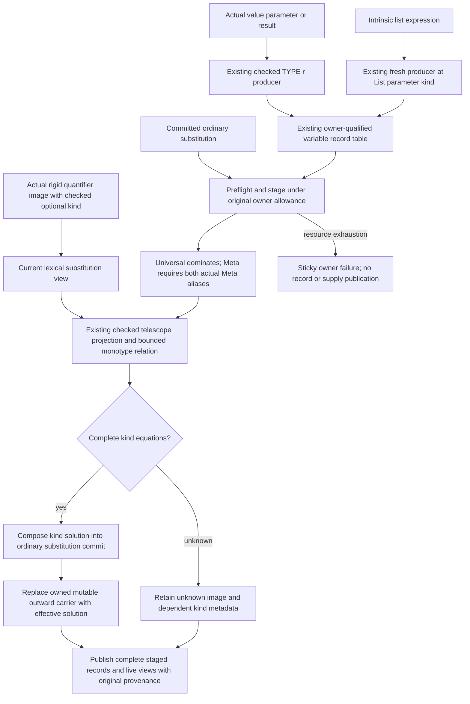
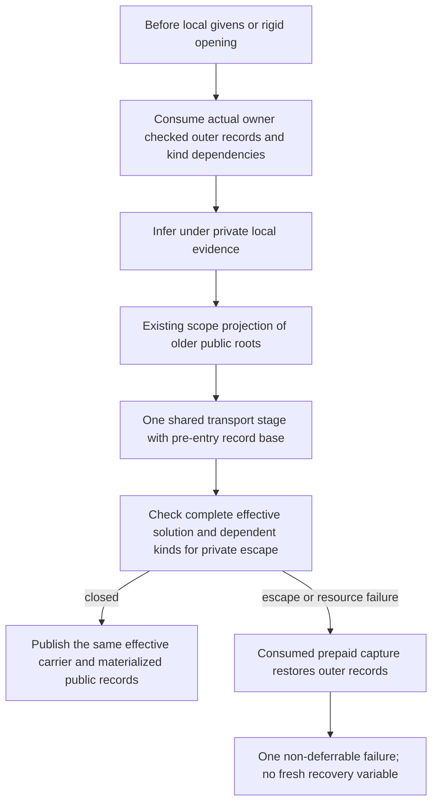
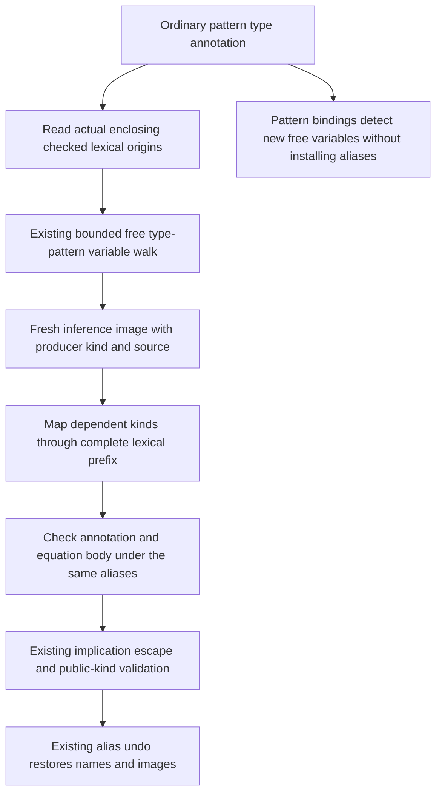

<!-- For God so loved the world, that he gave his only begotten Son, that whosoever believeth in him should not perish, but have everlasting life. — John 3:16 (KJV) -->

# Genuine metas and committed kind transport Chirho

Actual value parameter and named result producers share `fresh_value_meta_chirho`: the checked state creates a RuntimeRep meta and the value meta has kind TYPE r. An intrinsic list expression creates its element meta at the compiler List telescope's required Type parameter. Hole/error recovery, absent kind metadata and imported unknown bindings do not become Meta by this change.

`apply_subst_all_chirho` takes the caller's owned mutable substitution and returns a checked `Result`. It stages the ordinary solution and additional checked kind equations before publishing either the outward carrier or its environment, equality and evidence views. Every production caller handles terminal failure explicitly, commits before composing, and retains the effective carrier or materializes its concrete checked result. A final bounded closure resolves only explicitly returned substitution domains through that carrier; it does not export the solver's working equality map or scoped givens. The strict shared relation recognizes only the existing sealed TYPE/CONSTRAINT representation equation and still uses the same actual Meta callback, budget, occurs and multiplicity checks.

The temporary record staging pass admits its full table size before traversal and charges every copied kind and equation to the same remaining owner allowance. It reads the adopted declaration state's earlier checked kind links before the new commit, without copying ordinary term equations back into that separately scoped substitution. It is not a second live registry and creates no variable IDs. Each record retains its original source owner and specificity; a chosen alias does not acquire another binder's provenance. Missing or unknown compound/scalar projection remains a decline, and an equation that the checked relation cannot close publishes no partial kind solution. Failed staging leaves the live records and supply unchanged while keeping spent work and the terminal resource failure.

Rigid term images borrow their checked kind from the caller's actual current `skolem_bindings_chirho` payload. An internal skolem name only selects exact equal images in that view; its spelling supplies no kind. The charged scan ignores absent kind payloads and requires all supplied kinds to agree after the current committed substitution, without any Meta binding. Plain synonym/family pattern variables, absent views, disagreement and scopes already restored away still decline. Recursive compound checking uses the same leaf rule. The FD solver retains its no-lexical-view adapter and unchanged binding authority. This is an extension of the existing transient operation view, not a new registry or a fallback to Type. Execution of this handoff and the original scoped-pattern witnesses remains a separate acceptance gate.

Eight focused producer/transport controls cover intrinsic list metadata, a real value-result representation equation reaching the existing commit path, dependent kinds, both alias orientations under Universal/Unknown/absent barriers, foreign provenance, unknown compound free variables, atomic owner-budget exhaustion and strict representation equations in both orientations. They are source controls, not a repair claim for the original fundep witnesses. Their execution is scheduled by the root compiler owner.

The opaque pre-entry capture retains actual record presence, role, owner, origin and specificity, with kinds resolved under pre-local checked links. It is temporary consumed scope ownership, not a second catalogue. The public stage overlays only those original outer permissions before the existing bounded transport; it must not re-read later private declaration links for captured kinds. Public links preserve Universal/Unknown/absence barriers, while a private alias alone does not permanently remove an original Meta permission. Complete staged validation covers newly derived kind bindings as well as the input projection. Additional domains require the bounded dependency graph rooted in explicit public inputs, their images and actual checked kind edges; graph-unrelated domains and actual private rigid images are refused before publication. New image variables use their real pre-publication kind edges, before staging can erase a solved representation variable. This graph admits no binding authority: kind equations still require the existing checked Meta-only stage. Failure restores only captured keys using work and storage reserved before entry, preserves spent work and never resets the owner's budget or allocates a recovery meta. Concrete signature and constructor-pattern controls exercise kind-only escape, safe outer permission recovery, full-effective-delta validation and terminal public rejection. Source controls and formatting alone do not establish executed acceptance.

The initial age-only additional-domain restriction and its negative oracle were overbroad. A positively checked fresh inference value of kind TYPE r can safely resolve r to Lifted even when created after scope capture. The paired correction preserves that old setup as a positive, and the existing negative now uses a genuinely local rigid RuntimeRep binder opened by the actual signature route, together with a new inferred representation equation. It must refuse specifically for the private rigid image before publishing either equation. This changes the incorrect permission assumption; it does not waive the Universal/Unknown, owner, resource, whole-tree closure or single-publication obligations. The corrected pair awaits its own executed gate.

The actual compiler declarations for the shared numeric binary operators and `print` now retain their explicitly declared Type-kind quantifier records at the seed producer. Their IDs, predicates, value signatures, source and specificity are unchanged; no consumer assigns a kind from a value's spelling. Higher-kinded and other unknown builtin schemes do not pass through that narrow producer. Ordinary integer and fractional literal syntax creates a checked Meta at the closed Type parameter of its sealed compiler Num/Fractional schema only when the existing compiler-literal mode, actual elaboration owner and checked module policy all hold. The third AST literal field is only OriginId and supplies no kind or primitive-literal authority. RebindableSyntax, MagicHash, raw/unproven inference and unrelated string literals retain their prior path. The actual owned fresh producer records terminal resource failure without allocating a recovery variable or publishing deferred literal evidence. Focused controls instantiate the actual compiler schemes, infer actual literals under real elaboration/module preparation, and preserve unknown shadows, higher-kind parameters and bounded failure; the unchanged runtime companion still requires its separately scheduled executed gate.

Ordinary pattern signatures under ScopedTypeVariables reuse the constructor type-pattern alias carrier. Only free variables absent from the actual enclosing checked lexical identities acquire fresh local inference images. Explicit forall binders remain local to their type, and existing scoped variables retain their images. The fresh images prevent an annotation's earlier module-kind ID from masquerading as an outer inference meta at the existential escape check. Their checked kind and source come from the original variable producer; neither age nor spelling grants binding permission. The same implication mark restores the alias names and images after solving and escape validation. A context without an actual owner or a recoverable enclosing source origin delegates to its previous path; pattern bindings use the same traversal in non-binding mode and refuse a new free variable without allocating an image. Traversal, source-key hashing and dependent-kind copying use the existing owner allowance.

An ordinary pattern signature with an unstamped variable or forall binder rolls back its temporary aliases and delegates without manufacturing resource exhaustion. Genuine exhausted allowance remains terminal. The existing constructor type-pattern entry retains its previous missing-proof refusal. An enclosing lexical variable with no recoverable checked source also delegates; the old pattern-binding false accept can remain in that unproved context. A source review also identified a possible asymmetry between declaration-checked links and lent image kinds; no reachable counterexample was found, and no new checked-link privilege is granted by this leaf.

The owned substitution resolver recognizes an exact variable-to-itself image as identity after its existing charge. It returns that variable without entering cycle detection, while retaining the original entry and its optional source/kind payload. Nontrivial variable cycles and structural self-occurrences still decline, and zero allowance still fails. This prevents a legitimate identity image in the dependent GADT negative T12785b from being mislabeled as exhausted kind transport. It grants no Meta or scope permission and changes no allowance, depth cap or publication boundary.
