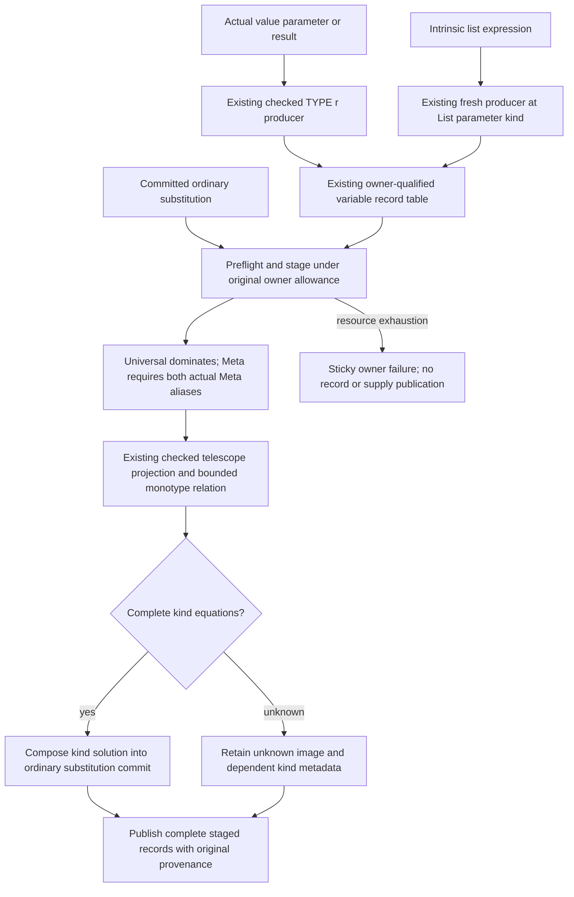

<!-- For God so loved the world, that he gave his only begotten Son, that whosoever believeth in him should not perish, but have everlasting life. — John 3:16 (KJV) -->

# Genuine metas and committed kind transport Chirho

Actual value parameter and named result producers share `fresh_value_meta_chirho`: the checked state creates a RuntimeRep meta and the value meta has kind TYPE r. An intrinsic list expression creates its element meta at the compiler List telescope's required Type parameter. Hole/error recovery, absent kind metadata and imported unknown bindings do not become Meta by this change.

`apply_subst_all_chirho` is the only new caller of the transport. It commits additional checked kind equations through its existing environment, equality and evidence substitution path; changing a record alone never establishes agreement. The strict shared relation recognizes only the existing sealed TYPE/CONSTRAINT representation equation and still uses the same actual Meta callback, budget, occurs and multiplicity checks.

The temporary record staging pass admits its full table size before traversal and charges every copied kind and equation to the same remaining owner allowance. It reads the adopted declaration state's earlier checked kind links before the new commit, without copying ordinary term equations back into that separately scoped substitution. It is not a second live registry and creates no variable IDs. Each record retains its original source owner and specificity; a chosen alias does not acquire another binder's provenance. Missing or unknown compound/scalar projection remains a decline, and an equation that the checked relation cannot close publishes no partial kind solution. Failed staging leaves the live records and supply unchanged while keeping spent work and the terminal resource failure.

Eight focused producer/transport controls cover intrinsic list metadata, a real value-result representation equation reaching the existing commit path, dependent kinds, both alias orientations under Universal/Unknown/absent barriers, foreign provenance, unknown compound free variables, atomic owner-budget exhaustion and strict representation equations in both orientations. They are source controls, not a repair claim for the original fundep witnesses. Their execution is scheduled by the root compiler owner.
