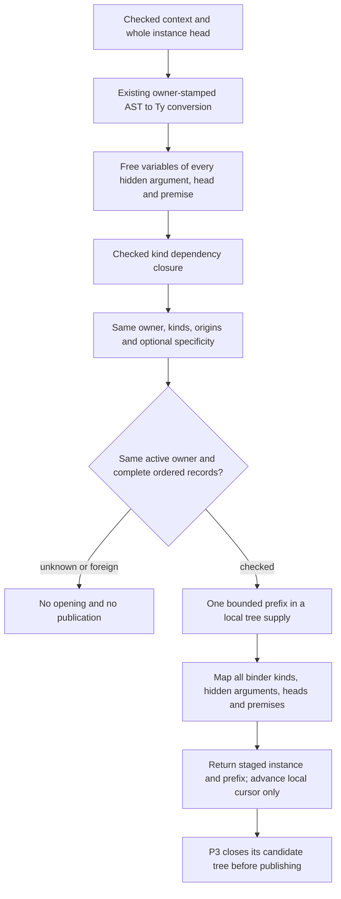

<!-- For God so loved the world, that he gave his only begotten Son, that whosoever believeth in him should not perish, but have everlasting life. — John 3:16 (KJV) -->

# Checked instance binders Chirho

An instance retains an optional catalogue of its actual checked quantifier records and their elaboration owner. `InstDeclPartsChirho` and legacy seed constructors acquire no new proof. Absence is unknown; a checked empty group describes a ground instance.

The registration join is the existing owner-qualified `InferenceChirho` variable ID, validated by `surface_variable_chirho`; spelling is not a binder account. A published declaration quantifier that has not been opened through its actual telescope remains unproved. Premises the existing conversion cannot model do not receive a complete catalogue. Context-only intermediate variables participate in the same closure as variables visible in the head.

Kinds come only from the actual checked state records. Every record is supplied to the common quantifier dependency ordering, so it cannot supply missing metadata. Optional specificity stays optional, including on generated hidden dependencies. Class-parameter visibility stays in the checked class telescope. The catalogue neither mints a class/instance identity nor changes their existing proofs.

`InferCtxChirho::stage_instance_opening_chirho(instance_chirho, &mut next_variable_chirho, span_chirho)` returns `Result<Option<(InstDeclChirho, SubstChirho)>, ElaborationErrorChirho>`. The caller starts its tree's local cursor at the live supply. Each successful opening advances that local cursor, so repeated openings use distinct variables. One prefix carries each image, mapped kind and original source correspondence; the returned catalogue also retains specificity. The opening maps every hidden argument, primary/extra head and premise through that prefix, preserving predicate and instance proofs.

The operation never installs live metas, advances the live supply, changes a solver substitution, or registers an instance. Unknown, foreign-owner and incomplete inputs return no opening. A bounded failure discards its local partial tree and leaves the supplied cursor unchanged. Work is charged to the original owner's allowance even when the tree is discarded.

P3 must retain its actual starting owner and live supply, check that they still agree before committing a successful closed tree, and publish its own complete local cursor and checked meta images together. A producer origin is correspondence metadata, not a newly declared consumer binder. Cross-owner imported catalogue transport and functional-dependency improvement are separate work; this prerequisite alone makes no repair claim for the original fundep programs.

Focused controls exercise repeated openings, dependent/hidden kinds, one prefix shared with a context-only variable, the actual AST-ID registration join, unknown/foreign refusals, and failure after part of a local opening has been allocated. They do not pin enum size or incidental storage layout.
